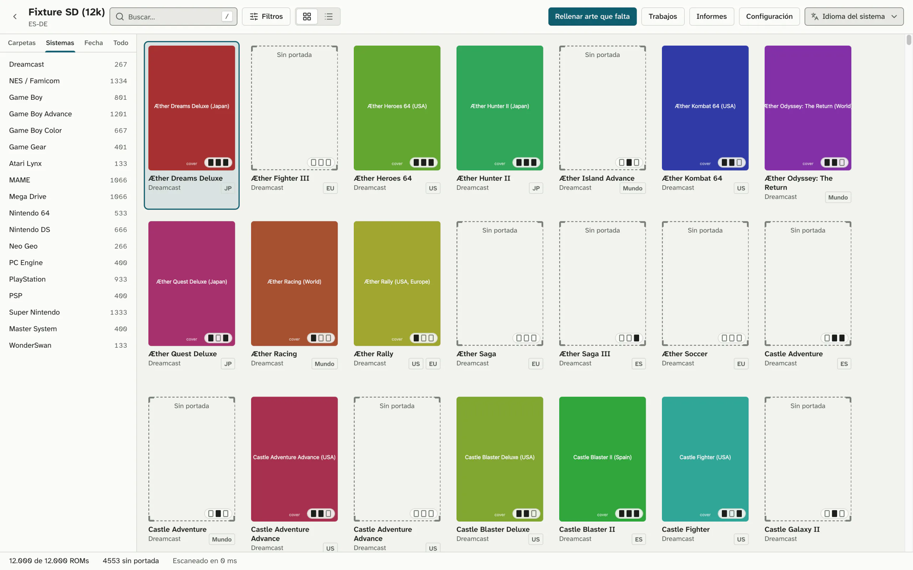
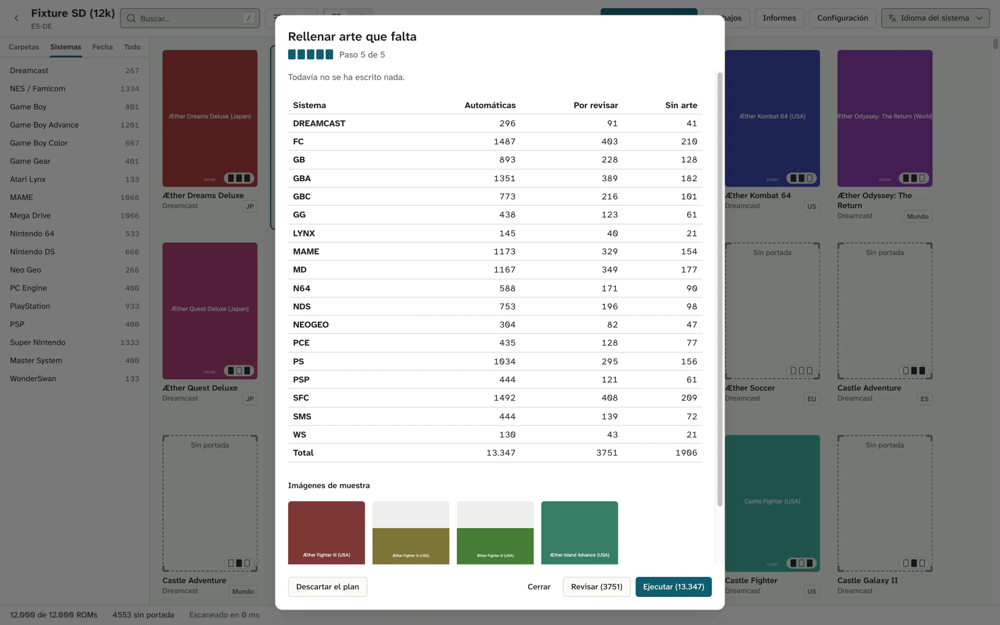
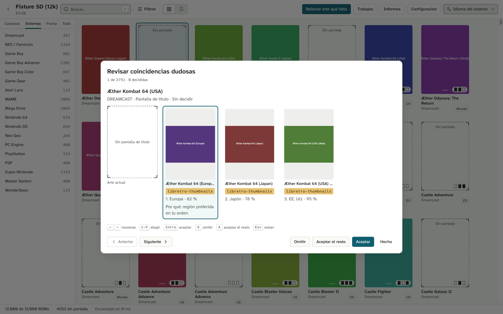

<p align="center">
  <a href="https://coverly-roms.maecly.com/"></a>
</p>

<h1 align="center">Cada ROM, con su portada.</h1>

<p align="center">
  <b>Coverly ROMs</b> encuentra las ROMs de la tarjeta SD de tu consola portátil que no tienen portada y las rellena.<br>
  Primero lo simula, y todo se puede deshacer. Windows, macOS y Linux.
</p>

<p align="center">
  <b>Gratis</b> · <b>Sin cuenta</b> · <b>Código abierto</b>
</p>

<p align="center">
  <a href="https://coverly-roms.maecly.com/#descargar"></a>
</p>

<p align="center">
  <a href="https://github.com/MAECLY/coverly-roms/releases/latest"></a>
  <a href="https://github.com/MAECLY/coverly-roms/releases"></a>
  <a href="https://github.com/MAECLY/coverly-roms/stargazers"></a>
  <a href="https://hits.sh/github.com/MAECLY/coverly-roms/"></a>
  <a href="https://github.com/MAECLY/coverly-roms/commits/main"></a>
  <a href="https://github.com/MAECLY/coverly-roms/actions/workflows/ci.yml"></a>
  <a href="LICENSE"></a>
  <a href="#sistemas-compatibles"></a>
  <a href="#instalar"></a>
  <a href="README.md"></a>
  <a href="#privacidad-y-seguridad"></a>
</p>

<p align="center">
  <a href="https://coverly-roms.maecly.com/"><b>Web</b></a> ·
  <a href="#instalar">Descargar</a> ·
  <a href="#cómo-funciona">Cómo funciona</a> ·
  <a href="#integraciones">Integraciones</a> ·
  <a href="#preguntas">Preguntas</a> ·
  <a href="https://coverly-roms.maecly.com/features/">Funciones</a> ·
  <a href="https://coverly-roms.maecly.com/roadmap/">Hoja de ruta</a> ·
  <a href="CONTRIBUTING.md">Contribuir</a> ·
  <b>Español</b> · <a href="README.md">English</a>
</p>

<p align="center">
  <a href="https://coverly-roms.maecly.com/">
    <picture>
      <source media="(prefers-color-scheme: dark)" srcset="docs/assets/shots/es/library-dark.webp">
      
    </picture>
  </a>
</p>

> [!NOTE]
> **Primeros pasos, dicho claro.** La v0.4.0 es la versión actual. Coverly ROMs
> aún no se ha probado en consolas reales. Las versiones todavía no están
> firmadas con un certificado de Apple ni de Microsoft, así que la primera vez
> aparece un aviso (ver [Instalar](#instalar)). Si lo pruebas en una consola,
> una [incidencia](https://github.com/MAECLY/coverly-roms/issues) contando cómo
> fue ayuda mucho.

---

## El problema

El firmware de fábrica de muchas consolas portátiles enseña una ficha vacía
cuando un juego no tiene portada. En una tarjeta con unos miles de ROMs, son
muchas fichas vacías. Las herramientas que lo arreglan funcionan solo en
Windows, piden montarlas a mano o van mejor con una cuenta de ScreenScraper.
Coverly ROMs es la opción segura en los tres sistemas de escritorio: sin
cuenta, con una simulación antes de escribir nada y con deshacer después.

Coverly ROMs no incluye ROMs, BIOS ni imágenes de juegos.

## Qué hace

**Auditar, solo lectura.** Abre una carpeta o una tarjeta SD y Coverly lista
cada sistema, cada ROM (los juegos de varios archivos, como `.cue`/`.bin`,
`.m3u` y `.gdi`, cuentan una vez) y qué imágenes tiene cada uno: portada,
captura, pantalla de título. Exporta el informe a CSV o JSON.

**Rellenar los huecos de una vez.** Cada ROM se identifica por su huella (CRC32,
MD5 y SHA1 contra libretro-database) y, si no, por su nombre, traduciendo los
nombres cortos de arcade. Cuando encajan varias imágenes, una estrategia elige
una: **Región de la ROM** (la de serie, con el orden de regiones
`rom,world,usa,europe,japan`), **Prioridad de fuentes** (el orden que les das) o
**Popularidad** (los votos de SteamGridDB). Las coincidencias seguras van solas;
las dudosas esperan en una cola de revisión. En Batocera y Knulli también
fusiona `gamelist.xml`, con copia de seguridad, y deshacer lo deja byte a byte
como estaba.

**No sobrescribe salvo que lo pidas.** Por defecto solo escribe lo que falta.
Si eliges sustituir imágenes (`--overwrite backup`), antes guarda una copia en
la carpeta de datos de la app, no en la tarjeta. No escribe nada fuera de la
carpeta que abriste.

**Organizar ROMs sueltas.** Elige una carpeta de descargas llena de zips y
Coverly propone una carpeta por sistema, con el formato que elijas (de serie,
Anbernic de fábrica: `ROMS/GBA/`, `ROMS/GB/`, `ROMS/SFC/`…). Cada archivo se
identifica por el CRC del catálogo (también dentro de los zip), luego por la
cabecera, la extensión y el nombre, y por ScreenScraper con el CRC si lo tienes
configurado, y muestra una confianza y un motivo. Los comprimidos se reconocen
por su contenido, no por su nombre, así que un 7z guardado como `.zip` se abre
como 7z: zip, 7z, RAR, tar, gzip, bzip2, xz, zstd, lz4 y ROMs sueltas
comprimidas como `juego.gba.gz`. Los juegos de disco dentro de un comprimido
(PlayStation, Saturn, Dreamcast, Sega CD, PC Engine CD, Neo Geo CD) se
identifican por el propio disco, con su número de serie, y al aplicar se
extraen su `.cue`/`.gdi` y sus pistas a la carpeta del sistema, cada pista
comprobada contra el comprimido. Las descargas sin terminar, las BIOS, las
páginas web guardadas como `.zip` y los archivos dañados o con varios juegos se
quedan donde están. Un juego que ya tienes en la biblioteca, con cualquier
nombre o formato, se aparta en vez de copiarse otra vez. No pisa ningún
archivo, las copias entre discos se verifican y un trabajo interrumpido se
puede reanudar o deshacer.

**131 sistemas, de los cartuchos a las consolas actuales.** De la Atari 2600 a
la PlayStation 5, cada uno con los nombres de carpeta que usan los formatos.
Las imágenes de disco y los comprimidos se identifican por lo que llevan
dentro. Los juegos de GameCube, Wii, Wii U, 3DS, Switch, PS Vita, PS3, PS4,
PS5, Xbox, Xbox 360 y Xbox One se reconocen por la cabecera en claro de su
propio formato, leyendo unos pocos kilobytes; no se lee nada cifrado, y Coverly
nunca lee, pide, descarga ni incluye claves de consola. Los nombres de Switch
salen del title ID, sin claves, con un catálogo opcional (blawar/titledb, MIT)
que está apagado hasta que lo activas en Configuración → Integraciones; sin red se
usa el nombre del archivo, y un juego cuyo nombre no se puede leer sin claves
aparece como «Cifrado» en vez de adivinarse. Un juego que es una carpeta (PS3,
PS Vita, Wii U, PS4, Xbox…) se mueve como un solo elemento y nunca se parte,
también desde dentro de un zip o un 7z, donde se reconoce por el listado sin
extraer. Los juegos de varios discos sueltos se agrupan en un solo conjunto con
un `.m3u`, con un aviso si falta un disco. Cada elemento que escribe 10 GB o
más pregunta antes («Sí / Sí a todo / No»), con su tamaño y el espacio libre
que queda en el destino.

**Encontrar duplicados.** Coverly encuentra el mismo juego guardado más de una
vez en un sistema por su contenido, nunca por su nombre: los mismos datos
exactos, sea cual sea el nombre, el contenedor, la cabecera de copiadora o la
compresión (`Tetris.gb` y `Tetris (1).zip`), y el mismo disco en otro formato
por su número de serie (`Crash Bash.bin` y `Crash Bash.PBP`). Las otras
versiones de un juego (revisiones, regiones, betas) se enumeran, y solo se
apartan con «Una ROM por juego». Para cada juego elige la copia que se queda,
con su motivo («Se queda: tiene tu partida»), y puedes elegir otra. Las demás
copias se apartan en `_Duplicados/` dentro de la biblioteca, con sus carpetas,
sus partidas y sus imágenes; o van a la Papelera si lo prefieres. Las copias
con partidas distintas no se tocan. Las actualizaciones y los DLC se listan
debajo de su juego, y también se encuentra el mismo juego guardado dos veces
con un mismo title ID, quedándose la versión más nueva. Cada trabajo se puede
deshacer y nada se borra.

**Explorar la biblioteca.** Vistas por carpeta, sistema, fecha y lista plana;
filtros por imágenes que faltan, sistema, extensión y región; búsqueda; y una
ficha de detalle donde cambias a mano la imagen de cada hueco o buscas por
título. Seis formas de verla, todas fluidas con más de 10.000 juegos:
**Portadas** (cinco tamaños), **Detalles** (columnas a elegir y de ancho
ajustable, miniaturas, filas compactas), **Columnas** (sistema → carpeta →
juego → vista previa), **Galería** (la imagen de un juego en grande, con tira
de miniaturas), **Huecos de arte** (portada, título y captura lado a lado, para
ver lo que falta) y **Estantes** (una fila por sistema). Cambia con
⌘/Ctrl+1–6, ajusta el tamaño de las portadas con ⌘/Ctrl +/−, agrupa por
sistema, carpeta, región, estado del arte o inicial, escribe un nombre para
saltar a él y pulsa Espacio para una Vista rápida. Cada biblioteca recuerda su
vista.

**Iconos de sistema.** Cada nombre de sistema en la app lleva su icono al lado:
una silueta sencilla del hardware (del tema Monochrome de RetroArch,
CC BY 4.0) o una etiqueta corta cuando no hay un dibujo neutro.

**Trabajos bajo control.** El asistente de relleno te enseña el plan entero
antes de ejecutarlo. Los trabajos se pueden pausar, reanudar, cancelar y
deshacer.

**Configuración.** General, Biblioteca, Organizar, Duplicados, Perfiles, Arte,
Coincidencias, Fuentes, Integraciones, Red, Seguridad, Avanzado,
Agradecimientos y Acerca de, en tres grupos. Las opciones comunes van primero y
el resto espera en _Opciones avanzadas_. Busca con ⌘F (Ctrl+F en Windows y
Linux) y llega al ajuste. Las pantallas de Duplicados y Organizar abren su
pestaña y vuelven con lo que habías elegido. Los perfiles de formato propios
tienen vista previa de las rutas.

**Integraciones.** Configuración → Integraciones tiene una tarjeta por cada
servicio con el que Coverly habla en tu nombre: SteamGridDB (clave de API),
ScreenScraper (cuenta), el catálogo de nombres de Switch y un enlace a
Actualizaciones. Cada tarjeta dice para qué sirve el servicio, muestra su
estado (sin configurar, guardada, conectado, error con qué hacer, cuota
agotada, desactivado) y tiene «Probar conexión», «Cómo conseguir la clave» (la
página de cuenta del propio servicio), desactivar sin borrar y «Olvidar
credenciales». Las claves se guardan en el llavero del sistema y nunca se
vuelven a mostrar; si el llavero está bloqueado o niega el acceso, el aviso
dice qué hacer en tu sistema. La cuota diaria de ScreenScraper se muestra
cuando el servicio la informa. Rellenar, Organizar y la línea de comandos
llevan a la tarjeta cuando falta una cuenta o se agota una cuota. Las claves
que ya habías guardado siguen funcionando. Cómo configurar cada una está en
[Integraciones](#integraciones).

**Agradecimientos.** Configuración → Agradecimientos lista cada fuente de
portadas y metadatos, base de datos, referencia técnica, biblioteca y
tipografía que usa Coverly, con su licencia, su enlace y el crédito que pide, y
enseña los textos completos de las licencias de terceros. La misma lista está
en [Agradecimientos](#agradecimientos) y en
[THIRD-PARTY-NOTICES.md](THIRD-PARTY-NOTICES.md).

**Además:** una herramienta de línea de comandos, `coverly`; interfaz en
inglés y español; temas claro y oscuro; actualizaciones desde la app.

Todas las funciones, una a una, están en la [página de
funciones](https://coverly-roms.maecly.com/features/), y lo que viene después,
en la [hoja de ruta](https://coverly-roms.maecly.com/roadmap/).

## Cómo funciona

Cuatro pasos. Los dos primeros no escriben nada.

1. **Abre la carpeta o la tarjeta SD.** Coverly reconoce el formato de tu
   firmware o frontend y te enseña cada sistema con lo que le falta.
2. **Prueba el trabajo antes de hacerlo.** La simulación identifica cada ROM,
   elige la imagen y te enseña el plan entero. Hasta que pulsas **Ejecutar**
   (o pasas `--apply`), no se escribe nada.
3. **Decide solo las dudosas.** Esperan en una cola que recorres con el
   teclado, y la elegida dice por qué.
4. **Aplica, y deshaz si no te convence.** Las imágenes se escriben de una en
   una, sin dejar archivos a medias. Deshacer devuelve la tarjeta a como
   estaba.

<table>
  <tr>
    <td width="50%">
      <picture>
        <source media="(prefers-color-scheme: dark)" srcset="docs/assets/shots/es/fill-dark.webp">
        
      </picture>
    </td>
    <td width="50%">
      <picture>
        <source media="(prefers-color-scheme: dark)" srcset="docs/assets/shots/es/review-dark.webp">
        
      </picture>
    </td>
  </tr>
</table>

Más detalle (en inglés): [proceso de relleno](docs/04-architecture/fill-pipeline.md),
[identificación](docs/04-architecture/identification.md),
[organizar](docs/04-architecture/organize.md).

## Formatos compatibles

Ocho formatos de firmware y frontend, detectados al abrir la carpeta. Puedes
cambiar el que se detecta y crear un perfil propio para cualquier otro
firmware.

| ID               | Nombre                               | Carpeta de ROMs | Imágenes que escribe                                                                                       |
| ---------------- | ------------------------------------ | --------------- | ---------------------------------------------------------------------------------------------------------- |
| `anbernic-stock` | Anbernic de fábrica                  | `ROMS`          | portada en `<SIS>/Imgs/<nombre>.png`                                                                       |
| `garlicos`       | GarlicOS                             | `Roms`          | portada en `Imgs/`                                                                                         |
| `onion`          | Onion OS                             | `Roms`          | portada en `Imgs/`                                                                                         |
| `muos`           | muOS                                 | `ROMS`          | portada y captura en `MUOS/info/catalogue/<sis>/box` y `preview`                                           |
| `minui`          | MinUI / NextUI                       | `Roms`          | portada en `.media/`                                                                                       |
| `esde`           | ES-DE                                | `ROMs`          | portada, captura y título en `downloaded_media/<sis>/covers`, `screenshots` y `titlescreens`               |
| `batocera`       | Batocera / Knulli / EmulationStation | `roms`          | portada, captura y título como `images/<nombre>-image`, `-screenshot` y `-titleshot.png`, y `gamelist.xml` |
| `retroarch`      | RetroArch                            | `.`             | portada, captura y título en `thumbnails/<db>/Named_Boxarts`, `Named_Snaps` y `Named_Titles`               |

`coverly profiles` los lista, junto con tus perfiles propios.

## Sistemas compatibles

131 sistemas, cada uno con los nombres de carpeta que usan los formatos
(`GBA`, `gba` y `gameboyadvance` son el mismo sistema). Entre ellos: Game Boy,
Game Boy Color, Game Boy Advance, NES/Famicom, Super Nintendo, Mega Drive,
Master System, Game Gear, PlayStation de la 1 a la 5, PSP, PS Vita, Nintendo
64, GameCube, Wii, Wii U, Nintendo DS, 3DS, Switch, Dreamcast, Saturn, Xbox,
Xbox 360, Xbox One, Neo Geo, CPS1–3, MAME, FinalBurn Neo, ZX Spectrum, Amstrad
CPC, PICO-8, ScummVM y DOS.

<details>
<summary>Los 131 sistemas y sus nombres de carpeta (<code>coverly systems</code>)</summary>

| ID                | Nombre                        | Nombres de carpeta                                       |
| ----------------- | ----------------------------- | -------------------------------------------------------- |
| `a2600`           | Atari 2600                    | `A2600`, `atari2600`, `2600`                             |
| `a5200`           | Atari 5200                    | `A5200`, `atari5200`, `5200`                             |
| `a7800`           | Atari 7800                    | `A7800`, `atari7800`, `7800`                             |
| `a800`            | Atari 8-bit                   | `A800`, `atari800`, `atari8bit`                          |
| `amiga`           | Commodore Amiga               | `AMIGA`                                                  |
| `atarist`         | Atari ST                      | `ATARIST`, `atari st`                                    |
| `atomiswave`      | Atomiswave                    | `ATOMISWAVE`, `awave`                                    |
| `c64`             | Commodore 64                  | `C64`, `commodore64`                                     |
| `cps1`            | Capcom Play System            | `CPS1`                                                   |
| `cps2`            | Capcom Play System II         | `CPS2`                                                   |
| `cps3`            | Capcom Play System III        | `CPS3`                                                   |
| `dos`             | DOS                           | `DOS`, `msdos`                                           |
| `dreamcast`       | Sega Dreamcast                | `DREAMCAST`, `dc`                                        |
| `easyrpg`         | EasyRPG                       | `EASYRPG`, `rpgmaker`                                    |
| `fbneo`           | FinalBurn Neo                 | `FBNEO`, `fba`, `fbalpha`, `finalburn`                   |
| `nes`             | Nintendo Entertainment System | `FC`, `NES`, `famicom`                                   |
| `fds`             | Famicom Disk System           | `FDS`, `famicomdisk`                                     |
| `gb`              | Game Boy                      | `GB`, `gameboy`                                          |
| `gba`             | Game Boy Advance              | `GBA`, `gameboyadvance`                                  |
| `gbc`             | Game Boy Color                | `GBC`, `gameboycolor`                                    |
| `gamegear`        | Sega Game Gear                | `GG`, `gamegear`                                         |
| `gw`              | Game & Watch                  | `GW`, `gameandwatch`                                     |
| `hbmame`          | HBMAME                        | `HBMAME`                                                 |
| `lynx`            | Atari Lynx                    | `LYNX`, `atarilynx`                                      |
| `mame`            | MAME                          | `MAME`, `arcade`, `mame2003`, `mame2003plus`, `mame2010` |
| `megadrive`       | Sega Mega Drive / Genesis     | `MD`, `megadrive`, `genesis`, `Mega Drive`               |
| `segacd`          | Sega CD / Mega-CD             | `MDCD`, `segacd`, `megacd`, `Mega CD`                    |
| `msx`             | MSX                           | `MSX`, `msx1`                                            |
| `n64`             | Nintendo 64                   | `N64`, `nintendo64`                                      |
| `naomi`           | Sega NAOMI                    | `NAOMI`                                                  |
| `nds`             | Nintendo DS                   | `NDS`, `nintendods`, `dsi`, `nintendodsi`                |
| `neocd`           | Neo Geo CD                    | `NEOCD`, `neogeocd`                                      |
| `neogeo`          | Neo Geo                       | `NEOGEO`, `Neo Geo`                                      |
| `ngp`             | Neo Geo Pocket                | `NGP`, `neogeopocket`                                    |
| `ngpc`            | Neo Geo Pocket Color          | `NGPC`, `neogeopocketcolor`                              |
| `ons`             | ONScripter                    | `ONS`, `onscripter`                                      |
| `openbor`         | OpenBOR                       | `OPENBOR`                                                |
| `pcengine`        | PC Engine / TurboGrafx-16     | `PCE`, `pcengine`, `tg16`, `turbografx16`, `PC Engine`   |
| `pcenginecd`      | PC Engine CD / TurboGrafx-CD  | `PCECD`, `pcenginecd`, `tgcd`, `turbografxcd`            |
| `pgm2`            | IGS PGM2                      | `PGM2`                                                   |
| `pico8`           | PICO-8                        | `PICO`, `pico8`, `pico-8`                                |
| `pokemini`        | Pokemon Mini                  | `POKE`, `pokemini`                                       |
| `psx`             | Sony PlayStation              | `PS`, `psx`, `ps1`, `playstation`                        |
| `psp`             | Sony PSP                      | `PSP`                                                    |
| `saturn`          | Sega Saturn                   | `SATURN`, `segasaturn`                                   |
| `scummvm`         | ScummVM                       | `SCUMMVM`, `scumm`                                       |
| `sega32x`         | Sega 32X                      | `SEGA32X`, `32x`, `sega32`                               |
| `snes`            | Super Nintendo                | `SFC`, `snes`, `Super Nintendo`, `supernintendo`         |
| `mastersystem`    | Sega Master System            | `SMS`, `mastersystem`, `Master System`                   |
| `varcade`         | Arcade (various)              | `VARCADE`                                                |
| `virtualboy`      | Virtual Boy                   | `VB`, `virtualboy`                                       |
| `vic20`           | Commodore VIC-20              | `VIC20`, `vic-20`                                        |
| `wonderswan`      | WonderSwan                    | `WS`, `wonderswan`                                       |
| `wonderswancolor` | WonderSwan Color              | `WSC`, `wonderswancolor`                                 |
| `ps2`             | Sony PlayStation 2            | `PS2`, `playstation2`                                    |
| `3do`             | 3DO Interactive Multiplayer   | `3DO`, `3d0`                                             |
| `pcfx`            | NEC PC-FX                     | `PCFX`, `pc-fx`                                          |
| `cdi`             | Philips CD-i                  | `CDI`, `cdimono1`, `cd-i`                                |
| `amigacd32`       | Commodore Amiga CD32          | `CD32`, `amigacd32`                                      |
| `cdtv`            | Commodore CDTV                | `CDTV`, `amigacdtv`                                      |
| `jaguarcd`        | Atari Jaguar CD               | `JAGUARCD`, `atarijaguarcd`                              |
| `fmtowns`         | Fujitsu FM Towns              | `FMTOWNS`, `fm-towns`                                    |
| `colecovision`    | ColecoVision                  | `COLECO`, `colecovision`                                 |
| `intellivision`   | Mattel Intellivision          | `INTELLIVISION`, `intv`                                  |
| `vectrex`         | GCE Vectrex                   | `VECTREX`, `gcevectrex`                                  |
| `odyssey2`        | Magnavox Odyssey² / Videopac  | `ODYSSEY`, `odyssey2`, `videopac`, `o2em`                |
| `channelf`        | Fairchild Channel F           | `FAIRCHILD`, `channelf`                                  |
| `arcadia`         | Emerson Arcadia 2001          | `ARCADIA`, `arcadia2001`                                 |
| `scv`             | Epoch Super Cassette Vision   | `SCV`, `supercassettevision`                             |
| `jaguar`          | Atari Jaguar                  | `JAGUAR`, `atarijaguar`                                  |
| `sg1000`          | Sega SG-1000 / SC-3000        | `SEGASGONE`, `sg1000`, `sg-1000`, `sc3000`               |
| `pico`            | Sega Pico                     | `SEGAPICO`                                               |
| `supergrafx`      | PC Engine SuperGrafx          | `SGFX`, `supergrafx`                                     |
| `n64dd`           | Nintendo 64DD                 | `N64DD`, `64dd`                                          |
| `satellaview`     | Nintendo Satellaview          | `SATELLAVIEW`, `bsx`, `bs-x`                             |
| `sufami`          | Bandai Sufami Turbo           | `SUFAMI`, `sufamiturbo`                                  |
| `supervision`     | Watara Supervision            | `SUPERVISION`                                            |
| `gamecom`         | Tiger Game.com                | `GAMECOM`                                                |
| `megaduck`        | Mega Duck / Cougar Boy        | `MEGADUCK`, `cougarboy`                                  |
| `zxspectrum`      | Sinclair ZX Spectrum          | `ZXS`, `zxspectrum`, `spectrum`                          |
| `zx81`            | Sinclair ZX81                 | `ZX81`                                                   |
| `amstradcpc`      | Amstrad CPC                   | `CPC`, `amstradcpc`                                      |
| `bbcmicro`        | Acorn BBC Micro               | `BBCMICRO`, `bbc`                                        |
| `thomson`         | Thomson MO/TO                 | `THOMSON`, `moto`, `to8`, `thomsonmoto`, `theodore`      |
| `dragon`          | Dragon 32/64                  | `DRAGON`, `dragon32`, `dragon64`                         |
| `coco`            | Tandy TRS-80 Color Computer   | `COCO`, `trs80coco`                                      |
| `ti99`            | Texas Instruments TI-99/4A    | `TI99`, `ti994a`                                         |
| `x68000`          | Sharp X68000                  | `X68000`, `x68k`                                         |
| `x1`              | Sharp X1                      | `X1`                                                     |
| `pc98`            | NEC PC-98                     | `PC98`, `pc9800`                                         |
| `pc88`            | NEC PC-88                     | `PC88`, `pc8800`, `pc8000`                               |
| `plus4`           | Commodore Plus/4              | `PLUS4`, `cplus4`, `commodoreplus4`                      |
| `pet`             | Commodore PET                 | `PET`, `commodorepet`                                    |
| `c128`            | Commodore 128                 | `C128`, `commodore128`                                   |
| `atarixe`         | Atari XE / XEGS               | `ATARIXE`, `xegs`                                        |
| `msx2`            | MSX2                          | `MSX2`                                                   |
| `msxturbor`       | MSX turbo R                   | `MSXTURBOR`, `turbor`                                    |
| `apple2`          | Apple II                      | `APPLE2`, `appleii`                                      |
| `tic80`           | TIC-80                        | `TIC`, `tic80`                                           |
| `wasm4`           | WASM-4                        | `WASM4`                                                  |
| `arduboy`         | Arduboy                       | `ARDUBOY`                                                |
| `uzebox`          | Uzebox                        | `UZEBOX`                                                 |
| `lowresnx`        | LowRes NX                     | `LOWRESNX`                                               |
| `vircon32`        | Vircon32                      | `VIRCON32`                                               |
| `doom`            | Doom (PrBoom)                 | `PRBOOM`, `doom`                                         |
| `quake`           | Quake                         | `QUAKE`, `tyrquake`                                      |
| `cavestory`       | Cave Story (NXEngine)         | `CAVESTORY`, `nxengine`                                  |
| `wolf3d`          | Wolfenstein 3D (ECWolf)       | `ECWOLF`, `wolf3d`, `wolfenstein3d`                      |
| `mrboom`          | Mr. Boom                      | `MRBOOM`                                                 |
| `dinothawr`       | Dinothawr                     | `DINOTHAWR`                                              |
| `lutro`           | Lutro                         | `LUTRO`                                                  |
| `solarus`         | Solarus                       | `SOLARUS`                                                |
| `flashback`       | Flashback (REminiscence)      | `REMINISCENCE`, `flashback`                              |
| `xrick`           | Rick Dangerous (XRick)        | `XRICK`, `rickdangerous`                                 |
| `model2`          | Sega Model 2                  | `MODEL2`                                                 |
| `model3`          | Sega Model 3                  | `MODEL3`                                                 |
| `naomi2`          | Sega NAOMI 2                  | `NAOMI2`                                                 |
| `triforce`        | Namco Sega Nintendo Triforce  | `TRIFORCE`                                               |
| `gamecube`        | Nintendo GameCube             | `GAMECUBE`, `gc`, `ngc`, `gcn`                           |
| `wii`             | Nintendo Wii                  | `WII`                                                    |
| `3ds`             | Nintendo 3DS                  | `3DS`, `n3ds`, `nintendo3ds`                             |
| `wiiu`            | Nintendo Wii U                | `WIIU`                                                   |
| `switch`          | Nintendo Switch               | `SWITCH`, `nintendoswitch`, `nsw`                        |
| `psvita`          | Sony PlayStation Vita         | `PSVITA`, `vita`                                         |
| `ps3`             | Sony PlayStation 3            | `PS3`, `playstation3`                                    |
| `xbox`            | Microsoft Xbox                | `XBOX`                                                   |
| `xbox360`         | Microsoft Xbox 360            | `XBOX360`, `x360`                                        |
| `ps4`             | Sony PlayStation 4            | `PS4`, `playstation4`                                    |
| `ps5`             | Sony PlayStation 5            | `PS5`, `playstation5`                                    |
| `xboxone`         | Microsoft Xbox One            | `XBOXONE`, `xb1`                                         |
| `xboxseries`      | Microsoft Xbox Series X\|S    | `XBOXSERIES`, `xsx`, `xboxseriesx`                       |

</details>

## Fuentes de imágenes

- **[libretro-thumbnails](https://github.com/libretro-thumbnails/libretro-thumbnails)**
  (`thumbnails.libretro.com`): la de serie. Sin cuenta.
- **[SteamGridDB](https://www.steamgriddb.com/)**: opcional, con tu propia
  clave de API. Los votos de su comunidad alimentan la estrategia Popularidad.
  Se configura en Configuración → Integraciones y se guarda en el llavero del
  sistema; la CLI lee primero `COVERLY_SGDB_KEY` y, si no está, la clave que
  guardó la app.
- **ScreenScraper**: previsto para una versión posterior, aún no disponible
  como fuente de imágenes. Hoy solo se usa para identificar archivos al
  organizar, si lo tienes configurado.
- **Los datos de identificación** vienen de
  [libretro-database](https://github.com/libretro/libretro-database), que se
  descarga al usar la app, no va incluida.

Más detalle (en inglés): [docs/04-architecture/art-sources.md](docs/04-architecture/art-sources.md).

## Integraciones

Coverly funciona sin ninguna cuenta. En Configuración → Integraciones añades
las opcionales y activas o desactivas los servicios en línea:

| Servicio                      | Qué añade                                                        | Qué necesita                                                                                                         |
| ----------------------------- | ---------------------------------------------------------------- | -------------------------------------------------------------------------------------------------------------------- |
| SteamGridDB                   | Portadas de la comunidad al rellenar, y los votos de Popularidad | Tu propia clave de API, de la [página de API de SteamGridDB](https://www.steamgriddb.com/profile/preferences/api)    |
| ScreenScraper                 | Identificar archivos por hash al organizar                       | Una cuenta gratuita, de la [página de registro de ScreenScraper](https://www.screenscraper.fr/membreinscription.php) |
| Catálogo de nombres de Switch | Nombres, editora y fecha de los juegos de Switch por title ID    | Nada; está apagado hasta que lo activas                                                                              |
| Actualizaciones de Coverly    | Comprueba si hay una versión nueva de Coverly ROMs en GitHub     | Nada; se desactiva en Configuración → General                                                                        |

ScreenScraper necesita además unas credenciales de desarrollador incluidas en
la app, y las versiones publicadas aún no las llevan: su tarjeta sale como «No
disponible», y puedes guardar tu cuenta para cuando llegue.

**Cómo conseguir una clave.** «Cómo conseguir la clave», en cada tarjeta, abre
la página de cuenta del propio servicio, nunca una web de terceros.
SteamGridDB: inicia sesión con Steam, abre Preferencias › API, genera una clave
y pégala en la tarjeta. ScreenScraper: crea una cuenta gratuita y escribe su
usuario y contraseña. Después pulsa **Probar conexión**: la tarjeta dice si
funciona, si la clave es incorrecta, si no hay conexión o el servicio está
caído y, en ScreenScraper (en las versiones que lo incluyen), cuánto de la
cuota diaria se ha usado.

**Qué se envía.** Cada tarjeta lo dice. A SteamGridDB, el nombre del juego que
buscas y tu clave; a ScreenScraper, el nombre del archivo, su tamaño, sus
hashes y el sistema, con tu cuenta, por HTTPS (nunca la ruta completa ni el
contenido de los archivos); el catálogo de Switch y la comprobación de
actualizaciones descargan archivos públicos y no envían nada de tu biblioteca,
salvo los iconos de la eShop (se piden juego a juego) y el respaldo en línea
(el title ID que falta) si los activas.

**Dónde se guardan las claves.** En el llavero del sistema: Llavero en macOS,
Administrador de credenciales en Windows y el Secret Service (GNOME Keyring o
KWallet) en Linux. Una clave guardada no se vuelve a mostrar, ni en la app, ni
en los registros, ni al exportar la configuración, ni en la CLI; solo dicen si
hay una o no. «Olvidar credenciales» la borra del llavero, y desactivar un
servicio la conserva para más adelante.

**Desde la línea de comandos.** `coverly integrations` usa la misma lista y las
mismas entradas del llavero que la app:

```bash
coverly integrations list                          # cada servicio, activo o no, y qué claves hay guardadas
coverly integrations set steamgriddb               # pide la clave sin mostrar lo que escribes
coverly integrations set steamgriddb --from-env COVERLY_SGDB_KEY  # o la lee de una variable
coverly integrations set screenscraper --field user
coverly integrations set screenscraper --field password
coverly integrations test steamgriddb              # una petición con la clave guardada
coverly integrations forget steamgriddb            # pregunta antes; --yes sin terminal
```

`set` nunca recibe el secreto como argumento, así que no acaba en el historial
de tu terminal: escríbelo en el aviso oculto, pásalo por stdin o nombra una
variable con `--from-env`. Las opciones y los códigos de salida están en
[Línea de comandos](#línea-de-comandos).

## Instalar

Descarga el archivo para tu ordenador desde la
[última versión](https://github.com/MAECLY/coverly-roms/releases/latest):

| Sistema                                              | Archivo                                                                                                                                                                      |
| ---------------------------------------------------- | ---------------------------------------------------------------------------------------------------------------------------------------------------------------------------- |
| macOS 11 o posterior, Apple silicon (M1 o posterior) | `Coverly-ROMs_<versión>_mac_arm.dmg`                                                                                                                                         |
| macOS 11 o posterior, Intel                          | `Coverly-ROMs_<versión>_mac_intel.dmg`                                                                                                                                       |
| Windows 10/11 (x64)                                  | `Coverly-ROMs_<versión>_windows_x64-setup.exe` (recomendado); las versiones estables también `Coverly-ROMs_<versión>_windows_x64.msi`                                        |
| Windows 11 (ARM64)                                   | `Coverly-ROMs_<versión>_windows_arm-setup.exe` (recomendado); las versiones estables pueden traer también `Coverly-ROMs_<versión>_windows_arm.msi`                           |
| Linux x64                                            | `Coverly-ROMs_<versión>_linux_x64.AppImage` o `Coverly-ROMs_<versión>_linux_x64.deb`                                                                                         |
| Linux ARM64                                          | `Coverly-ROMs_<versión>_linux_arm.AppImage` o `Coverly-ROMs_<versión>_linux_arm.deb`                                                                                         |
| Línea de comandos                                    | `coverly_<versión>_<sistema>` (`mac_arm`, `mac_intel`, `windows_x64.exe`, `windows_arm.exe`, `linux_x64`, `linux_arm`); después, `coverly update install` la mantiene al día |

¿No sabes qué Mac tienes? Menú Apple → Acerca de este Mac:
«Chip» es Apple silicon, «Procesador» es Intel. En un PC con Windows ARM64,
instala la versión ARM64; una copia de la versión x64 instalada antes sigue
funcionando y actualizándose como x64.

Comprueba el archivo con `SHA256SUMS` de la misma versión, por ejemplo
`shasum -a 256 -c SHA256SUMS --ignore-missing` (macOS),
`sha256sum -c SHA256SUMS --ignore-missing` (Linux) o
`Get-FileHash <archivo>` (PowerShell en Windows).

> [!WARNING]
> Las versiones todavía no están firmadas con un certificado de Apple ni de
> Microsoft, así que macOS y Windows te avisan la primera vez. Sigue estos pasos
> solo con un archivo que hayas bajado de las versiones de este repositorio y
> comprobado con `SHA256SUMS`.
>
> <details>
> <summary><b>macOS dice que la app está dañada, o que Apple no puede comprobarla.</b> No lo está.</summary>
>
> macOS pone en cuarentena las apps sin Apple Developer ID. Mueve Coverly ROMs a
> Aplicaciones y quita la marca una vez, en Terminal (las comillas importan: el
> nombre lleva un espacio):
>
> ```bash
> xattr -rd com.apple.quarantine "/Applications/Coverly ROMs.app"
> ```
>
> Esa marca es la comprobación que te protege de una descarga manipulada. En
> lugar de Terminal, también puedes intentar abrirla una vez, ir a **Ajustes del
> Sistema → Privacidad y seguridad**, bajar y pulsar **Abrir igualmente**. El
> binario `coverly` para macOS queda en cuarentena igual si lo baja un
> navegador: `xattr -d com.apple.quarantine coverly_<versión>_mac_arm`
> (o `_mac_intel`).
>
> </details>
>
> <details>
> <summary><b>Windows muestra «Windows protegió su PC».</b></summary>
>
> Elige **Más información** y luego **Ejecutar de todas formas**. Si en su lugar
> ves una **Advertencia de seguridad** con **Editor: Editor desconocido**, elige
> **Ejecutar**. Con Smart App Control activado no hay **Ejecutar de todas
> formas**: bloquea las apps sin firmar, y puede que desactivarlo no tenga
> vuelta atrás sin reinstalar Windows. Coverly ROMs necesita Windows 10/11
> (x64) o Windows 11 (ARM64).
> El `-setup.exe` instala para tu usuario sin permisos de administrador; el
> `.msi` instala para todos los usuarios. Los dos usan Microsoft Edge WebView2:
> Windows 11 ya lo trae, y en Windows 10 el instalador lo descarga si falta
> (necesita internet).
>
> </details>
>
> <details>
> <summary><b>Linux</b></summary>
>
> Marca el AppImage como ejecutable (`chmod +x`) si tu gestor de archivos no lo
> ha hecho. El `.deb` depende de `libwebkit2gtk-4.1-0` y `libgtk-3-0`;
> `sudo apt install ./Coverly-ROMs_<versión>_linux_x64.deb` (o
> `_linux_arm.deb`) los instala. Los dos se compilan en Ubuntu 22.04 para x64
> y ARM64, así que necesitan glibc 2.35 o posterior (Ubuntu 22.04, Debian 12 o
> posteriores).
>
> </details>

**Línea de comandos.** Renombra el binario a `coverly` (`coverly.exe` en
Windows), hazlo ejecutable (`chmod +x`) y ponlo en tu `PATH`.

**Avisos de nuevas versiones.** En GitHub, **Watch → Custom → Releases**, o
sigue el [feed de versiones](https://github.com/MAECLY/coverly-roms/releases.atom).

## Actualizaciones

La app busca actualizaciones al iniciarse (Configuración →
General; si lo desactivas no hace ninguna petición) y desde Configuración →
Acerca de, y nunca se reinicia mientras un trabajo de relleno está en marcha.
La CLI: `coverly update check` y `coverly update install`. Cada actualización
se verifica con la clave minisign del proyecto antes de instalarse; una
descarga que no pasa la comprobación no se instala. Hay canal estable y beta.

## Línea de comandos

`coverly` es la misma lógica que la app, para la terminal. Como la app, no
escribe nada salvo que pases `--apply`.

| Orden          | Qué hace                                                                                                       |
| -------------- | -------------------------------------------------------------------------------------------------------------- |
| `audit`        | Informa de qué ROMs no tienen portada, captura o título (solo lectura)                                         |
| `catalog`      | Gestiona el catálogo opcional de nombres de Switch (`switch status`, `update`, `remove`)                       |
| `fill`         | Rellena las imágenes que faltan desde las fuentes activas (simulación salvo con `--apply`)                     |
| `integrations` | Lista, prueba, guarda u olvida las cuentas y claves de servicios en línea (`list`, `test`, `set`, `forget`)    |
| `organize`     | Reparte un montón de ROMs sueltas en una carpeta por sistema (simulación salvo con `--apply`)                  |
| `dedupe`       | Encuentra el mismo juego guardado dos veces en un sistema y aparta las copias (simulación salvo con `--apply`) |
| `profiles`     | Lista los perfiles de formato, de serie y propios                                                              |
| `systems`      | Lista los sistemas conocidos y sus nombres de carpeta                                                          |
| `undo`         | Deshace el último trabajo (relleno, organización o duplicados), o el que indiques con `--job`                  |
| `update`       | Comprueba si hay un `coverly` más nuevo, o lo instala (verificado con minisign)                                |

La ayuda de `coverly` está en inglés; la tabla traduce su descripción.

```bash
coverly audit /Volumes/SD --missing-only --format csv --output informe.csv
coverly fill /Volumes/SD                      # simulación: el plan, sin escribir nada
coverly fill /Volumes/SD --apply --auto-only --system gba,snes --media cover
coverly fill /Volumes/SD --sources libretro,steamgriddb --strategy popularity
coverly organize ~/Downloads/roms             # simulación: propuesta por sistema
coverly organize ~/Downloads/roms --target /Volumes/SD --copy --apply
coverly dedupe /Volumes/SD                    # simulación: qué copia se queda y adónde van las demás
coverly dedupe /Volumes/SD --apply            # las aparta en /Volumes/SD/_Duplicados
coverly dedupe /Volumes/SD --apply --trash    # o las manda a la Papelera
coverly catalog switch update                 # descarga el catálogo opcional de nombres de Switch
coverly integrations list                     # qué servicios están activos y qué claves hay guardadas
coverly integrations set steamgriddb          # guarda una clave, escrita en un aviso oculto
coverly integrations test steamgriddb         # una petición con la clave guardada
coverly undo --list
coverly undo                                  # deshace el último trabajo
```

<details>
<summary>Opciones útiles</summary>

**`fill`:** `--profile ID|auto`, `--regions rom,world,usa,europe,japan`,
`--match hash-then-name|hash-only|name-only`, `--scope missing|all` (`all`
necesita `--overwrite backup`), `--concurrency 1-6`, `--refresh` (ignora los
candidatos e índices en caché), `--report table|json`, `--output ARCHIVO`.

**`organize`:** `--layout PERFIL`, `--target CARPETA`, `--flat`,
`--copy`/`--move`, `--names keep|catalogue`, `--assign ARCHIVO=SISTEMA`
(repetible), `--resume TRABAJO`, `--include-review`, `--offline`,
`--no-external-tools` (no usa unrar, 7-Zip ni bsdtar),
`--duplicates set-aside|report|off` (copias que ya están en la biblioteca),
`--yes-large` (confirma un trabajo que escribe 10 GB o más), `--skip-large`
(deja esos elementos donde están), `--game-folders`/`--no-game-folders`
(en esta ejecución, cada juego moderno en su carpeta con `Updates/` y `DLC/`,
o todo suelto; por defecto, lo que diga el perfil),
`--emulator SISTEMA=EMULADOR|none` (repetible; ordena un sistema como lo
espera ese emulador, por ejemplo `ps4=shadps4`), `--emulator-data
EMULADOR=CARPETA` (repetible, ruta absoluta; dónde guarda ese emulador sus
trucos, parches y mods).

**`catalog switch`:** `status`, `update`, `remove`, `--data-dir CARPETA`.

**`dedupe`:** `--system gb,psx`, `--level exact,format,version`,
`--one-game-one-rom`, `--keep RUTA` (esta copia se queda; repetible),
`--keep-rules has_save,verified,…`, `--reset-choices`, `--quarantine CARPETA`,
`--trash`, `--resume TRABAJO`, `--offline`, `--no-external-tools`,
`--report table|json`, `--output ARCHIVO`.

**`undo`:** `--list`, `--job ID`, `--include-later` (con `--job`: deshace
también los trabajos posteriores que tocaron la misma carpeta, del más nuevo al
más antiguo).

**`integrations`:** `list [--json]`, `test ID [--json]`, `set ID [--field
user|password|api-key] [--from-env VARIABLE]`, `forget ID [--yes]`. `set` nunca
recibe el secreto como argumento: lo lee de stdin (sin eco si lo escribes) o
de la variable que indique `--from-env`. Ninguna salida muestra un valor, solo
`set` o `not set`. Códigos de salida: 0 bien, 1 la prueba falló (clave
incorrecta, falta, servicio caído) o el llavero lo rechazó, 2 uso incorrecto,
5 sin red o límite de peticiones.

**Variables de entorno:** `COVERLY_SGDB_KEY` (clave de SteamGridDB),
`COVERLY_SS_USER` y `COVERLY_SS_PASSWORD` (cuenta de ScreenScraper, para
`organize`). Si la variable está definida, manda; si no, la CLI usa la clave
que la app guardó en el llavero del sistema, y solo hacia la dirección del
propio servicio (nunca con `--steamgriddb-url` ni otro destino propio).
`COVERLY_NO_KEYCHAIN=1` desactiva el llavero.

`coverly <orden> --help` lista todas las opciones.

</details>

## Privacidad y seguridad

- **Sin telemetría ni cuenta.** La app solo se conecta a las fuentes de
  imágenes que actives, a los servicios que configures en Configuración →
  Integraciones, al catálogo de nombres de Switch si lo activas y, si no lo
  desactivas, a la comprobación de actualizaciones. Cada tarjeta de
  Integraciones dice qué envía.
- **Sin claves de consola.** Coverly nunca las lee, pide, descarga ni incluye;
  los archivos de claves y licencias de la tarjeta no se tocan.
- **Las imágenes se recodifican** antes de escribirse, así que no llevan
  metadatos.
- **Tus claves se quedan en el llavero del sistema.** La de SteamGridDB solo
  se envía a SteamGridDB, en una cabecera `Authorization: Bearer`, y la cuenta
  de ScreenScraper solo a ScreenScraper. Nada vuelve a mostrar una clave
  guardada, y los registros solo dicen si hay una o no. La configuración, su
  exportación y su importación nunca llevan una clave ni una contraseña, y
  `coverly integrations` nunca imprime una. Abrir Configuración no envía nada;
  «Probar conexión» hace una petición cuando la pulsas.
- **La auditoría solo lee.** Rellenar, organizar y apartar duplicados no
  escriben nada hasta que aplicas, nunca fuera de la raíz de la biblioteca, y
  cada trabajo se puede deshacer. Los duplicados se apartan o van a la
  Papelera; nunca se borran.
- **Las copias y el registro de cada trabajo** van a la carpeta de datos de la
  app, no a la tarjeta SD.
- **Coverly ROMs no incluye ROMs, BIOS ni imágenes de juegos.**

## Lo que aún no hace

- ScreenScraper como fuente de imágenes: previsto, aún no disponible.
- Vídeos, mezclas de imágenes, marquesinas o logos.
- Editar metadatos, renombrar o verificar ROMs.
- Funcionar en la propia consola.
- Aún no se ha probado en consolas reales.
- Las versiones aún no están firmadas con un certificado de Apple ni de
  Microsoft.

## Frente a otras herramientas

Skraper, Skyscraper y ARRM usan ScreenScraper y traen vídeos, mezclas de
imágenes y metadatos; Coverly ROMs solo rellena imágenes. Mini Scraper también
funciona sin cuenta y ya tiene versiones publicadas. En lo que Coverly ROMs se
distingue: versión nativa para macOS (Apple silicon e Intel), Windows y Linux
(x64 y ARM64), el formato `Imgs/` de Anbernic de serie, sin cuenta, y
simulación y deshacer en cada trabajo. La
[comparación de la web](https://coverly-roms.maecly.com/#comparar) cita las
fuentes de cada herramienta.

## Preguntas

<details>
<summary><b>¿Es gratis?</b></summary>

Sí. No cuesta nada, no pide cuenta y no tiene versión de pago. El código es
AGPL-3.0.

</details>

<details>
<summary><b>¿Trae ROMs o portadas?</b></summary>

No. Coverly ROMs no incluye ROMs, BIOS ni arte de juegos. Las imágenes se
descargan de libretro-thumbnails y, si pones tu propia clave, de SteamGridDB.
Cada imagen es de sus dueños.

</details>

<details>
<summary><b>¿Necesita claves de consola?</b></summary>

No. Cada sistema se identifica con lo que se puede leer sin claves: cabeceras
en claro, tablas de archivos, el title ID y el nombre del archivo. Un juego de
Switch o 3DS cuyo nombre no se puede leer así aparece como «Cifrado». Archivos
como `prod.keys` o `title.keys` nunca se abren ni se mueven.

</details>

<details>
<summary><b>¿Va a sobrescribir mis portadas?</b></summary>

No, salvo que lo pidas. Por defecto solo rellena lo que falta. Si eliges
sustituir, antes guarda una copia en la carpeta de datos de la app, no en la
tarjeta, y Deshacer la devuelve.

</details>

<details>
<summary><b>¿Necesito una cuenta?</b></summary>

No. libretro-thumbnails funciona sin cuenta. SteamGridDB es opcional: usa tu
propia clave, que se guarda en el llavero del sistema; añádela en
Configuración → Integraciones.

</details>

<details>
<summary><b>¿Abre comprimidos 7z y RAR?</b></summary>

Sí. Zip, 7z, tar, gzip, bzip2, xz, zstd y lz4 se abren sin instalar nada más.
RAR necesita un programa que ya está en muchos ordenadores, porque el código
oficial de RAR no puede ir dentro de un programa libre: `unrar`, 7-Zip (`7zz` o
`7z`) o `bsdtar`, que macOS ya trae (`/usr/bin/bsdtar`). En Windows encuentra
7-Zip o WinRAR en sus carpetas habituales; en Linux, instala `unrar`, `7zip` o
`libarchive-tools`. Si no hay ninguno, el RAR se queda donde está con el aviso
«Para abrir archivos RAR instala unrar» y se organiza lo demás. Configuración →
Organizar → _Opciones avanzadas_ → _Programas externos para RAR_ muestra lo que
ha encontrado y permite desactivarlos.

Los juegos de disco se **extraen**, porque las consolas cargan el `.cue`/`.gdi`
y las pistas, no el comprimido. Las ROMs de cartucho en zip o 7z se mueven tal
cual cuando el formato de la tarjeta los carga; los demás comprimidos se
extraen. Al mover, el comprimido va a la papelera solo cuando todos los
archivos se han comprobado y no queda nada más dentro (si trae una partida
guardada, el comprimido se queda). Deshacer borra lo extraído y devuelve el
comprimido de la papelera.

</details>

<details>
<summary><b>¿Con qué consolas funciona?</b></summary>

Con las que usan los formatos de Anbernic de fábrica, GarlicOS, Onion OS, MinUI
y NextUI, muOS, ES-DE, Batocera, Knulli y EmulationStation, o RetroArch. Para
otro firmware puedes crear tu formato con vista previa. Aún no se ha probado en
consolas reales.

</details>

<details>
<summary><b>¿Por qué avisan Gatekeeper y SmartScreen?</b></summary>

Porque las descargas aún no llevan certificados de Apple ni de Microsoft. La
primera vez, en macOS quita la marca de cuarentena o pulsa **Abrir
igualmente**; en Windows, elige **Más información** y **Ejecutar de todas
formas**. Hazlo solo con archivos de las versiones de este proyecto. Los pasos
están en [Instalar](#instalar).

</details>

<details>
<summary><b>¿Envía datos a algún sitio?</b></summary>

No hay telemetría. La app solo se conecta a las fuentes de imágenes que
actives, a los servicios que configures en Configuración → Integraciones, al
catálogo de nombres de Switch si lo activas y, si no lo desactivas, a la
comprobación de actualizaciones al arrancar. Cada tarjeta de Integraciones dice
exactamente qué envía. Las imágenes se recodifican, así que no llevan
metadatos.

</details>

<details>
<summary><b>¿Cómo se actualiza?</b></summary>

Desde la propia app, con versiones de GitHub Releases verificadas con minisign
antes de instalarse. Hay canal estable y beta, y nunca se reinicia en mitad de
un trabajo. La línea de comandos usa `coverly update`.

</details>

## Ayuda a mejorarlo

- **Pruébalo en una consola real** y
  [abre una incidencia](https://github.com/MAECLY/coverly-roms/issues) con el
  firmware, el formato que detectó y cómo fue el relleno.
- **Añade un perfil de formato o un nombre de carpeta** que use tu firmware.
- **Mejora una traducción** en [`locales/en/ui.json`](locales/en/ui.json) o
  [`locales/es/ui.json`](locales/es/ui.json).

Lee antes [CONTRIBUTING.md](CONTRIBUTING.md) (en inglés). En resumen: las
contribuciones se hacen bajo el
[Acuerdo de Licencia de Contribuidor](CLA.md); `make check` pasa todo lo que
pasa la CI; los commits siguen
[Conventional Commits](https://www.conventionalcommits.org/), y commitlint lo
comprueba; lo nuevo en `coverly-core` llega con su test primero; y el
repositorio nunca acepta ROMs ni imágenes de juegos. Los informes de seguridad
siguen [SECURITY.md](SECURITY.md) (un aviso privado en GitHub, o
`security@maecly.com`).

## Para desarrolladores

<details>
<summary>Tecnología, estructura y compilar desde el código</summary>

**Tecnología.** Tauri 2 · Rust · React + TypeScript + Vite + Tailwind.

| Ruta                  | Qué contiene                                                               |
| --------------------- | -------------------------------------------------------------------------- |
| `crates/coverly-core` | Escaneo, identificación, fuentes, relleno, organizar, deshacer (sin Tauri) |
| `crates/coverly-cli`  | La herramienta de línea de comandos `coverly`                              |
| `src-tauri`           | La app de escritorio y sus órdenes                                         |
| `src`                 | La interfaz en React                                                       |

**Requisitos:** [Rust](https://rustup.rs/) 1.93 o superior,
[Node.js](https://nodejs.org/) 22.22.2 o superior con [pnpm](https://pnpm.io/), y
las [dependencias de sistema de Tauri 2](https://v2.tauri.app/start/prerequisites/)
para tu sistema operativo. `make doctor` muestra cuáles tienes instaladas.

```sh
make install                                   # instala las dependencias JS y Rust
make dev                                       # ejecuta la app de escritorio en desarrollo
make web                                       # solo la interfaz, en el navegador, con un backend simulado
make example                                   # crea una biblioteca de ejemplo y la audita
make example-fill                              # planifica rellenar sus portadas (simulación)
make audit ROOT=<ruta>                         # audita una biblioteca desde la terminal
make check                                     # lint, formato y todos los tests
```

Además: `make build` (un paquete de la app sin firmar), `make cli ARGS="systems"`
(ejecuta la CLI), `make fill ROOT=<ruta>` (planifica un relleno, simulación).

`make help` lista todos los objetivos. La biblioteca de ejemplo vive en
`target/example` (`make example-apply`, `make example-undo`, `make example-clean`).

La página web de [coverly-roms.maecly.com](https://coverly-roms.maecly.com)
vive en su propio repositorio, [MAECLY/coverly-roms-landing](https://github.com/MAECLY/coverly-roms-landing),
que explica cómo verla en local, comprobarla y publicarla (en inglés).

**Documentación** (en inglés). [docs/README.md](docs/README.md) es el índice.
La arquitectura está en [docs/04-architecture/](docs/04-architecture/system-architecture.md),
las decisiones en [docs/adr/](docs/adr/README.md), el proceso de publicación en
[RELEASING.md](RELEASING.md) y el historial en [CHANGELOG.md](CHANGELOG.md).

</details>

## Agradecimientos

<!-- credits:start -->
<!-- Generado desde credits/credits.json con `pnpm credits:readme`; no lo edites a mano. -->

Coverly se apoya en el trabajo de estos proyectos. Aquí tienes qué usa de cada uno, su licencia y el crédito que piden.

### Fuentes de portadas y metadatos

- [libretro-thumbnails](https://github.com/libretro-thumbnails/libretro-thumbnails). Portadas, capturas, pantallas de título y logos, buscados por nombre. Licencia: Sin licencia declarada; el arte es de sus titulares.

  > Portadas y capturas: libretro-thumbnails. Capturas vía MobyGames, Fandom y aportaciones de voluntarios. El arte pertenece a los desarrolladores y editores de cada juego.

- [SteamGridDB](https://www.steamgriddb.com/). Crédito de cortesía. Portadas verticales hechas por la comunidad, con tu propia clave de API. Licencia: Términos de SteamGridDB (sin verificar).
- [ScreenScraper](https://www.screenscraper.fr/). Medios e identificación por hash en Organizar, con tu cuenta. Licencia: [CC BY-NC-SA 4.0](https://creativecommons.org/licenses/by-nc-sa/4.0/).

  > Datos y medios de ScreenScraper (screenscraper.fr), CC BY-NC-SA 4.0.

- Arte dentro de los juegos. Iconos y arte que traen los propios archivos de juego (SMDH, NACP, ICON0…), leídos en local. Licencia: © los titulares de cada juego.
- Iconos de la Nintendo eShop. Iconos de los juegos de Switch, solo si los activas; se guardan en tu caché local y nunca se redistribuyen. Licencia: © Nintendo.

  > Iconos de juegos de Switch © Nintendo, descargados solo si lo activas y guardados solo en tu equipo.

### Bases de datos y DAT

- [titledb](https://github.com/blawar/titledb). Nombres, editora y fecha de los juegos de Switch por title ID; descarga opcional bajo demanda. Licencia: [MIT](https://github.com/blawar/titledb/blob/master/LICENSE).

  > Nombres de títulos de Switch: blawar/titledb (MIT, © 2019 Blake Warner). Los nombres y el arte de los juegos pertenecen a sus titulares.

- [nlib (api.nlib.cc)](https://github.com/ghost-land/nlib-api). Respaldo opcional para nombres de Switch, solo si lo activas; Coverly no incluye nada de su código. Licencia: GPL-3.0.
- [libretro-database](https://github.com/libretro/libretro-database). Identificar ROMs por hash, serie o nombre corto de arcade, y el nombre del catálogo; se descarga a tu caché. Licencia: [CC BY-SA 4.0](https://creativecommons.org/licenses/by-sa/4.0/).

  > Datos de identificación: libretro-database, © libretro contributors, CC BY-SA 4.0.

- [GameTDB](https://www.gametdb.com/). Los ID de GameCube, Wii, Wii U y PS3 que trae libretro-database. Licencia: Permiso de su FAQ.

  > Datos de juegos de GameTDB (https://www.gametdb.com/), donde puedes añadir juegos y arte nuevos.

- [No-Intro](https://no-intro.org/). Crédito de cortesía. DAT de cartuchos y la nomenclatura de los nombres de archivo, a través de libretro-database. Licencia: Términos de DAT-o-MATIC (sin verificar).
- [Redump](https://redump.org/). Crédito de cortesía. DAT de discos y las convenciones de pistas y hojas CUE, a través de libretro-database. Licencia: Términos de Redump (sin verificar).
- [TOSEC](https://www.tosecdev.org/). Crédito de cortesía. DAT de ordenadores clásicos y sus convenciones de nombres, a través de libretro-database. Licencia: Términos de TOSEC (sin verificar).
- MAME. Crédito de cortesía. Nombres cortos y DAT de arcade del emulador MAME, a través de libretro-database. Licencia: Licencia del DAT sin verificar.
- FinalBurn Neo. Crédito de cortesía. DAT de arcade del emulador FinalBurn Neo, a través de libretro-database. Licencia: Licencia propia (sin verificar).

### Documentación y wikis técnicos

- [Switchbrew](https://switchbrew.org/). Crédito de cortesía. Documentación de formatos de Switch (NCA, NRO, CNMT, XCI, tickets). Licencia: Contenido de la wiki (licencia sin verificar).
- [WiiBrew](https://wiibrew.org/). Crédito de cortesía. Documentación de formatos de Wii (discos, DOL, WAD, TMD). Licencia: Contenido de la wiki (licencia sin verificar).
- [WiiUBrew](https://wiiubrew.org/). Crédito de cortesía. Documentación de formatos de Wii U (TMD, RPX/RPL, meta.xml) y su base de títulos. Licencia: Contenido de la wiki (licencia sin verificar).
- [3dbrew](https://www.3dbrew.org/). Crédito de cortesía. Documentación de formatos de 3DS (NCCH, CIA, SMDH, TMD) y su lista de títulos. Licencia: Contenido de la wiki (licencia sin verificar).
- [DSiBrew](https://dsibrew.org/). Crédito de cortesía. Documentación de la lista de títulos de DSi. Licencia: Contenido de la wiki (licencia sin verificar).
- [XboxDevWiki](https://xboxdevwiki.net/). Crédito de cortesía. Documentación del formato XBE de la Xbox original. Licencia: Contenido de la wiki (licencia sin verificar).
- [PSDevWiki](https://www.psdevwiki.com/). Crédito de cortesía. Documentación de formatos de PlayStation (SFO, PKG, SELF, PBP, SYSTEM.CNF). Licencia: Contenido de la wiki (licencia sin verificar).
- Dolphin. Crédito de cortesía. Código fuente del emulador, consultado para entender los formatos de Wii y GameCube. Licencia: Licencia sin verificar.
- PPSSPP. Crédito de cortesía. Código fuente del emulador, consultado para entender los formatos de PSP. Licencia: Licencia sin verificar.
- RPCS3. Crédito de cortesía. Código fuente del emulador, consultado para entender los formatos de PS3. Licencia: [GPL-2.0](https://spdx.org/licenses/GPL-2.0-only.html).
- Vita3K. Crédito de cortesía. Código fuente del emulador, consultado para entender los formatos de PS Vita. Licencia: [MIT](https://spdx.org/licenses/MIT.html).
- Cemu. Crédito de cortesía. Código fuente del emulador, consultado para entender los formatos de Wii U. Licencia: [MPL-2.0](https://spdx.org/licenses/MPL-2.0.html).
- Xenia. Crédito de cortesía. Código fuente del emulador, consultado para entender los formatos de Xbox 360. Licencia: Licencia sin verificar.
- xemu. Crédito de cortesía. Código fuente del emulador, consultado para entender los formatos de Xbox. Licencia: Licencia sin verificar.
- Azahar. Crédito de cortesía. Código fuente del emulador, consultado para entender los formatos de 3DS. Licencia: GPL-3.0.
- DuckStation. Crédito de cortesía. Código fuente del emulador, consultado para entender los formatos de PlayStation. Licencia: Licencia sin verificar.
- shadPS4. Crédito de cortesía. Código fuente del emulador, consultado para entender los formatos de PS4. Licencia: Licencia sin verificar.
- Cxbx-Reloaded. Crédito de cortesía. Código fuente del emulador, consultado para entender los formatos de Xbox. Licencia: Licencia sin verificar.
- decaf-emu. Crédito de cortesía. Código fuente del emulador, consultado para entender los formatos de Wii U. Licencia: Licencia sin verificar.

### Convenciones de frontends y firmwares

- [ES-DE](https://es-de.org/). Crédito de cortesía. Nombres de carpetas de sistemas y de medios que Coverly respeta al organizar. Licencia: Licencia sin verificar.
- [Batocera](https://batocera.org/). Crédito de cortesía. Nombres de carpetas de sistemas y de medios que Coverly respeta al organizar. Licencia: Licencia sin verificar.
- [muOS](https://muos.dev/). Crédito de cortesía. Nombres de carpetas de sistemas y de medios que Coverly respeta al organizar. Licencia: Licencia sin verificar.
- [Knulli](https://knulli.org/). Crédito de cortesía. Nombres de carpetas de sistemas y de medios que Coverly respeta al organizar. Licencia: Licencia sin verificar.
- RetroBat. Crédito de cortesía. Nombres de carpetas de sistemas y de medios que Coverly respeta al organizar. Licencia: Licencia sin verificar.
- [Onion](https://onionui.github.io/). Crédito de cortesía. Nombres de carpetas de sistemas y de medios que Coverly respeta al organizar. Licencia: Licencia sin verificar.
- [ROCKNIX](https://rocknix.org/). Crédito de cortesía. Nombres de carpetas de sistemas y de medios que Coverly respeta al organizar. Licencia: Licencia sin verificar.

### Bibliotecas

- [Tauri](https://tauri.app/). La base de la app de escritorio: ventana, diálogos, enlaces y actualizaciones. Licencia: Apache-2.0 OR MIT.
- [React](https://react.dev/). El motor de la interfaz. Licencia: [MIT](https://spdx.org/licenses/MIT.html).
- [zustand](https://github.com/pmndrs/zustand). El estado de la interfaz. Licencia: [MIT](https://spdx.org/licenses/MIT.html).
- [Radix UI](https://www.radix-ui.com/primitives). Componentes accesibles: diálogos, menús, pestañas. Licencia: [MIT](https://spdx.org/licenses/MIT.html).
- [shadcn/ui](https://ui.shadcn.com/). La base de los componentes de la interfaz. Licencia: [MIT](https://spdx.org/licenses/MIT.html).
- [Tailwind CSS](https://tailwindcss.com/). Genera los estilos de la interfaz. Licencia: [MIT](https://spdx.org/licenses/MIT.html).
- [TanStack Virtual](https://tanstack.com/virtual). Listas largas sin perder fluidez. Licencia: [MIT](https://spdx.org/licenses/MIT.html).
- [sonner](https://sonner.emilkowal.ski/). Los avisos emergentes. Licencia: [MIT](https://spdx.org/licenses/MIT.html).
- [class-variance-authority](https://github.com/joe-bell/cva). Las variantes de estilo de los componentes. Licencia: [Apache-2.0](https://spdx.org/licenses/Apache-2.0.html).
- [SQLite](https://sqlite.org/). La caché y la base de datos local. Licencia: Dominio público.
- [rusqlite](https://github.com/rusqlite/rusqlite). Acceso a SQLite desde Rust. Licencia: [MIT](https://spdx.org/licenses/MIT.html).
- [ureq](https://github.com/algesten/ureq). Las peticiones de red. Licencia: MIT OR Apache-2.0.
- [rustls](https://github.com/rustls/rustls). Las conexiones HTTPS. Licencia: Apache-2.0 OR ISC OR MIT.
- [serde](https://serde.rs/). Leer y escribir ajustes y datos. Licencia: MIT OR Apache-2.0.
- [zip](https://github.com/zip-rs/zip2). Leer y extraer archivos zip. Licencia: [MIT](https://spdx.org/licenses/MIT.html).
- [sevenz-rust2](https://github.com/hasenbanck/sevenz-rust2). Leer y extraer archivos 7z. Licencia: [Apache-2.0](https://spdx.org/licenses/Apache-2.0.html).
- [image](https://github.com/image-rs/image). Decodificar y redimensionar las imágenes. Licencia: MIT OR Apache-2.0.

### Tipografías e iconos

- [RetroArch Assets](https://github.com/libretro/retroarch-assets). Siluetas de los sistemas (tema XMB Monochrome), adaptadas. Licencia: [CC BY 4.0](https://creativecommons.org/licenses/by/4.0/).

  > Iconos de sistemas adaptados de RetroArch Assets (tema XMB Monochrome), © libretro contributors. CC BY 4.0 (https://creativecommons.org/licenses/by/4.0/), sin garantías. Original: https://github.com/libretro/retroarch-assets. Cambios: recoloreados, optimizados con SVGO y recortados.

- [Lucide](https://lucide.dev/). Los iconos de la interfaz. Licencia: [ISC](https://spdx.org/licenses/ISC.html).

  > Copyright (c) 2026 Lucide Icons and Contributors. Copyright (c) 2013-present Cole Bemis.

- [Archivo](https://github.com/Omnibus-Type/Archivo). La tipografía de los títulos. Licencia: [SIL OFL 1.1](https://openfontlicense.org/).

  > Copyright 2020 The Archivo Project Authors. SIL Open Font License 1.1.

- [Atkinson Hyperlegible Next](https://github.com/googlefonts/atkinson-hyperlegible-next). La tipografía del texto. Licencia: [SIL OFL 1.1](https://openfontlicense.org/).

  > Copyright 2020-2024 The Atkinson Hyperlegible Next Project Authors. SIL Open Font License 1.1.

- [Atkinson Hyperlegible Mono](https://github.com/googlefonts/atkinson-hyperlegible-next-mono). La tipografía monoespaciada de cifras y rutas. Licencia: [SIL OFL 1.1](https://openfontlicense.org/).

  > Copyright 2020-2024 The Atkinson Hyperlegible Mono Project Authors. SIL Open Font License 1.1.

Coverly no incluye ROMs, BIOS, claves ni arte de juegos.
Las licencias de cada crate de Rust y paquete de npm de la compilación están en `LICENSES/generated/`, y la app las muestra en Configuración → Agradecimientos.
<!-- credits:end -->

Las imágenes de los juegos son de sus dueños. Lista completa:
[THIRD-PARTY-NOTICES.md](THIRD-PARTY-NOTICES.md).

## Licencia y marcas

Coverly ROMs es software libre, publicado bajo la
[GNU Affero General Public License v3.0 only](LICENSE) (`AGPL-3.0-only`).
Copyright © 2026 Miguel Angel Esparza Calero (MAECLY).

El nombre **Coverly ROMs**, su logotipo de texto y su marca son marcas de
MAECLY y no se licencian bajo la AGPL (sección 7(e)); los forks deben usar su
propio nombre. Ver [TRADEMARKS.md](TRADEMARKS.md) y
[docs/09-legal/](docs/09-legal/license.md).

Las imágenes de los juegos se descargan de fuentes de terceros a petición tuya
y pertenecen a sus propietarios; ver
[THIRD-PARTY-NOTICES.md](THIRD-PARTY-NOTICES.md). El resto de nombres de
productos mencionados son marcas de sus respectivos propietarios.

---

<p align="center">
  <sub>Hecho por Miguel Angel Esparza Calero · <a href="https://coverly-roms.maecly.com/">coverly-roms.maecly.com</a></sub>
</p>
