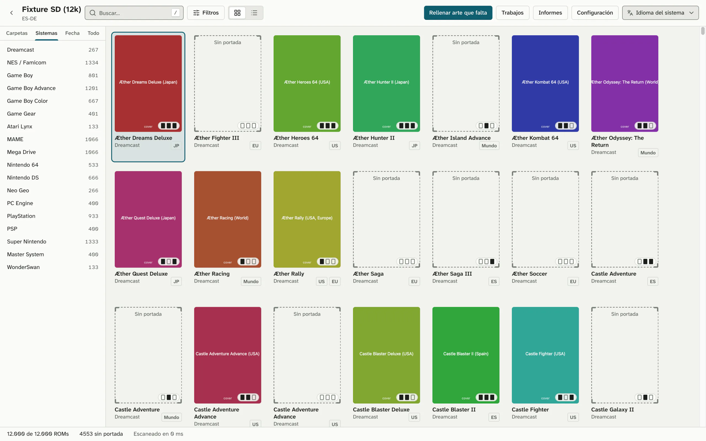
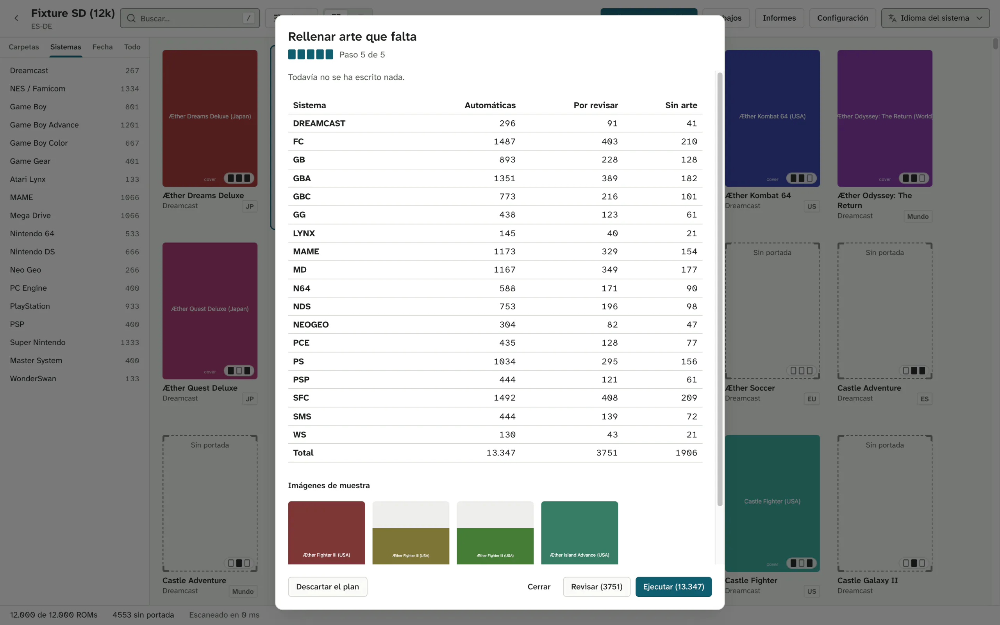
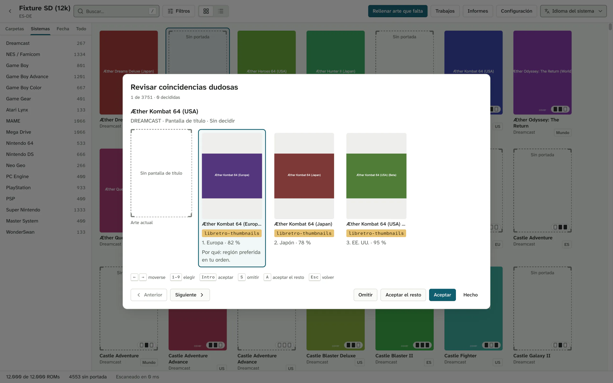

<p align="center">
  <a href="https://coverly-roms.maecly.com/"></a>
</p>

<h1 align="center">Cada ROM, con su portada.</h1>

<p align="center">
  <b>Coverly ROMs</b> encuentra las ROMs de la tarjeta SD de tu consola portátil que no tienen portada y las rellena.<br>
  Primero lo simula, y todo se puede deshacer. Windows, macOS y Linux.
</p>

<p align="center">
  <b>Gratis</b> · <b>Sin cuenta</b> · <b>Código abierto</b>
</p>

<p align="center">
  <a href="https://coverly-roms.maecly.com/#descargar"></a>
</p>

<p align="center">
  <a href="https://github.com/MAECLY/coverly-roms/releases/latest"></a>
  <a href="https://github.com/MAECLY/coverly-roms/releases"></a>
  <a href="https://github.com/MAECLY/coverly-roms/actions/workflows/ci.yml"></a>
  <a href="LICENSE"></a>
  <a href="#instalar"></a>
  <a href="README.md"></a>
  <a href="#privacidad-y-seguridad"></a>
</p>

<p align="center">
  <a href="https://coverly-roms.maecly.com/"><b>Web</b></a> ·
  <a href="#instalar">Descargar</a> ·
  <a href="#cómo-funciona">Cómo funciona</a> ·
  <a href="#preguntas">Preguntas</a> ·
  <a href="CONTRIBUTING.md">Contribuir</a> ·
  <b>Español</b> · <a href="README.md">English</a>
</p>

<p align="center">
  <a href="https://coverly-roms.maecly.com/">
    <picture>
      <source media="(prefers-color-scheme: dark)" srcset="docs/assets/shots/es/library-dark.webp">
      
    </picture>
  </a>
</p>

> [!NOTE]
> **Primeros pasos, dicho claro.** La v0.1.0 es la primera versión. Coverly ROMs
> aún no se ha probado en consolas reales. Las versiones todavía no están
> firmadas con un certificado de Apple ni de Microsoft, así que la primera vez
> aparece un aviso (ver [Instalar](#instalar)). Si lo pruebas en una consola,
> una [incidencia](https://github.com/MAECLY/coverly-roms/issues) contando cómo
> fue ayuda mucho.

---

## El problema

El firmware de fábrica de muchas consolas portátiles enseña una ficha vacía
cuando un juego no tiene portada. En una tarjeta con unos miles de ROMs, son
muchas fichas vacías. Las herramientas que lo arreglan funcionan solo en
Windows, piden montarlas a mano o van mejor con una cuenta de ScreenScraper.
Coverly ROMs es la opción segura en los tres sistemas de escritorio: sin
cuenta, con una simulación antes de escribir nada y con deshacer después.

Coverly ROMs no incluye ROMs, BIOS ni imágenes de juegos.

## Qué hace

**Auditar, solo lectura.** Abre una carpeta o una tarjeta SD y Coverly lista
cada sistema, cada ROM (los juegos de varios archivos, como `.cue`/`.bin`,
`.m3u` y `.gdi`, cuentan una vez) y qué imágenes tiene cada uno: portada,
captura, pantalla de título. Exporta el informe a CSV o JSON.

**Rellenar los huecos de una vez.** Cada ROM se identifica por su huella (CRC32,
MD5 y SHA1 contra libretro-database) y, si no, por su nombre, traduciendo los
nombres cortos de arcade. Cuando encajan varias imágenes, una estrategia elige
una: **Región de la ROM** (la de serie, con el orden de regiones
`rom,world,usa,europe,japan`), **Prioridad de fuentes** (el orden que les das) o
**Popularidad** (los votos de SteamGridDB). Las coincidencias seguras van solas;
las dudosas esperan en una cola de revisión. En Batocera y Knulli también
fusiona `gamelist.xml`, con copia de seguridad, y deshacer lo deja byte a byte
como estaba.

**No sobrescribe salvo que lo pidas.** Por defecto solo escribe lo que falta.
Si eliges sustituir imágenes (`--overwrite backup`), antes guarda una copia en
la carpeta de datos de la app, no en la tarjeta. No escribe nada fuera de la
carpeta que abriste.

**Organizar ROMs sueltas.** Elige una carpeta de descargas llena de zips y
Coverly propone una carpeta por sistema, con el formato que elijas (de serie,
Anbernic de fábrica: `ROMS/GBA/`, `ROMS/GB/`, `ROMS/SFC/`…). Cada archivo se
identifica por el CRC del catálogo (también dentro de los zip), luego por la
cabecera, la extensión y el nombre, y por ScreenScraper con el CRC si lo tienes
configurado, y muestra una confianza y un motivo. Los comprimidos se reconocen
por su contenido, no por su nombre, así que un 7z guardado como `.zip` se abre
como 7z: zip, 7z, RAR, tar, gzip, bzip2, xz, zstd, lz4 y ROMs sueltas
comprimidas como `juego.gba.gz`. Los juegos de disco dentro de un comprimido
(PlayStation, Saturn, Dreamcast, Sega CD, PC Engine CD, Neo Geo CD) se
identifican por el propio disco, con su número de serie, y al aplicar se
extraen su `.cue`/`.gdi` y sus pistas a la carpeta del sistema, cada pista
comprobada contra el comprimido. Las descargas sin terminar, las BIOS, las
páginas web guardadas como `.zip`, los archivos dañados o con varios juegos y
los duplicados se quedan donde están. No pisa ningún archivo, las copias entre
discos se verifican y un trabajo interrumpido se puede reanudar o deshacer.

**Explorar la biblioteca.** Vistas por carpeta, sistema, fecha y lista plana;
filtros por imágenes que faltan, sistema, extensión y región; búsqueda; y una
ficha de detalle donde cambias a mano la imagen de cada hueco o buscas por
título. Seis formas de verla, todas fluidas con más de 10.000 juegos:
**Portadas** (cinco tamaños), **Detalles** (columnas a elegir y de ancho
ajustable, miniaturas, filas compactas), **Columnas** (sistema → carpeta →
juego → vista previa), **Galería** (la imagen de un juego en grande, con tira
de miniaturas), **Huecos de arte** (portada, título y captura lado a lado, para
ver lo que falta) y **Estantes** (una fila por sistema). Cambia con
⌘/Ctrl+1–6, ajusta el tamaño de las portadas con ⌘/Ctrl +/−, agrupa por
sistema, carpeta, región, estado del arte o inicial, escribe un nombre para
saltar a él y pulsa Espacio para una Vista rápida. Cada biblioteca recuerda su
vista.

**Iconos de sistema.** Cada nombre de sistema en la app lleva su icono al lado:
una silueta sencilla del hardware (del tema Monochrome de RetroArch,
CC BY 4.0) o una etiqueta corta cuando no hay un dibujo neutro.

**Trabajos bajo control.** El asistente de relleno te enseña el plan entero
antes de ejecutarlo. Los trabajos se pueden pausar, reanudar, cancelar y
deshacer.

**Configuración.** General, Biblioteca, Arte, Coincidencias, Fuentes, Red,
Seguridad, Avanzado, Perfiles y Acerca de. Los perfiles de formato propios
tienen vista previa de las rutas. Las claves de API se guardan en el llavero
del sistema.

**Además:** una herramienta de línea de comandos, `coverly`; interfaz en
inglés y español; temas claro y oscuro; actualizaciones desde la app.

## Cómo funciona

Cuatro pasos. Los dos primeros no escriben nada.

1. **Abre la carpeta o la tarjeta SD.** Coverly reconoce el formato de tu
   firmware o frontend y te enseña cada sistema con lo que le falta.
2. **Prueba el trabajo antes de hacerlo.** La simulación identifica cada ROM,
   elige la imagen y te enseña el plan entero. Hasta que pulsas **Ejecutar**
   (o pasas `--apply`), no se escribe nada.
3. **Decide solo las dudosas.** Esperan en una cola que recorres con el
   teclado, y la elegida dice por qué.
4. **Aplica, y deshaz si no te convence.** Las imágenes se escriben de una en
   una, sin dejar archivos a medias. Deshacer devuelve la tarjeta a como
   estaba.

<table>
  <tr>
    <td width="50%">
      <picture>
        <source media="(prefers-color-scheme: dark)" srcset="docs/assets/shots/es/fill-dark.webp">
        
      </picture>
    </td>
    <td width="50%">
      <picture>
        <source media="(prefers-color-scheme: dark)" srcset="docs/assets/shots/es/review-dark.webp">
        
      </picture>
    </td>
  </tr>
</table>

Más detalle (en inglés): [proceso de relleno](docs/04-architecture/fill-pipeline.md),
[identificación](docs/04-architecture/identification.md),
[organizar](docs/04-architecture/organize.md).

## Formatos compatibles

Ocho formatos de firmware y frontend, detectados al abrir la carpeta. Puedes
cambiar el que se detecta y crear un perfil propio para cualquier otro
firmware.

| ID               | Nombre                               | Carpeta de ROMs | Imágenes que escribe                                                                                       |
| ---------------- | ------------------------------------ | --------------- | ---------------------------------------------------------------------------------------------------------- |
| `anbernic-stock` | Anbernic de fábrica                  | `ROMS`          | portada en `<SIS>/Imgs/<nombre>.png`                                                                       |
| `garlicos`       | GarlicOS                             | `Roms`          | portada en `Imgs/`                                                                                         |
| `onion`          | Onion OS                             | `Roms`          | portada en `Imgs/`                                                                                         |
| `muos`           | muOS                                 | `ROMS`          | portada y captura en `MUOS/info/catalogue/<sis>/box` y `preview`                                           |
| `minui`          | MinUI / NextUI                       | `Roms`          | portada en `.media/`                                                                                       |
| `esde`           | ES-DE                                | `ROMs`          | portada, captura y título en `downloaded_media/<sis>/covers`, `screenshots` y `titlescreens`               |
| `batocera`       | Batocera / Knulli / EmulationStation | `roms`          | portada, captura y título como `images/<nombre>-image`, `-screenshot` y `-titleshot.png`, y `gamelist.xml` |
| `retroarch`      | RetroArch                            | `.`             | portada, captura y título en `thumbnails/<db>/Named_Boxarts`, `Named_Snaps` y `Named_Titles`               |

`coverly profiles` los lista, junto con tus perfiles propios.

## Sistemas compatibles

54 sistemas, cada uno con los nombres de carpeta que usan los formatos (`GBA`,
`gba` y `gameboyadvance` son el mismo sistema). Entre ellos: Game Boy, Game Boy
Color, Game Boy Advance, NES/Famicom, Super Nintendo, Mega Drive, Master
System, Game Gear, PlayStation, PSP, Nintendo 64, Nintendo DS, Dreamcast,
Saturn, Neo Geo, CPS1–3, MAME, FinalBurn Neo, PICO-8, ScummVM y DOS.

<details>
<summary>Los 54 sistemas y sus nombres de carpeta (<code>coverly systems</code>)</summary>

| ID                | Nombre                        | Nombres de carpeta                                       |
| ----------------- | ----------------------------- | -------------------------------------------------------- |
| `a2600`           | Atari 2600                    | `A2600`, `atari2600`, `2600`                             |
| `a5200`           | Atari 5200                    | `A5200`, `atari5200`, `5200`                             |
| `a7800`           | Atari 7800                    | `A7800`, `atari7800`, `7800`                             |
| `a800`            | Atari 8-bit                   | `A800`, `atari800`, `atari8bit`                          |
| `amiga`           | Commodore Amiga               | `AMIGA`                                                  |
| `atarist`         | Atari ST                      | `ATARIST`, `atari st`                                    |
| `atomiswave`      | Atomiswave                    | `ATOMISWAVE`, `awave`                                    |
| `c64`             | Commodore 64                  | `C64`, `commodore64`                                     |
| `cps1`            | Capcom Play System            | `CPS1`                                                   |
| `cps2`            | Capcom Play System II         | `CPS2`                                                   |
| `cps3`            | Capcom Play System III        | `CPS3`                                                   |
| `dos`             | DOS                           | `DOS`, `msdos`                                           |
| `dreamcast`       | Sega Dreamcast                | `DREAMCAST`, `dc`                                        |
| `easyrpg`         | EasyRPG                       | `EASYRPG`, `rpgmaker`                                    |
| `fbneo`           | FinalBurn Neo                 | `FBNEO`, `fba`, `fbalpha`, `finalburn`                   |
| `nes`             | Nintendo Entertainment System | `FC`, `NES`, `famicom`                                   |
| `fds`             | Famicom Disk System           | `FDS`, `famicomdisk`                                     |
| `gb`              | Game Boy                      | `GB`, `gameboy`                                          |
| `gba`             | Game Boy Advance              | `GBA`, `gameboyadvance`                                  |
| `gbc`             | Game Boy Color                | `GBC`, `gameboycolor`                                    |
| `gamegear`        | Sega Game Gear                | `GG`, `gamegear`                                         |
| `gw`              | Game & Watch                  | `GW`, `gameandwatch`                                     |
| `hbmame`          | HBMAME                        | `HBMAME`                                                 |
| `lynx`            | Atari Lynx                    | `LYNX`, `atarilynx`                                      |
| `mame`            | MAME                          | `MAME`, `arcade`, `mame2003`, `mame2003plus`, `mame2010` |
| `megadrive`       | Sega Mega Drive / Genesis     | `MD`, `megadrive`, `genesis`, `Mega Drive`               |
| `segacd`          | Sega CD / Mega-CD             | `MDCD`, `segacd`, `megacd`, `Mega CD`                    |
| `msx`             | MSX                           | `MSX`, `msx1`, `msx2`                                    |
| `n64`             | Nintendo 64                   | `N64`, `nintendo64`                                      |
| `naomi`           | Sega NAOMI                    | `NAOMI`                                                  |
| `nds`             | Nintendo DS                   | `NDS`, `nintendods`                                      |
| `neocd`           | Neo Geo CD                    | `NEOCD`, `neogeocd`                                      |
| `neogeo`          | Neo Geo                       | `NEOGEO`, `Neo Geo`                                      |
| `ngp`             | Neo Geo Pocket                | `NGP`, `neogeopocket`                                    |
| `ngpc`            | Neo Geo Pocket Color          | `NGPC`, `neogeopocketcolor`                              |
| `ons`             | ONScripter                    | `ONS`, `onscripter`                                      |
| `openbor`         | OpenBOR                       | `OPENBOR`                                                |
| `pcengine`        | PC Engine / TurboGrafx-16     | `PCE`, `pcengine`, `tg16`, `turbografx16`, `PC Engine`   |
| `pcenginecd`      | PC Engine CD / TurboGrafx-CD  | `PCECD`, `pcenginecd`, `tgcd`, `turbografxcd`            |
| `pgm2`            | IGS PGM2                      | `PGM2`                                                   |
| `pico8`           | PICO-8                        | `PICO`, `pico8`, `pico-8`                                |
| `pokemini`        | Pokemon Mini                  | `POKE`, `pokemini`                                       |
| `psx`             | Sony PlayStation              | `PS`, `psx`, `ps1`, `playstation`                        |
| `psp`             | Sony PSP                      | `PSP`                                                    |
| `saturn`          | Sega Saturn                   | `SATURN`, `segasaturn`                                   |
| `scummvm`         | ScummVM                       | `SCUMMVM`, `scumm`                                       |
| `sega32x`         | Sega 32X                      | `SEGA32X`, `32x`, `sega32`                               |
| `snes`            | Super Nintendo                | `SFC`, `snes`, `Super Nintendo`, `supernintendo`         |
| `mastersystem`    | Sega Master System            | `SMS`, `mastersystem`, `Master System`                   |
| `varcade`         | Arcade (various)              | `VARCADE`                                                |
| `virtualboy`      | Virtual Boy                   | `VB`, `virtualboy`                                       |
| `vic20`           | Commodore VIC-20              | `VIC20`, `vic-20`                                        |
| `wonderswan`      | WonderSwan                    | `WS`, `wonderswan`                                       |
| `wonderswancolor` | WonderSwan Color              | `WSC`, `wonderswancolor`                                 |

</details>

## Fuentes de imágenes

- **[libretro-thumbnails](https://github.com/libretro-thumbnails/libretro-thumbnails)**
  (`thumbnails.libretro.com`): la de serie. Sin cuenta.
- **[SteamGridDB](https://www.steamgriddb.com/)**: opcional, con tu propia
  clave de API. Los votos de su comunidad alimentan la estrategia Popularidad.
  En la app la clave se guarda en el llavero del sistema; la CLI la lee de
  `COVERLY_SGDB_KEY`.
- **ScreenScraper**: previsto para una versión posterior, aún no disponible
  como fuente de imágenes. Hoy solo se usa para identificar archivos al
  organizar, si lo tienes configurado.
- **Los datos de identificación** vienen de
  [libretro-database](https://github.com/libretro/libretro-database), que se
  descarga al usar la app, no va incluida.

Más detalle (en inglés): [docs/04-architecture/art-sources.md](docs/04-architecture/art-sources.md).

## Instalar

Descarga el archivo para tu ordenador desde la
[última versión](https://github.com/MAECLY/coverly-roms/releases/latest):

| Sistema                                     | Archivo                                                                            |
| ------------------------------------------- | ---------------------------------------------------------------------------------- |
| macOS 11 o superior (Apple silicon e Intel) | `Coverly.ROMs_<versión>_universal.dmg`                                             |
| Windows 10/11 (x64)                         | `Coverly.ROMs_<versión>_x64-setup.exe` (recomendado) o `.msi`                      |
| Linux (x64, ARM64)                          | `.AppImage` o `.deb`                                                               |
| Línea de comandos (`coverly`)               | `coverly-<versión>-<os>-<arq>` (`darwin`, `windows`, `linux`; `x86_64`, `aarch64`) |

Comprueba el archivo con `SHA256SUMS` de la misma versión, por ejemplo
`shasum -a 256 -c SHA256SUMS --ignore-missing` (macOS),
`sha256sum -c SHA256SUMS --ignore-missing` (Linux) o
`Get-FileHash <archivo>` (PowerShell en Windows).

> [!WARNING]
> Las versiones todavía no están firmadas con un certificado de Apple ni de
> Microsoft, así que macOS y Windows te avisan la primera vez. Sigue estos pasos
> solo con un archivo que hayas bajado de las versiones de este repositorio y
> comprobado con `SHA256SUMS`.
>
> <details>
> <summary><b>macOS dice que la app está dañada, o que Apple no puede comprobarla.</b> No lo está.</summary>
>
> macOS pone en cuarentena las apps sin Apple Developer ID. Mueve Coverly ROMs a
> Aplicaciones y quita la marca una vez, en Terminal (las comillas importan: el
> nombre lleva un espacio):
>
> ```bash
> xattr -rd com.apple.quarantine "/Applications/Coverly ROMs.app"
> ```
>
> Esa marca es la comprobación que te protege de una descarga manipulada. En
> lugar de Terminal, también puedes intentar abrirla una vez, ir a **Ajustes del
> Sistema → Privacidad y seguridad**, bajar y pulsar **Abrir igualmente**. El
> binario `coverly` para macOS queda en cuarentena igual si lo baja un
> navegador: `xattr -d com.apple.quarantine coverly-<versión>-darwin-<arq>`.
>
> </details>
>
> <details>
> <summary><b>Windows muestra «Windows protegió su PC».</b></summary>
>
> Elige **Más información** y luego **Ejecutar de todas formas**. Si en su lugar
> ves una **Advertencia de seguridad** con **Editor: Editor desconocido**, elige
> **Ejecutar**. Con Smart App Control activado no hay **Ejecutar de todas
> formas**: bloquea las apps sin firmar, y puede que desactivarlo no tenga
> vuelta atrás sin reinstalar Windows. Coverly ROMs necesita Windows 10 u 11 en x64.
> El `-setup.exe` instala para tu usuario sin permisos de administrador; el
> `.msi` instala para todos los usuarios. Los dos usan Microsoft Edge WebView2:
> Windows 11 ya lo trae, y en Windows 10 el instalador lo descarga si falta
> (necesita internet).
>
> </details>
>
> <details>
> <summary><b>Linux</b></summary>
>
> Marca el AppImage como ejecutable (`chmod +x`) si tu gestor de archivos no lo
> ha hecho. El `.deb` depende de `libwebkit2gtk-4.1-0` y `libgtk-3-0`;
> `sudo apt install ./Coverly.ROMs_<versión>_amd64.deb` (o `_arm64.deb`) los
> instala. Los dos se compilan en Ubuntu 22.04 para x64 y ARM64, así que
> necesitan glibc 2.35 o posterior (Ubuntu 22.04, Debian 12 o posteriores).
>
> </details>

**Línea de comandos.** Renombra el binario a `coverly` (`coverly.exe` en
Windows), hazlo ejecutable (`chmod +x`) y ponlo en tu `PATH`.

**Avisos de nuevas versiones.** En GitHub, **Watch → Custom → Releases**, o
sigue el [feed de versiones](https://github.com/MAECLY/coverly-roms/releases.atom).

## Actualizaciones

La app busca actualizaciones al iniciarse (Configuración →
General; si lo desactivas no hace ninguna petición) y desde Configuración →
Acerca de, y nunca se reinicia mientras un trabajo de relleno está en marcha.
La CLI: `coverly update check` y `coverly update install`. Cada actualización
se verifica con la clave minisign del proyecto antes de instalarse; una
descarga que no pasa la comprobación no se instala. Hay canal estable y beta.

## Línea de comandos

`coverly` es la misma lógica que la app, para la terminal. Como la app, no
escribe nada salvo que pases `--apply`.

| Orden      | Qué hace                                                                                      |
| ---------- | --------------------------------------------------------------------------------------------- |
| `audit`    | Informa de qué ROMs no tienen portada, captura o título (solo lectura)                        |
| `fill`     | Rellena las imágenes que faltan desde las fuentes activas (simulación salvo con `--apply`)    |
| `organize` | Reparte un montón de ROMs sueltas en una carpeta por sistema (simulación salvo con `--apply`) |
| `profiles` | Lista los perfiles de formato, de serie y propios                                             |
| `systems`  | Lista los sistemas conocidos y sus nombres de carpeta                                         |
| `undo`     | Deshace el último trabajo (relleno u organización), o el que indiques con `--job`             |
| `update`   | Comprueba si hay un `coverly` más nuevo, o lo instala (verificado con minisign)               |

La ayuda de `coverly` está en inglés; la tabla traduce su descripción.

```bash
coverly audit /Volumes/SD --missing-only --format csv --output informe.csv
coverly fill /Volumes/SD                      # simulación: el plan, sin escribir nada
coverly fill /Volumes/SD --apply --auto-only --system gba,snes --media cover
coverly fill /Volumes/SD --sources libretro,steamgriddb --strategy popularity
coverly organize ~/Downloads/roms             # simulación: propuesta por sistema
coverly organize ~/Downloads/roms --target /Volumes/SD --copy --apply
coverly undo --list
coverly undo                                  # deshace el último trabajo
```

<details>
<summary>Opciones útiles</summary>

**`fill`:** `--profile ID|auto`, `--regions rom,world,usa,europe,japan`,
`--match hash-then-name|hash-only|name-only`, `--scope missing|all` (`all`
necesita `--overwrite backup`), `--concurrency 1-6`, `--refresh` (ignora los
candidatos e índices en caché), `--report table|json`, `--output ARCHIVO`.

**`organize`:** `--layout PERFIL`, `--target CARPETA`, `--flat`,
`--copy`/`--move`, `--names keep|catalogue`, `--assign ARCHIVO=SISTEMA`
(repetible), `--resume TRABAJO`, `--include-review`, `--offline`,
`--no-external-tools` (no usa unrar, 7-Zip ni bsdtar).

**`undo`:** `--list`, `--job ID`, `--include-later` (con `--job`: deshace
también los trabajos posteriores que tocaron la misma carpeta, del más nuevo al
más antiguo).

**Variables de entorno:** `COVERLY_SGDB_KEY` (clave de SteamGridDB; la CLI no
usa el llavero), `COVERLY_SS_USER` y `COVERLY_SS_PASSWORD` (cuenta de
ScreenScraper, para `organize`).

`coverly <orden> --help` lista todas las opciones.

</details>

## Privacidad y seguridad

- **Sin telemetría ni cuenta.** La app solo se conecta a las fuentes de
  imágenes que actives y, si no lo desactivas, a la comprobación de
  actualizaciones.
- **Las imágenes se recodifican** antes de escribirse, así que no llevan
  metadatos.
- **Tu clave de SteamGridDB se queda en el llavero del sistema** y solo se
  envía a SteamGridDB, en una cabecera `Authorization: Bearer`.
- **La auditoría solo lee.** Rellenar y organizar no escriben nada hasta que
  aplicas, nunca fuera de la raíz de la biblioteca, y cada trabajo se puede
  deshacer.
- **Las copias y el registro de cada trabajo** van a la carpeta de datos de la
  app, no a la tarjeta SD.
- **Coverly ROMs no incluye ROMs, BIOS ni imágenes de juegos.**

## Lo que aún no hace

- ScreenScraper como fuente de imágenes: previsto, aún no disponible.
- Vídeos, mezclas de imágenes, marquesinas o logos.
- Editar metadatos, renombrar o verificar ROMs.
- Funcionar en la propia consola.
- Aún no se ha probado en consolas reales.
- Las versiones aún no están firmadas con un certificado de Apple ni de
  Microsoft.

## Frente a otras herramientas

Skraper, Skyscraper y ARRM usan ScreenScraper y traen vídeos, mezclas de
imágenes y metadatos; Coverly ROMs solo rellena imágenes. Mini Scraper también
funciona sin cuenta y ya tiene versiones publicadas. En lo que Coverly ROMs se
distingue: versión nativa para macOS (Apple silicon e Intel), Windows y Linux
(x64 y ARM64), el formato `Imgs/` de Anbernic de serie, sin cuenta, y
simulación y deshacer en cada trabajo. La
[comparación de la web](https://coverly-roms.maecly.com/#comparar) cita las
fuentes de cada herramienta.

## Preguntas

<details>
<summary><b>¿Es gratis?</b></summary>

Sí. No cuesta nada, no pide cuenta y no tiene versión de pago. El código es
AGPL-3.0.

</details>

<details>
<summary><b>¿Trae ROMs o portadas?</b></summary>

No. Coverly ROMs no incluye ROMs, BIOS ni arte de juegos. Las imágenes se
descargan de libretro-thumbnails y, si pones tu propia clave, de SteamGridDB.
Cada imagen es de sus dueños.

</details>

<details>
<summary><b>¿Va a sobrescribir mis portadas?</b></summary>

No, salvo que lo pidas. Por defecto solo rellena lo que falta. Si eliges
sustituir, antes guarda una copia en la carpeta de datos de la app, no en la
tarjeta, y Deshacer la devuelve.

</details>

<details>
<summary><b>¿Necesito una cuenta?</b></summary>

No. libretro-thumbnails funciona sin cuenta. SteamGridDB es opcional: usa tu
propia clave, que se guarda en el llavero del sistema.

</details>

<details>
<summary><b>¿Abre comprimidos 7z y RAR?</b></summary>

Sí. Zip, 7z, tar, gzip, bzip2, xz, zstd y lz4 se abren sin instalar nada más.
RAR necesita un programa que ya está en muchos ordenadores, porque el código
oficial de RAR no puede ir dentro de un programa libre: `unrar`, 7-Zip (`7zz` o
`7z`) o `bsdtar`, que macOS ya trae (`/usr/bin/bsdtar`). En Windows encuentra
7-Zip o WinRAR en sus carpetas habituales; en Linux, instala `unrar`, `7zip` o
`libarchive-tools`. Si no hay ninguno, el RAR se queda donde está con el aviso
«Para abrir archivos RAR instala unrar» y se organiza lo demás. Configuración →
Organizar → _Programas externos para RAR_ muestra lo que ha encontrado y
permite desactivarlos.

Los juegos de disco se **extraen**, porque las consolas cargan el `.cue`/`.gdi`
y las pistas, no el comprimido. Las ROMs de cartucho en zip o 7z se mueven tal
cual cuando el formato de la tarjeta los carga; los demás comprimidos se
extraen. Al mover, el comprimido va a la papelera solo cuando todos los
archivos se han comprobado y no queda nada más dentro (si trae una partida
guardada, el comprimido se queda). Deshacer borra lo extraído y devuelve el
comprimido de la papelera.

</details>

<details>
<summary><b>¿Con qué consolas funciona?</b></summary>

Con las que usan los formatos de Anbernic de fábrica, GarlicOS, Onion OS, MinUI
y NextUI, muOS, ES-DE, Batocera, Knulli y EmulationStation, o RetroArch. Para
otro firmware puedes crear tu formato con vista previa. Aún no se ha probado en
consolas reales.

</details>

<details>
<summary><b>¿Por qué avisan Gatekeeper y SmartScreen?</b></summary>

Porque las descargas aún no llevan certificados de Apple ni de Microsoft. La
primera vez, en macOS quita la marca de cuarentena o pulsa **Abrir
igualmente**; en Windows, elige **Más información** y **Ejecutar de todas
formas**. Hazlo solo con archivos de las versiones de este proyecto. Los pasos
están en [Instalar](#instalar).

</details>

<details>
<summary><b>¿Envía datos a algún sitio?</b></summary>

No hay telemetría. La app solo se conecta a las fuentes de arte y, si no lo
desactivas, a la comprobación de actualizaciones al arrancar. Las imágenes se
recodifican, así que no llevan metadatos.

</details>

<details>
<summary><b>¿Cómo se actualiza?</b></summary>

Desde la propia app, con versiones de GitHub Releases verificadas con minisign
antes de instalarse. Hay canal estable y beta, y nunca se reinicia en mitad de
un trabajo. La línea de comandos usa `coverly update`.

</details>

## Ayuda a mejorarlo

- **Pruébalo en una consola real** y
  [abre una incidencia](https://github.com/MAECLY/coverly-roms/issues) con el
  firmware, el formato que detectó y cómo fue el relleno.
- **Añade un perfil de formato o un nombre de carpeta** que use tu firmware.
- **Mejora una traducción** en [`locales/en/ui.json`](locales/en/ui.json) o
  [`locales/es/ui.json`](locales/es/ui.json).

Lee antes [CONTRIBUTING.md](CONTRIBUTING.md) (en inglés). En resumen: las
contribuciones se hacen bajo el
[Acuerdo de Licencia de Contribuidor](CLA.md); `make check` pasa todo lo que
pasa la CI; los commits siguen
[Conventional Commits](https://www.conventionalcommits.org/), y commitlint lo
comprueba; lo nuevo en `coverly-core` llega con su test primero; y el
repositorio nunca acepta ROMs ni imágenes de juegos. Los informes de seguridad
siguen [SECURITY.md](SECURITY.md) (un aviso privado en GitHub, o
`security@maecly.com`).

## Para desarrolladores

<details>
<summary>Tecnología, estructura y compilar desde el código</summary>

**Tecnología.** Tauri 2 · Rust · React + TypeScript + Vite + Tailwind.

| Ruta                  | Qué contiene                                                               |
| --------------------- | -------------------------------------------------------------------------- |
| `crates/coverly-core` | Escaneo, identificación, fuentes, relleno, organizar, deshacer (sin Tauri) |
| `crates/coverly-cli`  | La herramienta de línea de comandos `coverly`                              |
| `src-tauri`           | La app de escritorio y sus órdenes                                         |
| `src`                 | La interfaz en React                                                       |

**Requisitos:** [Rust](https://rustup.rs/) 1.93 o superior,
[Node.js](https://nodejs.org/) 22.22.2 o superior con [pnpm](https://pnpm.io/), y
las [dependencias de sistema de Tauri 2](https://v2.tauri.app/start/prerequisites/)
para tu sistema operativo. `make doctor` muestra cuáles tienes instaladas.

```sh
make install                                   # instala las dependencias JS y Rust
make dev                                       # ejecuta la app de escritorio en desarrollo
make web                                       # solo la interfaz, en el navegador, con un backend simulado
make example                                   # crea una biblioteca de ejemplo y la audita
make example-fill                              # planifica rellenar sus portadas (simulación)
make audit ROOT=<ruta>                         # audita una biblioteca desde la terminal
make check                                     # lint, formato y todos los tests
```

Además: `make build` (un paquete de la app sin firmar), `make cli ARGS="systems"`
(ejecuta la CLI), `make fill ROOT=<ruta>` (planifica un relleno, simulación).

`make help` lista todos los objetivos. La biblioteca de ejemplo vive en
`target/example` (`make example-apply`, `make example-undo`, `make example-clean`).

La página web de [coverly-roms.maecly.com](https://coverly-roms.maecly.com)
vive en su propio repositorio, [MAECLY/coverly-roms-landing](https://github.com/MAECLY/coverly-roms-landing),
que explica cómo verla en local, comprobarla y publicarla (en inglés).

**Documentación** (en inglés). [docs/README.md](docs/README.md) es el índice.
La arquitectura está en [docs/04-architecture/](docs/04-architecture/system-architecture.md),
las decisiones en [docs/adr/](docs/adr/README.md), el proceso de publicación en
[RELEASING.md](RELEASING.md) y el historial en [CHANGELOG.md](CHANGELOG.md).

</details>

## Agradecimientos

- [libretro-thumbnails](https://github.com/libretro-thumbnails/libretro-thumbnails)
  y [libretro-database](https://github.com/libretro/libretro-database), por las
  imágenes y los datos de identificación, que se descargan al usar la app.
- [SteamGridDB](https://www.steamgriddb.com/) y su comunidad.
- [RetroArch Assets](https://github.com/libretro/retroarch-assets), por las
  siluetas monocromas de los sistemas (CC BY 4.0, © libretro contributors).
- [Tauri](https://tauri.app/), [Rust](https://www.rust-lang.org/) y
  [React](https://react.dev/).
- Las fuentes Archivo, Atkinson Hyperlegible Next y Atkinson Hyperlegible Mono
  (SIL Open Font License 1.1).

Las imágenes de los juegos son de sus dueños. Lista completa:
[THIRD-PARTY-NOTICES.md](THIRD-PARTY-NOTICES.md).

## Licencia y marcas

Coverly ROMs es software libre, publicado bajo la
[GNU Affero General Public License v3.0 only](LICENSE) (`AGPL-3.0-only`).
Copyright © 2026 Miguel Angel Esparza Calero (MAECLY).

El nombre **Coverly ROMs**, su logotipo de texto y su marca son marcas de
MAECLY y no se licencian bajo la AGPL (sección 7(e)); los forks deben usar su
propio nombre. Ver [TRADEMARKS.md](TRADEMARKS.md) y
[docs/09-legal/](docs/09-legal/license.md).

Las imágenes de los juegos se descargan de fuentes de terceros a petición tuya
y pertenecen a sus propietarios; ver
[THIRD-PARTY-NOTICES.md](THIRD-PARTY-NOTICES.md). El resto de nombres de
productos mencionados son marcas de sus respectivos propietarios.

---

<p align="center">
  <sub>Hecho por Miguel Angel Esparza Calero · <a href="https://coverly-roms.maecly.com/">coverly-roms.maecly.com</a></sub>
</p>
