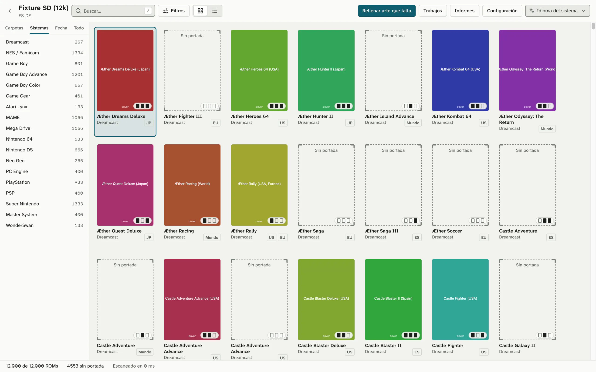

<p align="center">
  <a href="https://coverly-roms.maecly.com/"></a>
</p>

<h1 align="center">Cada ROM, con su portada.</h1>

<p align="center">
  <b>Coverly ROMs</b> encuentra las ROMs de la tarjeta SD de tu consola portátil que no tienen portada y las rellena.<br>
  Primero lo simula, y todo se puede deshacer. Windows, macOS y Linux.
</p>

<p align="center">
  <b>Gratis</b> · <b>Sin cuenta</b> · <b>Código abierto</b>
</p>

<p align="center">
  <a href="https://coverly-roms.maecly.com/#descargar"></a>
</p>

<p align="center">
  <a href="https://github.com/MAECLY/coverly-roms/releases/latest"></a>
  <a href="https://github.com/MAECLY/coverly-roms/releases"></a>
  <a href="https://github.com/MAECLY/coverly-roms/stargazers"></a>
  <a href="https://github.com/MAECLY/coverly-roms/actions/workflows/ci.yml"></a>
  <a href="LICENSE"></a>
  <a href="docs/guide/layouts-and-systems.es.md#sistemas-compatibles"></a>
  <a href="#privacidad-y-seguridad"></a>
</p>

<p align="center">
  <a href="https://coverly-roms.maecly.com/"><b>Web</b></a> ·
  <a href="#descargar">Descargar</a> ·
  <a href="https://coverly-roms.maecly.com/features/">Funciones</a> ·
  <a href="docs/guide/layouts-and-systems.es.md">Sistemas</a> ·
  <a href="docs/guide/faq.es.md">Preguntas</a> ·
  <a href="https://coverly-roms.maecly.com/roadmap/">Hoja de ruta</a> ·
  <b>Español</b> · <a href="README.md">English</a>
</p>

<p align="center">
  <a href="https://coverly-roms.maecly.com/">
    <picture>
      <source media="(prefers-color-scheme: dark)" srcset="docs/assets/shots/es/library-dark.webp">
      
    </picture>
  </a>
</p>

> [!NOTE]
> **Primeros pasos, dicho claro.** La v0.5.2 es la versión actual. Coverly ROMs
> aún no se ha probado en consolas reales. Las versiones todavía no están
> firmadas con un certificado de Apple ni de Microsoft, así que la primera vez
> aparece un aviso (ver [Descargar](#descargar)). Si lo pruebas en una consola,
> una [incidencia](https://github.com/MAECLY/coverly-roms/issues) contando cómo
> fue ayuda mucho.

## Qué hace

- **Audita** una carpeta o una tarjeta SD, solo lectura: cada sistema, cada ROM
  y qué imágenes tiene cada una (portada, captura, pantalla de título).
- **Rellena los huecos de una vez**, identificando cada ROM por su huella o su
  nombre. Las coincidencias seguras van solas; las dudosas esperan en una cola
  de revisión.
- **No sobrescribe** tus imágenes salvo que lo pidas, y antes guarda una copia.
- **Organiza ROMs sueltas** en una carpeta por sistema, con el formato de tu
  firmware, y las identifica también dentro de zip, 7z y otros comprimidos.
- **Da a cada juego su propia carpeta** con sus actualizaciones, DLC, mods,
  trucos y extras, con el formato «Coverly».
- **Encuentra duplicados** por su contenido, nunca por el nombre, y los aparta
  en vez de borrarlos.
- **Cubre 133 sistemas** y 8 formatos de firmware y frontend, de la Atari 2600
  a la PlayStation 5.
- **Trae línea de comandos**, `coverly`, con la misma lógica que la app.

Coverly ROMs no incluye ROMs, BIOS ni imágenes de juegos. Cada función está en
la [página de funciones](https://coverly-roms.maecly.com/features/), y la
versión larga en la [guía de funciones](docs/guide/features.es.md).

## Cómo empezar

1. **Abre la carpeta o la tarjeta SD.** Coverly reconoce el formato de tu
   firmware o frontend y te enseña cada sistema con lo que le falta.
2. **Prueba el trabajo antes de hacerlo.** La simulación identifica cada ROM,
   elige la imagen y te enseña el plan entero. No se escribe nada hasta que
   pulsas **Ejecutar**.
3. **Decide solo las dudosas.** Cada elección dice por qué se eligió.
4. **Aplícalo, y deshazlo si cambias de idea.** Deshacer deja la tarjeta como
   estaba.

## Descargar

Descarga el archivo para tu ordenador desde la
[última versión](https://github.com/MAECLY/coverly-roms/releases/latest):

| Sistema                                              | Archivo                                                                                                                                                                      |
| ---------------------------------------------------- | ---------------------------------------------------------------------------------------------------------------------------------------------------------------------------- |
| macOS 11 o posterior, Apple silicon (M1 o posterior) | `Coverly-ROMs_<versión>_mac_arm.dmg`                                                                                                                                         |
| macOS 11 o posterior, Intel                          | `Coverly-ROMs_<versión>_mac_intel.dmg`                                                                                                                                       |
| Windows 10/11 (x64)                                  | `Coverly-ROMs_<versión>_windows_x64-setup.exe` (recomendado); las versiones estables también `Coverly-ROMs_<versión>_windows_x64.msi`                                        |
| Windows 11 (ARM64)                                   | `Coverly-ROMs_<versión>_windows_arm-setup.exe` (recomendado); las versiones estables pueden traer también `Coverly-ROMs_<versión>_windows_arm.msi`                           |
| Linux x64                                            | `Coverly-ROMs_<versión>_linux_x64.AppImage` o `Coverly-ROMs_<versión>_linux_x64.deb`                                                                                         |
| Linux ARM64                                          | `Coverly-ROMs_<versión>_linux_arm.AppImage` o `Coverly-ROMs_<versión>_linux_arm.deb`                                                                                         |
| Línea de comandos                                    | `coverly_<versión>_<sistema>` (`mac_arm`, `mac_intel`, `windows_x64.exe`, `windows_arm.exe`, `linux_x64`, `linux_arm`); después, `coverly update install` la mantiene al día |

¿No sabes qué Mac tienes? Menú Apple → Acerca de este Mac:
«Chip» es Apple silicon, «Procesador» es Intel. En un PC con Windows ARM64,
instala la versión ARM64; una copia de la versión x64 instalada antes sigue
funcionando y actualizándose como x64.

Comprueba el archivo con `SHA256SUMS` de la misma versión, por ejemplo
`shasum -a 256 -c SHA256SUMS --ignore-missing` (macOS),
`sha256sum -c SHA256SUMS --ignore-missing` (Linux) o
`Get-FileHash <archivo>` (PowerShell en Windows).

> [!WARNING]
> Las versiones todavía no están firmadas con un certificado de Apple ni de
> Microsoft, así que macOS y Windows te avisan la primera vez. Sigue estos pasos
> solo con un archivo que hayas bajado de las versiones de este repositorio y
> comprobado con `SHA256SUMS`.
>
> <details>
> <summary><b>macOS dice que la app está dañada, o que Apple no puede comprobarla.</b> No lo está.</summary>
>
> macOS pone en cuarentena las apps sin Apple Developer ID. Mueve Coverly ROMs a
> Aplicaciones y quita la marca una vez, en Terminal (las comillas importan: el
> nombre lleva un espacio):
>
> ```bash
> xattr -rd com.apple.quarantine "/Applications/Coverly ROMs.app"
> ```
>
> Esa marca es la comprobación que te protege de una descarga manipulada. En
> lugar de Terminal, también puedes intentar abrirla una vez, ir a **Ajustes del
> Sistema → Privacidad y seguridad**, bajar y pulsar **Abrir igualmente**. El
> binario `coverly` para macOS queda en cuarentena igual si lo baja un
> navegador: `xattr -d com.apple.quarantine coverly_<versión>_mac_arm`
> (o `_mac_intel`).
>
> </details>
>
> <details>
> <summary><b>Windows muestra «Windows protegió su PC».</b></summary>
>
> Elige **Más información** y luego **Ejecutar de todas formas**. Si en su lugar
> ves una **Advertencia de seguridad** con **Editor: Editor desconocido**, elige
> **Ejecutar**. Con Smart App Control activado no hay **Ejecutar de todas
> formas**: bloquea las apps sin firmar, y puede que desactivarlo no tenga
> vuelta atrás sin reinstalar Windows. Coverly ROMs necesita Windows 10/11
> (x64) o Windows 11 (ARM64).
> El `-setup.exe` instala para tu usuario sin permisos de administrador; el
> `.msi` instala para todos los usuarios. Los dos usan Microsoft Edge WebView2:
> Windows 11 ya lo trae, y en Windows 10 el instalador lo descarga si falta
> (necesita internet).
>
> </details>
>
> <details>
> <summary><b>Linux</b></summary>
>
> Marca el AppImage como ejecutable (`chmod +x`) si tu gestor de archivos no lo
> ha hecho. El `.deb` depende de `libwebkit2gtk-4.1-0` y `libgtk-3-0`;
> `sudo apt install ./Coverly-ROMs_<versión>_linux_x64.deb` (o
> `_linux_arm.deb`) los instala. Los dos se compilan en Ubuntu 22.04 para x64
> y ARM64, así que necesitan glibc 2.35 o posterior (Ubuntu 22.04, Debian 12 o
> posteriores).
>
> </details>

**Línea de comandos.** Renombra el binario a `coverly` (`coverly.exe` en
Windows), hazlo ejecutable (`chmod +x`) y ponlo en tu `PATH`.

**Actualizaciones.** La app busca actualizaciones al iniciarse (Configuración →
General; si lo desactivas no hace ninguna petición) y desde Configuración →
Acerca de, y nunca se reinicia mientras un trabajo de relleno está en marcha.
La CLI: `coverly update check` y `coverly update install`. Cada actualización
se verifica con la clave minisign del proyecto antes de instalarse; una
descarga que no pasa la comprobación no se instala. Hay canal estable y beta.
Para enterarte de cada versión nueva, usa **Watch → Custom → Releases** en
GitHub o el [feed de versiones](https://github.com/MAECLY/coverly-roms/releases.atom).

## Línea de comandos

`coverly` es la misma lógica que la app, para la terminal. Como la app, no
escribe nada salvo que pases `--apply`.

```bash
coverly audit /Volumes/SD --missing-only --format csv --output informe.csv
coverly fill /Volumes/SD                      # simulación: el plan, sin escribir nada
coverly fill /Volumes/SD --apply --auto-only --system gba,snes --media cover
coverly organize ~/Downloads/roms             # simulación: propuesta por sistema
coverly dedupe /Volumes/SD                    # simulación: qué copia se queda y adónde van las demás
coverly undo                                  # deshace el último trabajo
```

Cada orden, opción y variable de entorno está en la
[guía de la línea de comandos](docs/guide/command-line.es.md);
`coverly <orden> --help` lista todas las opciones (en inglés).

## Privacidad y seguridad

- **Sin telemetría ni cuenta.** La app solo se conecta a las fuentes de
  imágenes que actives, a los servicios que configures en Configuración →
  Integraciones, al catálogo de nombres de Switch si lo activas y, si no lo
  desactivas, a la comprobación de actualizaciones. Cada tarjeta de
  Integraciones dice qué envía.
- **Sin claves de consola.** Coverly nunca las lee, pide, descarga ni incluye;
  los archivos de claves y licencias de la tarjeta no se tocan.
- **Tus claves se quedan en el llavero del sistema**, y nada vuelve a mostrar
  una clave guardada.
- **La auditoría solo lee.** Rellenar, organizar y apartar duplicados no
  escriben nada hasta que aplicas, nunca fuera de la raíz de la biblioteca, y
  cada trabajo se puede deshacer.
- **Las copias y el registro de cada trabajo** van a la carpeta de datos de la
  app, no a la tarjeta SD.

La lista completa, y qué recibe cada servicio, está en
[integraciones, privacidad y seguridad](docs/guide/integrations.es.md).

## Más

| Guía                                                                             | Qué contiene                                                                               |
| -------------------------------------------------------------------------------- | ------------------------------------------------------------------------------------------ |
| [Funciones](docs/guide/features.es.md)                                           | Cada función en detalle, y cómo funciona un relleno                                        |
| [Formatos, sistemas y fuentes de imágenes](docs/guide/layouts-and-systems.es.md) | Los 8 formatos, los 133 sistemas con sus nombres de carpeta, y de dónde salen las imágenes |
| [Integraciones, privacidad y seguridad](docs/guide/integrations.es.md)           | SteamGridDB, ScreenScraper, el catálogo de nombres de Switch, y qué se envía               |
| [Línea de comandos](docs/guide/command-line.es.md)                               | Cada orden, las opciones útiles y las variables de entorno                                 |
| [Preguntas](docs/guide/faq.es.md)                                                | Preguntas frecuentes, lo que aún no hace y cómo se compara con otras herramientas          |
| [Contribuir y compilar](docs/guide/development.es.md)                            | Cómo ayudar, la tecnología y cómo compilar desde el código                                 |
| [Agradecimientos](docs/guide/credits.es.md)                                      | Cada fuente, base de datos, biblioteca y tipografía que usa Coverly, con su licencia       |

Las contribuciones son bienvenidas: lee antes [CONTRIBUTING.md](CONTRIBUTING.md)
(en inglés). Los informes de seguridad siguen [SECURITY.md](SECURITY.md).

## Licencia y marcas

Coverly ROMs es software libre, publicado bajo la
[GNU Affero General Public License v3.0 only](LICENSE) (`AGPL-3.0-only`).
Copyright © 2026 Miguel Angel Esparza Calero (MAECLY).

El nombre **Coverly ROMs**, su logotipo de texto y su marca son marcas de
MAECLY y no se licencian bajo la AGPL (sección 7(e)); los forks deben usar su
propio nombre. Ver [TRADEMARKS.md](TRADEMARKS.md) y
[docs/09-legal/](docs/09-legal/license.md).

Las imágenes de los juegos se descargan de fuentes de terceros a petición tuya
y pertenecen a sus propietarios; ver
[THIRD-PARTY-NOTICES.md](THIRD-PARTY-NOTICES.md). El resto de nombres de
productos mencionados son marcas de sus respectivos propietarios.

---

<p align="center">
  <sub>Hecho por Miguel Angel Esparza Calero · <a href="https://coverly-roms.maecly.com/">coverly-roms.maecly.com</a></sub>
</p>
