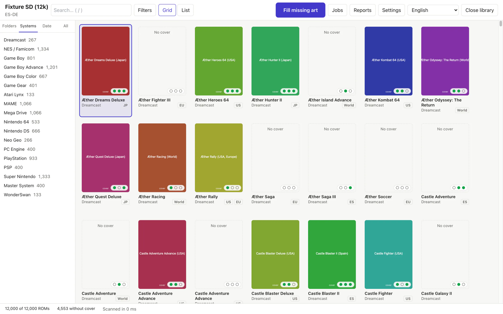
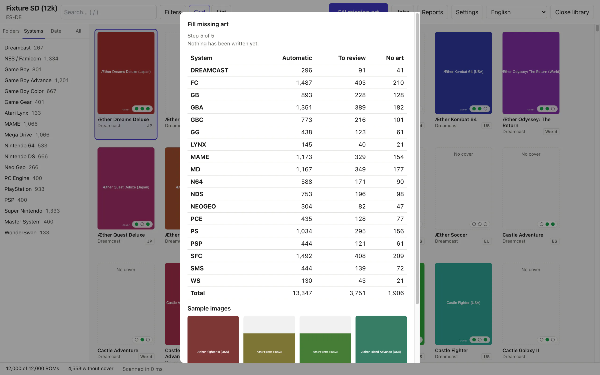
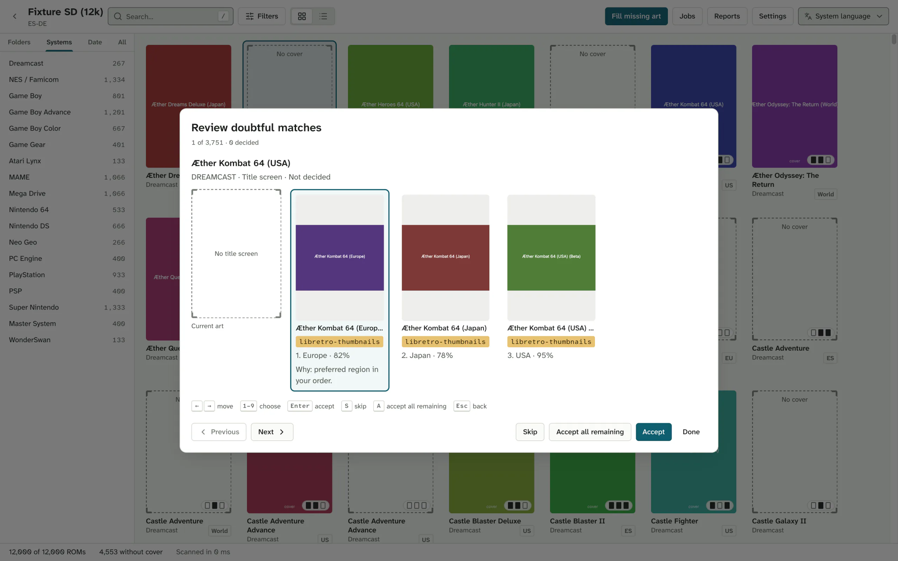

<p align="center">
  <a href="https://coverly-roms.maecly.com/en/"></a>
</p>

<h1 align="center">Every ROM gets its cover.</h1>

<p align="center">
  <b>Coverly ROMs</b> finds the ROMs on your handheld's SD card with no cover art and fills them in.<br>
  Dry run first, undo anytime. Windows, macOS and Linux.
</p>

<p align="center">
  <b>Free</b> · <b>No account</b> · <b>Open source</b>
</p>

<p align="center">
  <a href="https://coverly-roms.maecly.com/en/#download"></a>
</p>

<p align="center">
  <a href="https://github.com/MAECLY/coverly-roms/releases/latest"></a>
  <a href="https://github.com/MAECLY/coverly-roms/releases"></a>
  <a href="https://github.com/MAECLY/coverly-roms/actions/workflows/ci.yml"></a>
  <a href="LICENSE"></a>
  <a href="#install"></a>
  <a href="README.es.md"></a>
  <a href="#privacy-and-safety"></a>
</p>

<p align="center">
  <a href="https://coverly-roms.maecly.com/en/"><b>Website</b></a> ·
  <a href="#install">Download</a> ·
  <a href="#how-it-works">How it works</a> ·
  <a href="#questions">FAQ</a> ·
  <a href="CONTRIBUTING.md">Contributing</a> ·
  <a href="README.es.md">Español</a>
</p>

<p align="center">
  <a href="https://coverly-roms.maecly.com/en/">
    <picture>
      <source media="(prefers-color-scheme: dark)" srcset="site/assets/shots/en/library-dark.webp">
      
    </picture>
  </a>
</p>

> [!NOTE]
> **Early days, said plainly.** v0.1.0 is the first release. Coverly ROMs has
> not been tested on real handhelds yet. The builds are not signed with an Apple or Microsoft certificate yet, so the first
> launch shows a warning (see [Install](#install)). If you try it on a
> handheld, an [issue](https://github.com/MAECLY/coverly-roms/issues) saying
> how it went helps a lot.

---

## The problem

Stock firmware on many handhelds shows a blank tile when a game has no cover.
On a card with a few thousand ROMs, that is a lot of blank tiles. The tools
that fix it either run on Windows only, take some assembly, or work best with a
ScreenScraper account. Coverly ROMs is the safe option on all three desktop
systems: no account, a dry run before anything is written, and undo after.

Coverly ROMs does not include ROMs, BIOS files or game art.

## What it does

**Audit, read-only.** Open a folder or an SD card and Coverly lists every
system, every ROM (multi-file games such as `.cue`/`.bin`, `.m3u` and `.gdi`
count once) and which art each one has: cover, screenshot, title screen. Export
the report as CSV or JSON.

**Fill the gaps in bulk.** Each ROM is identified by its fingerprint (CRC32,
MD5 and SHA1 against libretro-database), or failing that by its name, with
arcade short names translated. When several images match, a strategy picks
one: **ROM region** (the default, region order `rom,world,usa,europe,japan`),
**Source priority** (your source order) or **Popularity** (SteamGridDB votes).
Confident matches go through on their own; doubtful ones wait in a review
queue. On Batocera and Knulli it also merges `gamelist.xml`, with a backup, and
undo restores it byte for byte.

**Never overwrites unless you ask.** By default only missing art is written.
If you choose to replace art (`--overwrite backup`), a copy is kept first in the
app's data folder, not on the card. Nothing is written outside the folder you
opened.

**Organise loose ROMs.** Pick a downloads folder full of zips and Coverly
proposes one folder per system, in the layout you choose (Anbernic stock by
default: `ROMS/GBA/`, `ROMS/GB/`, `ROMS/SFC/`…). Each file is identified by
catalogue CRC (zip entries included), then header magic, extension and name,
plus ScreenScraper by CRC when configured, and shows a confidence and a reason.
Unfinished downloads, BIOS files, web pages saved as `.zip`, damaged or
multi-game archives and duplicates stay where they are. Nothing is clobbered,
copies across drives are verified, and an interrupted job can be resumed or
undone.

**Browse the library.** Folder, system, date and flat views; a grid and a table
that stay fast past 10,000 games; filters for missing art, system, extension
and region; search; and a detail panel where you can swap any slot's art by
hand or search by title.

**Jobs you control.** The fill wizard shows the whole plan before it runs.
Jobs can be paused, resumed, cancelled and undone.

**Settings.** General, Library, Art, Matching, Sources, Network, Safety,
Advanced, Profiles and About. Custom layout profiles have a live path preview.
API keys are kept in the OS keychain.

**Also:** a command-line tool, `coverly`; English and Spanish interface; light
and dark themes; in-app updates.

## How it works

Four steps. The first two write nothing.

1. **Open the folder or SD card.** Coverly recognises your firmware's or
   frontend's layout and shows every system with what it lacks.
2. **Rehearse the job first.** The dry run identifies each ROM, picks the
   image and shows the whole plan. Nothing is written until you press **Run**
   (or pass `--apply`).
3. **Decide only the doubtful ones.** They wait in a queue you can clear from
   the keyboard, and each pick says why it was picked.
4. **Apply it, and undo it if you change your mind.** Images are written one at
   a time, never left half-written. Undo puts the card back the way it was.

<table>
  <tr>
    <td width="50%">
      <picture>
        <source media="(prefers-color-scheme: dark)" srcset="site/assets/shots/en/fill-dark.webp">
        
      </picture>
    </td>
    <td width="50%">
      <picture>
        <source media="(prefers-color-scheme: dark)" srcset="site/assets/shots/en/review-dark.webp">
        
      </picture>
    </td>
  </tr>
</table>

More detail: [fill pipeline](docs/04-architecture/fill-pipeline.md),
[identification](docs/04-architecture/identification.md),
[organise](docs/04-architecture/organize.md).

## Supported layouts

Eight firmware and frontend layouts, detected when you open the folder. You can
override the detection, and build a custom profile for any other firmware.

| ID               | Name                                 | ROMs folder | Art it writes                                                                                                 |
| ---------------- | ------------------------------------ | ----------- | ------------------------------------------------------------------------------------------------------------- |
| `anbernic-stock` | Anbernic stock                       | `ROMS`      | cover in `<SYS>/Imgs/<stem>.png`                                                                              |
| `garlicos`       | GarlicOS                             | `Roms`      | cover in `Imgs/`                                                                                              |
| `onion`          | Onion OS                             | `Roms`      | cover in `Imgs/`                                                                                              |
| `muos`           | muOS                                 | `ROMS`      | cover and screenshot in `MUOS/info/catalogue/<sys>/box` and `preview`                                         |
| `minui`          | MinUI / NextUI                       | `Roms`      | cover in `.media/`                                                                                            |
| `esde`           | ES-DE                                | `ROMs`      | cover, screenshot and title in `downloaded_media/<sys>/covers`, `screenshots` and `titlescreens`              |
| `batocera`       | Batocera / Knulli / EmulationStation | `roms`      | cover, screenshot and title as `images/<stem>-image`, `-screenshot` and `-titleshot.png`, plus `gamelist.xml` |
| `retroarch`      | RetroArch                            | `.`         | cover, screenshot and title in `thumbnails/<db>/Named_Boxarts`, `Named_Snaps` and `Named_Titles`              |

`coverly profiles` lists them, with your custom profiles.

## Supported systems

54 systems, each under the folder names the layouts use (`GBA`, `gba` and
`gameboyadvance` are the same system). Among them: Game Boy, Game Boy Color,
Game Boy Advance, NES/Famicom, Super Nintendo, Mega Drive, Master System, Game
Gear, PlayStation, PSP, Nintendo 64, Nintendo DS, Dreamcast, Saturn, Neo Geo,
CPS1–3, MAME, FinalBurn Neo, PICO-8, ScummVM and DOS.

<details>
<summary>All 54 systems and their folder aliases (<code>coverly systems</code>)</summary>

| ID                | Name                          | Folder aliases                                           |
| ----------------- | ----------------------------- | -------------------------------------------------------- |
| `a2600`           | Atari 2600                    | `A2600`, `atari2600`, `2600`                             |
| `a5200`           | Atari 5200                    | `A5200`, `atari5200`, `5200`                             |
| `a7800`           | Atari 7800                    | `A7800`, `atari7800`, `7800`                             |
| `a800`            | Atari 8-bit                   | `A800`, `atari800`, `atari8bit`                          |
| `amiga`           | Commodore Amiga               | `AMIGA`                                                  |
| `atarist`         | Atari ST                      | `ATARIST`, `atari st`                                    |
| `atomiswave`      | Atomiswave                    | `ATOMISWAVE`, `awave`                                    |
| `c64`             | Commodore 64                  | `C64`, `commodore64`                                     |
| `cps1`            | Capcom Play System            | `CPS1`                                                   |
| `cps2`            | Capcom Play System II         | `CPS2`                                                   |
| `cps3`            | Capcom Play System III        | `CPS3`                                                   |
| `dos`             | DOS                           | `DOS`, `msdos`                                           |
| `dreamcast`       | Sega Dreamcast                | `DREAMCAST`, `dc`                                        |
| `easyrpg`         | EasyRPG                       | `EASYRPG`, `rpgmaker`                                    |
| `fbneo`           | FinalBurn Neo                 | `FBNEO`, `fba`, `fbalpha`, `finalburn`                   |
| `nes`             | Nintendo Entertainment System | `FC`, `NES`, `famicom`                                   |
| `fds`             | Famicom Disk System           | `FDS`, `famicomdisk`                                     |
| `gb`              | Game Boy                      | `GB`, `gameboy`                                          |
| `gba`             | Game Boy Advance              | `GBA`, `gameboyadvance`                                  |
| `gbc`             | Game Boy Color                | `GBC`, `gameboycolor`                                    |
| `gamegear`        | Sega Game Gear                | `GG`, `gamegear`                                         |
| `gw`              | Game & Watch                  | `GW`, `gameandwatch`                                     |
| `hbmame`          | HBMAME                        | `HBMAME`                                                 |
| `lynx`            | Atari Lynx                    | `LYNX`, `atarilynx`                                      |
| `mame`            | MAME                          | `MAME`, `arcade`, `mame2003`, `mame2003plus`, `mame2010` |
| `megadrive`       | Sega Mega Drive / Genesis     | `MD`, `megadrive`, `genesis`, `Mega Drive`               |
| `segacd`          | Sega CD / Mega-CD             | `MDCD`, `segacd`, `megacd`, `Mega CD`                    |
| `msx`             | MSX                           | `MSX`, `msx1`, `msx2`                                    |
| `n64`             | Nintendo 64                   | `N64`, `nintendo64`                                      |
| `naomi`           | Sega NAOMI                    | `NAOMI`                                                  |
| `nds`             | Nintendo DS                   | `NDS`, `nintendods`                                      |
| `neocd`           | Neo Geo CD                    | `NEOCD`, `neogeocd`                                      |
| `neogeo`          | Neo Geo                       | `NEOGEO`, `Neo Geo`                                      |
| `ngp`             | Neo Geo Pocket                | `NGP`, `neogeopocket`                                    |
| `ngpc`            | Neo Geo Pocket Color          | `NGPC`, `neogeopocketcolor`                              |
| `ons`             | ONScripter                    | `ONS`, `onscripter`                                      |
| `openbor`         | OpenBOR                       | `OPENBOR`                                                |
| `pcengine`        | PC Engine / TurboGrafx-16     | `PCE`, `pcengine`, `tg16`, `turbografx16`, `PC Engine`   |
| `pcenginecd`      | PC Engine CD / TurboGrafx-CD  | `PCECD`, `pcenginecd`, `tgcd`, `turbografxcd`            |
| `pgm2`            | IGS PGM2                      | `PGM2`                                                   |
| `pico8`           | PICO-8                        | `PICO`, `pico8`, `pico-8`                                |
| `pokemini`        | Pokemon Mini                  | `POKE`, `pokemini`                                       |
| `psx`             | Sony PlayStation              | `PS`, `psx`, `ps1`, `playstation`                        |
| `psp`             | Sony PSP                      | `PSP`                                                    |
| `saturn`          | Sega Saturn                   | `SATURN`, `segasaturn`                                   |
| `scummvm`         | ScummVM                       | `SCUMMVM`, `scumm`                                       |
| `sega32x`         | Sega 32X                      | `SEGA32X`, `32x`, `sega32`                               |
| `snes`            | Super Nintendo                | `SFC`, `snes`, `Super Nintendo`, `supernintendo`         |
| `mastersystem`    | Sega Master System            | `SMS`, `mastersystem`, `Master System`                   |
| `varcade`         | Arcade (various)              | `VARCADE`                                                |
| `virtualboy`      | Virtual Boy                   | `VB`, `virtualboy`                                       |
| `vic20`           | Commodore VIC-20              | `VIC20`, `vic-20`                                        |
| `wonderswan`      | WonderSwan                    | `WS`, `wonderswan`                                       |
| `wonderswancolor` | WonderSwan Color              | `WSC`, `wonderswancolor`                                 |

</details>

## Art sources

- **[libretro-thumbnails](https://github.com/libretro-thumbnails/libretro-thumbnails)**
  (`thumbnails.libretro.com`): the default. No account.
- **[SteamGridDB](https://www.steamgriddb.com/)**: optional, with your own API
  key. Its community votes feed the Popularity strategy. In the app the key is
  kept in the OS keychain; the CLI reads it from `COVERLY_SGDB_KEY`.
- **ScreenScraper**: planned for a later version, not available as an art
  source yet. Today it is only used to identify files when organising, when it
  is configured.
- **Identification data** comes from
  [libretro-database](https://github.com/libretro/libretro-database),
  downloaded at runtime, not bundled.

More detail: [docs/04-architecture/art-sources.md](docs/04-architecture/art-sources.md).

## Install

Download the file for your computer from the
[latest release](https://github.com/MAECLY/coverly-roms/releases/latest):

| System                                      | File                                                                                |
| ------------------------------------------- | ----------------------------------------------------------------------------------- |
| macOS 11 or newer (Apple silicon and Intel) | `Coverly.ROMs_<version>_universal.dmg`                                              |
| Windows 10/11 (x64)                         | `Coverly.ROMs_<version>_x64-setup.exe` (recommended) or `.msi`                      |
| Linux (x64, ARM64)                          | `.AppImage` or `.deb`                                                               |
| Command line (`coverly`)                    | `coverly-<version>-<os>-<arch>` (`darwin`, `windows`, `linux`; `x86_64`, `aarch64`) |

Check the file against `SHA256SUMS` from the same release, for example
`shasum -a 256 -c SHA256SUMS --ignore-missing` (macOS),
`sha256sum -c SHA256SUMS --ignore-missing` (Linux) or
`Get-FileHash <file>` (Windows PowerShell).

> [!WARNING]
> The builds are not signed with an Apple or Microsoft certificate yet, so macOS
> and Windows warn you the first time. Only follow these steps for a file you
> took from this repository's releases and checked against `SHA256SUMS`.
>
> <details>
> <summary><b>macOS says the app is damaged, or that Apple could not verify it.</b> It isn't.</summary>
>
> macOS quarantines apps without an Apple Developer ID. Move Coverly ROMs to
> Applications, then clear the flag once in Terminal (the quotes matter: the
> name has a space):
>
> ```bash
> xattr -rd com.apple.quarantine "/Applications/Coverly ROMs.app"
> ```
>
> That flag is the check that protects you from a tampered download. Instead of
> Terminal you can also try to open it once, then go to **System Settings →
> Privacy & Security**, scroll down and click **Open Anyway**. The `coverly`
> binary for macOS is quarantined the same way when a browser downloads it:
> `xattr -d com.apple.quarantine coverly-<version>-darwin-<arch>`.
>
> </details>
>
> <details>
> <summary><b>Windows shows "Windows protected your PC".</b></summary>
>
> Choose **More info**, then **Run anyway**. If you see a **Security Warning**
> with **Publisher: Unknown Publisher** instead, choose **Run**. With Smart App
> Control turned on there is no **Run anyway**: it blocks unsigned apps, and
> turning it off may not be reversible without reinstalling Windows.
> Coverly ROMs needs Windows 10 or 11 on x64. The `-setup.exe` installs for your
> user without administrator rights; the `.msi` installs for every user. Both
> use Microsoft Edge WebView2: Windows 11 has it, and on Windows 10 the
> installer downloads it if it is missing (that needs internet).
>
> </details>
>
> <details>
> <summary><b>Linux</b></summary>
>
> Mark the AppImage executable (`chmod +x`) if your file manager has not. The
> `.deb` depends on `libwebkit2gtk-4.1-0` and `libgtk-3-0`;
> `sudo apt install ./Coverly.ROMs_<version>_amd64.deb` (or `_arm64.deb`) pulls
> them in. Both are built on Ubuntu 22.04 for x64 and ARM64, so they need glibc
> 2.35 or newer (Ubuntu 22.04, Debian 12 or later).
>
> </details>

**Command line.** Rename the binary to `coverly` (`coverly.exe` on Windows),
make it executable (`chmod +x`) and put it on your `PATH`.

**Watch for releases.** On GitHub, **Watch → Custom → Releases**, or follow the
[releases feed](https://github.com/MAECLY/coverly-roms/releases.atom).

## Updates

**Updates.** The app checks for updates on start (Settings → General; turn it
off and it requests nothing) and from Settings → About, and never restarts
while a fill job is running. The CLI: `coverly update check` and
`coverly update install`. Every update is verified with the project's minisign
key before it is installed; a download that fails the check is not installed.
There are stable and beta channels.

## Command line

`coverly` is the same engine as the app, for the terminal. Like the app, it
writes nothing unless you pass `--apply`.

| Command    | What it does                                                                   |
| ---------- | ------------------------------------------------------------------------------ |
| `audit`    | Report which ROMs of a library lack cover, screenshot or title art (read-only) |
| `fill`     | Fill missing art from the enabled sources (dry run unless --apply)             |
| `organize` | Sort a pile of loose ROMs into one folder per system (dry run unless --apply)  |
| `profiles` | List the built-in and custom layout profiles                                   |
| `systems`  | List the known systems and their folder aliases                                |
| `undo`     | Undo the last job (fill or organise), or the one given with --job              |
| `update`   | Check for a newer coverly, or install it (verified with minisign)              |

```bash
coverly audit /Volumes/SD --missing-only --format csv --output report.csv
coverly fill /Volumes/SD                      # dry run: the plan, nothing written
coverly fill /Volumes/SD --apply --auto-only --system gba,snes --media cover
coverly fill /Volumes/SD --sources libretro,steamgriddb --strategy popularity
coverly organize ~/Downloads/roms             # dry run: a proposal by system
coverly organize ~/Downloads/roms --target /Volumes/SD --copy --apply
coverly undo --list
coverly undo                                  # undo the last job
```

<details>
<summary>Useful flags</summary>

**`fill`:** `--profile ID|auto`, `--regions rom,world,usa,europe,japan`,
`--match hash-then-name|hash-only|name-only`, `--scope missing|all` (`all`
needs `--overwrite backup`), `--concurrency 1-6`, `--refresh` (ignore cached
indexes), `--report table|json`, `--output FILE`.

**`organize`:** `--layout PROFILE_ID`, `--target DIR`, `--flat`,
`--copy`/`--move`, `--names keep|catalogue`, `--assign FILE=SYSTEM_ID`
(repeatable), `--resume JOB_ID`, `--include-review`, `--offline`.

**`undo`:** `--list`, `--job ID`, `--include-later` (with `--job`: also undo
the newer jobs that touched the same folder, newest first).

**Environment:** `COVERLY_SGDB_KEY` (SteamGridDB key; the CLI has no keychain),
`COVERLY_SS_USER` and `COVERLY_SS_PASSWORD` (ScreenScraper account, used by
`organize`).

`coverly <command> --help` lists every option.

</details>

## Privacy and safety

- **No telemetry, no account.** The app only talks to the art sources you
  enable and, unless you turn it off, to the update check.
- **Images are re-encoded** before they are written, so they carry no metadata.
- **Your SteamGridDB key stays in the OS keychain** and is sent only to
  SteamGridDB, as an `Authorization: Bearer` header.
- **The audit only reads.** Fill and organise write nothing until you apply,
  never outside the library root, and every job can be undone.
- **Backups and job logs** go to the app's data folder, not to the SD card.
- **No ROMs, BIOS files or game art** ship with Coverly ROMs.

## What it doesn't do yet

- ScreenScraper as an art source: planned, not available yet.
- Videos, mixed images, marquees or wheels.
- Editing metadata, renaming or verifying ROMs.
- Running on the handheld itself.
- It has not been tested on real handhelds yet.
- The builds are not signed with an Apple or Microsoft certificate yet.

## Compared with other tools

Skraper, Skyscraper and ARRM use ScreenScraper and bring videos, mixed images
and metadata; Coverly ROMs only fills images. Mini Scraper also works without
an account and already has releases out. Where Coverly ROMs differs: a native
build for macOS (Apple silicon and Intel), Windows and Linux (x64 and ARM64),
the Anbernic `Imgs/` layout built in, no account, and a dry run and undo for
every job. The [comparison on the website](https://coverly-roms.maecly.com/en/#compare)
lists each tool's sources.

## Questions

<details>
<summary><b>Is it free?</b></summary>

Yes. It costs nothing, needs no account and has no paid tier. The code is
AGPL-3.0.

</details>

<details>
<summary><b>Does it come with ROMs or cover art?</b></summary>

No. Coverly ROMs bundles no ROMs, BIOS files or game art. Images are downloaded
from libretro-thumbnails and, if you add your own key, SteamGridDB. Every image
belongs to its owners.

</details>

<details>
<summary><b>Will it overwrite my covers?</b></summary>

Not unless you ask it to. By default it only fills what is missing. If you
choose to replace art, it first keeps a copy in the app's data folder, not on
the card, and Undo puts it back.

</details>

<details>
<summary><b>Do I need an account?</b></summary>

No. libretro-thumbnails works without one. SteamGridDB is optional and uses
your own key, kept in your system keychain.

</details>

<details>
<summary><b>Which handhelds does it work with?</b></summary>

Any that uses the Anbernic stock, GarlicOS, Onion OS, MinUI and NextUI, muOS,
ES-DE, Batocera, Knulli and EmulationStation, or RetroArch layout. For other
firmware you can build your own layout with a live preview. It has not been
tested on real handhelds yet.

</details>

<details>
<summary><b>Why do Gatekeeper and SmartScreen warn me?</b></summary>

Because the downloads carry no Apple or Microsoft certificate yet. The first
time, on macOS clear the quarantine flag or click **Open Anyway**; on Windows,
choose **More info**, then **Run anyway**. Only do it for files from this
project's releases. The steps are under [Install](#install).

</details>

<details>
<summary><b>Does it send data anywhere?</b></summary>

There is no telemetry. The app only talks to the art sources and, unless you
turn it off, to the update check at startup. Images are re-encoded, so they
carry no metadata.

</details>

<details>
<summary><b>How does it update?</b></summary>

From inside the app, with GitHub Releases builds verified with minisign before
they install. There are stable and beta channels, and it never restarts in the
middle of a job. The command line uses `coverly update`.

</details>

## Help make it better

- **Try it on a real handheld** and [open an issue](https://github.com/MAECLY/coverly-roms/issues)
  saying which firmware, which layout was detected and how the fill went.
- **Add a layout profile or a folder alias** your firmware uses.
- **Improve a translation** in [`locales/en/ui.json`](locales/en/ui.json) or
  [`locales/es/ui.json`](locales/es/ui.json).

Read [CONTRIBUTING.md](CONTRIBUTING.md) first. In short: contributions are made
under the [Contributor License Agreement](CLA.md); `make check` runs everything
CI runs; commits follow [Conventional Commits](https://www.conventionalcommits.org/),
checked by commitlint; new behaviour in `coverly-core` comes with its test
first; and the repository never takes ROMs or game art. Security reports go
through [SECURITY.md](SECURITY.md) (a private GitHub advisory, or
`security@maecly.com`).

## For developers

<details>
<summary>Stack, layout and building from source</summary>

**Stack.** Tauri 2 · Rust · React + TypeScript + Vite + Tailwind.

| Path                  | What it holds                                                      |
| --------------------- | ------------------------------------------------------------------ |
| `crates/coverly-core` | Scanning, identification, sources, fill, organise, undo (no Tauri) |
| `crates/coverly-cli`  | The `coverly` command-line tool                                    |
| `src-tauri`           | The desktop shell and its commands                                 |
| `src`                 | The React interface                                                |
| `site`                | The landing page                                                   |

**Prerequisites:** [Rust](https://rustup.rs/) 1.90 or newer,
[Node.js](https://nodejs.org/) 22 or newer with [pnpm](https://pnpm.io/), and
the [Tauri 2 system dependencies](https://v2.tauri.app/start/prerequisites/)
for your OS. `make doctor` shows which ones are installed.

```sh
make install                                   # install JS and Rust dependencies
make dev                                       # run the desktop app in development
make web                                       # only the UI, in a browser, with a mock backend
make example                                   # build a small example library and audit it
make example-fill                              # plan filling its covers (dry run)
make audit ROOT=<path>                         # audit a library from the terminal
make check                                     # lint, format check and all tests
make site                                      # serve the landing page on http://localhost:8080
```

Also: `make build` (an unsigned release bundle), `make cli ARGS="systems"`
(run the CLI), `make fill ROOT=<path>` (plan a fill, dry run).

`make help` lists every target. The example library lives in `target/example`
(`make example-apply`, `make example-undo`, `make example-clean`).

The landing page at [coverly-roms.maecly.com](https://coverly-roms.maecly.com)
lives in `site/`. `make site` shows it as it looks before the first release;
`make site RELEASE=scripts/site/fixtures/release.json` shows it with a release,
and `make site-check` runs its checks.
[docs/07-build-and-release/landing.md](docs/07-build-and-release/landing.md)
explains how it is published.

**Docs.** [docs/README.md](docs/README.md) is the index. Architecture in
[docs/04-architecture/](docs/04-architecture/system-architecture.md), decisions
in [docs/adr/](docs/adr/README.md), the release process in
[RELEASING.md](RELEASING.md) and the history in [CHANGELOG.md](CHANGELOG.md).

</details>

## Acknowledgements

- [libretro-thumbnails](https://github.com/libretro-thumbnails/libretro-thumbnails)
  and [libretro-database](https://github.com/libretro/libretro-database), for
  the art and the identification data, downloaded at runtime.
- [SteamGridDB](https://www.steamgriddb.com/) and its community.
- [Tauri](https://tauri.app/), [Rust](https://www.rust-lang.org/) and
  [React](https://react.dev/).
- The Archivo, Atkinson Hyperlegible Next and Atkinson Hyperlegible Mono fonts
  (SIL Open Font License 1.1).

Game art belongs to its owners. Full list:
[THIRD-PARTY-NOTICES.md](THIRD-PARTY-NOTICES.md).

## Licence and trademarks

Coverly ROMs is free software, licensed under the
[GNU Affero General Public License v3.0 only](LICENSE) (`AGPL-3.0-only`).
Copyright © 2026 Miguel Angel Esparza Calero (MAECLY).

The name **Coverly ROMs**, its wordmark and its mark are trademarks of MAECLY
and are not licensed under the AGPL (section 7(e)); forks must use their own
name. See [TRADEMARKS.md](TRADEMARKS.md) and
[docs/09-legal/](docs/09-legal/license.md).

Game art is fetched from third-party sources at your request and belongs to
its owners; see [THIRD-PARTY-NOTICES.md](THIRD-PARTY-NOTICES.md). All other
product names mentioned are trademarks of their respective owners.

---

<p align="center">
  <sub>Made by Miguel Angel Esparza Calero · <a href="https://coverly-roms.maecly.com/en/">coverly-roms.maecly.com</a></sub>
</p>
