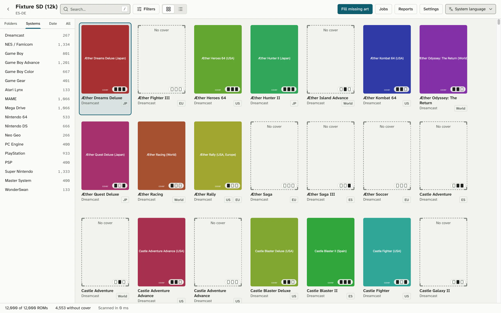

<p align="center">
  <a href="https://coverly-roms.maecly.com/en/"></a>
</p>

<h1 align="center">Every ROM gets its cover.</h1>

<p align="center">
  <b>Coverly ROMs</b> finds the ROMs on your handheld's SD card with no cover art and fills them in.<br>
  Dry run first, undo anytime. Windows, macOS and Linux.
</p>

<p align="center">
  <b>Free</b> · <b>No account</b> · <b>Open source</b>
</p>

<p align="center">
  <a href="https://coverly-roms.maecly.com/en/#download"></a>
</p>

<p align="center">
  <a href="https://github.com/MAECLY/coverly-roms/releases/latest"></a>
  <a href="https://github.com/MAECLY/coverly-roms/releases"></a>
  <a href="https://github.com/MAECLY/coverly-roms/stargazers"></a>
  <a href="https://github.com/MAECLY/coverly-roms/actions/workflows/ci.yml"></a>
  <a href="LICENSE"></a>
  <a href="docs/guide/layouts-and-systems.md#supported-systems"></a>
  <a href="#privacy-and-safety"></a>
</p>

<p align="center">
  <a href="https://coverly-roms.maecly.com/en/"><b>Website</b></a> ·
  <a href="#download">Download</a> ·
  <a href="https://coverly-roms.maecly.com/en/features/">Features</a> ·
  <a href="docs/guide/layouts-and-systems.md">Systems</a> ·
  <a href="docs/guide/faq.md">FAQ</a> ·
  <a href="https://coverly-roms.maecly.com/en/roadmap/">Roadmap</a> ·
  <b>English</b> · <a href="README.es.md">Español</a>
</p>

<p align="center">
  <a href="https://coverly-roms.maecly.com/en/">
    <picture>
      <source media="(prefers-color-scheme: dark)" srcset="docs/assets/shots/en/library-dark.webp">
      
    </picture>
  </a>
</p>

> [!NOTE]
> **Early days, said plainly.** v0.5.2 is the current release. Coverly ROMs has
> not been tested on real handhelds yet. The builds are not signed with an
> Apple or Microsoft certificate yet, so the first launch shows a warning (see
> [Download](#download)). If you try it on a handheld, an
> [issue](https://github.com/MAECLY/coverly-roms/issues) saying how it went
> helps a lot.

## What it does

- **Audits** a folder or SD card, read-only: every system, every ROM and which
  art each one has (cover, screenshot, title screen).
- **Fills the gaps in bulk**, matching each ROM by fingerprint or name.
  Confident matches go through; doubtful ones wait in a review queue.
- **Never overwrites** your art unless you ask, and keeps a copy first.
- **Organises loose ROMs** into one folder per system, in your firmware's
  layout, identifying them inside zip, 7z and other archives.
- **Gives each game its own folder** with its updates, DLC, mods, cheats and
  extras, with the "Coverly" layout.
- **Finds duplicates** by content, never by name, and sets them aside instead
  of deleting them.
- **Covers 133 systems** and 8 firmware and frontend layouts, from the Atari
  2600 to the PlayStation 5.
- **Comes with a command line**, `coverly`, built on the same engine as the app.

Coverly ROMs does not include ROMs, BIOS files or game art. Every feature is on
the [features page](https://coverly-roms.maecly.com/en/features/), and the long
version is in the [features guide](docs/guide/features.md).

## Quick start

1. **Open the folder or SD card.** Coverly recognises your firmware's or
   frontend's layout and shows every system with what it lacks.
2. **Rehearse the job first.** The dry run identifies each ROM, picks the image
   and shows the whole plan. Nothing is written until you press **Run**.
3. **Decide only the doubtful ones.** Each pick says why it was picked.
4. **Apply it, and undo it if you change your mind.** Undo puts the card back
   the way it was.

## Download

Download the file for your computer from the
[latest release](https://github.com/MAECLY/coverly-roms/releases/latest):

| System                                         | File                                                                                                                                                                             |
| ---------------------------------------------- | -------------------------------------------------------------------------------------------------------------------------------------------------------------------------------- |
| macOS 11 or later, Apple silicon (M1 or newer) | `Coverly-ROMs_<version>_mac_arm.dmg`                                                                                                                                             |
| macOS 11 or later, Intel                       | `Coverly-ROMs_<version>_mac_intel.dmg`                                                                                                                                           |
| Windows 10/11 (x64)                            | `Coverly-ROMs_<version>_windows_x64-setup.exe` (recommended); stable releases also `Coverly-ROMs_<version>_windows_x64.msi`                                                      |
| Windows 11 (ARM64)                             | `Coverly-ROMs_<version>_windows_arm-setup.exe` (recommended); stable releases may also have `Coverly-ROMs_<version>_windows_arm.msi`                                             |
| Linux x64                                      | `Coverly-ROMs_<version>_linux_x64.AppImage` or `Coverly-ROMs_<version>_linux_x64.deb`                                                                                            |
| Linux ARM64                                    | `Coverly-ROMs_<version>_linux_arm.AppImage` or `Coverly-ROMs_<version>_linux_arm.deb`                                                                                            |
| Command line                                   | `coverly_<version>_<system>` (`mac_arm`, `mac_intel`, `windows_x64.exe`, `windows_arm.exe`, `linux_x64`, `linux_arm`); once installed, `coverly update install` keeps it current |

Not sure which Mac you have? Apple menu → About This Mac:
"Chip" means Apple silicon, "Processor" means Intel. On a Windows ARM64 PC,
install the ARM64 build; a copy of the x64 build installed earlier keeps
working and updating as x64.

Check the file against `SHA256SUMS` from the same release, for example
`shasum -a 256 -c SHA256SUMS --ignore-missing` (macOS),
`sha256sum -c SHA256SUMS --ignore-missing` (Linux) or
`Get-FileHash <file>` (Windows PowerShell).

> [!WARNING]
> The builds are not signed with an Apple or Microsoft certificate yet, so macOS
> and Windows warn you the first time. Only follow these steps for a file you
> took from this repository's releases and checked against `SHA256SUMS`.
>
> <details>
> <summary><b>macOS says the app is damaged, or that Apple could not verify it.</b> It isn't.</summary>
>
> macOS quarantines apps without an Apple Developer ID. Move Coverly ROMs to
> Applications, then clear the flag once in Terminal (the quotes matter: the
> name has a space):
>
> ```bash
> xattr -rd com.apple.quarantine "/Applications/Coverly ROMs.app"
> ```
>
> That flag is the check that protects you from a tampered download. Instead of
> Terminal you can also try to open it once, then go to **System Settings →
> Privacy & Security**, scroll down and click **Open Anyway**. The `coverly`
> binary for macOS is quarantined the same way when a browser downloads it:
> `xattr -d com.apple.quarantine coverly_<version>_mac_arm` (or `_mac_intel`).
>
> </details>
>
> <details>
> <summary><b>Windows shows "Windows protected your PC".</b></summary>
>
> Choose **More info**, then **Run anyway**. If you see a **Security Warning**
> with **Publisher: Unknown Publisher** instead, choose **Run**. With Smart App
> Control turned on there is no **Run anyway**: it blocks unsigned apps, and
> turning it off may not be reversible without reinstalling Windows.
> Coverly ROMs needs Windows 10/11 (x64) or Windows 11 (ARM64). The
> `-setup.exe` installs for your user without administrator rights; the `.msi`
> installs for every user. Both use Microsoft Edge WebView2: Windows 11 has it,
> and on Windows 10 the installer downloads it if it is missing (that needs
> internet).
>
> </details>
>
> <details>
> <summary><b>Linux</b></summary>
>
> Mark the AppImage executable (`chmod +x`) if your file manager has not. The
> `.deb` depends on `libwebkit2gtk-4.1-0` and `libgtk-3-0`;
> `sudo apt install ./Coverly-ROMs_<version>_linux_x64.deb` (or
> `_linux_arm.deb`) pulls them in. Both are built on Ubuntu 22.04 for x64 and
> ARM64, so they need glibc 2.35 or newer (Ubuntu 22.04, Debian 12 or later).
>
> </details>

**Command line.** Rename the binary to `coverly` (`coverly.exe` on Windows),
make it executable (`chmod +x`) and put it on your `PATH`.

**Updates.** The app checks for updates on start (Settings → General; turn it
off and it requests nothing) and from Settings → About, and never restarts
while a fill job is running. The CLI: `coverly update check` and
`coverly update install`. Every update is verified with the project's minisign
key before it is installed; a download that fails the check is not installed.
There are stable and beta channels. To hear about new versions, use
**Watch → Custom → Releases** on GitHub or the
[releases feed](https://github.com/MAECLY/coverly-roms/releases.atom).

## Command line

`coverly` is the same engine as the app, for the terminal. Like the app, it
writes nothing unless you pass `--apply`.

```bash
coverly audit /Volumes/SD --missing-only --format csv --output report.csv
coverly fill /Volumes/SD                      # dry run: the plan, nothing written
coverly fill /Volumes/SD --apply --auto-only --system gba,snes --media cover
coverly organize ~/Downloads/roms             # dry run: a proposal by system
coverly dedupe /Volumes/SD                    # dry run: which copy stays, where the rest go
coverly undo                                  # undo the last job
```

Every command, flag and environment variable is in the
[command-line guide](docs/guide/command-line.md); `coverly <command> --help`
lists every option.

## Privacy and safety

- **No telemetry, no account.** The app only talks to the art sources you
  enable, to the services you set up in Settings → Integrations, to the Switch
  name catalogue if you turn it on and, unless you turn it off, to the update
  check. Each integration card says what it sends.
- **No console keys.** Coverly never reads, asks for, downloads or ships
  them; key and licence files on the card are left untouched.
- **Your keys stay in the OS keychain**, and nothing shows a saved key again.
- **The audit only reads.** Fill, organise and duplicates write nothing until
  you apply, never outside the library root, and every job can be undone.
- **Backups and job logs** go to the app's data folder, not to the SD card.

The full list, and what each service receives, is in
[integrations, privacy and safety](docs/guide/integrations.md).

## More

| Guide                                                       | What is in it                                                                         |
| ----------------------------------------------------------- | ------------------------------------------------------------------------------------- |
| [Features](docs/guide/features.md)                          | Every feature in detail, and how a fill job runs                                      |
| [Layouts, systems and art sources](docs/guide/layouts-and-systems.md) | The 8 layouts, all 133 systems with their folder aliases, and where the art comes from |
| [Integrations, privacy and safety](docs/guide/integrations.md) | SteamGridDB, ScreenScraper, the Switch name catalogue, and what is sent               |
| [Command line](docs/guide/command-line.md)                  | Every command, the useful flags and the environment variables                         |
| [Questions](docs/guide/faq.md)                              | FAQ, what it doesn't do yet, and how it compares with other tools                     |
| [Contributing and building](docs/guide/development.md)      | How to help, the stack, and building from source                                      |
| [Acknowledgements](docs/guide/credits.md)                   | Every source, database, library and font Coverly uses, with its licence               |

Contributions are welcome: read [CONTRIBUTING.md](CONTRIBUTING.md) first.
Security reports go through [SECURITY.md](SECURITY.md).

## Licence and trademarks

Coverly ROMs is free software, licensed under the
[GNU Affero General Public License v3.0 only](LICENSE) (`AGPL-3.0-only`).
Copyright © 2026 Miguel Angel Esparza Calero (MAECLY).

The name **Coverly ROMs**, its wordmark and its mark are trademarks of MAECLY
and are not licensed under the AGPL (section 7(e)); forks must use their own
name. See [TRADEMARKS.md](TRADEMARKS.md) and
[docs/09-legal/](docs/09-legal/license.md).

Game art is fetched from third-party sources at your request and belongs to
its owners; see [THIRD-PARTY-NOTICES.md](THIRD-PARTY-NOTICES.md). All other
product names mentioned are trademarks of their respective owners.

---

<p align="center">
  <sub>Made by Miguel Angel Esparza Calero · <a href="https://coverly-roms.maecly.com/en/">coverly-roms.maecly.com</a></sub>
</p>
