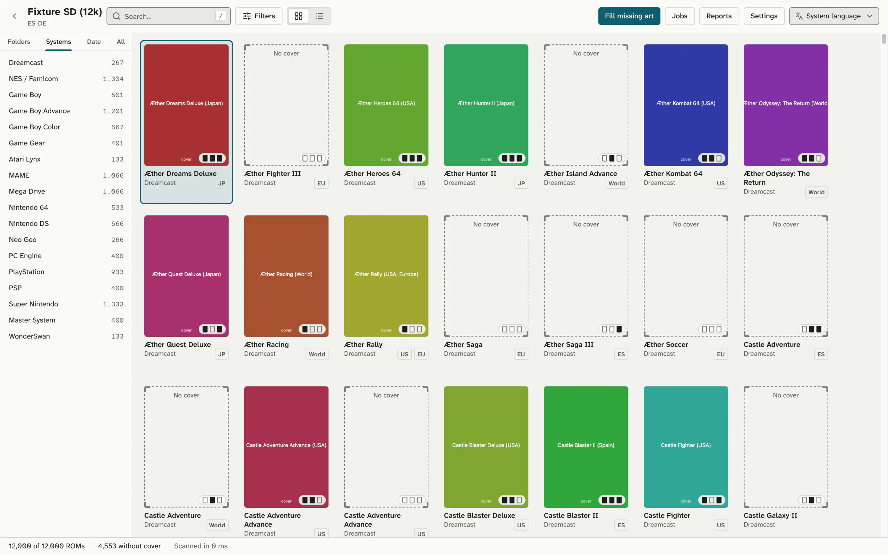
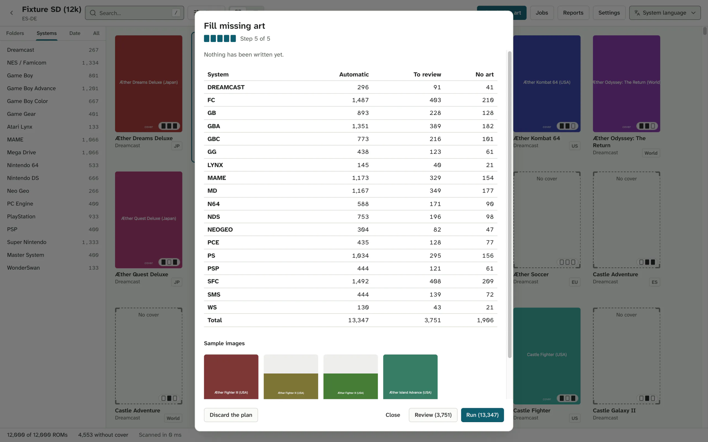
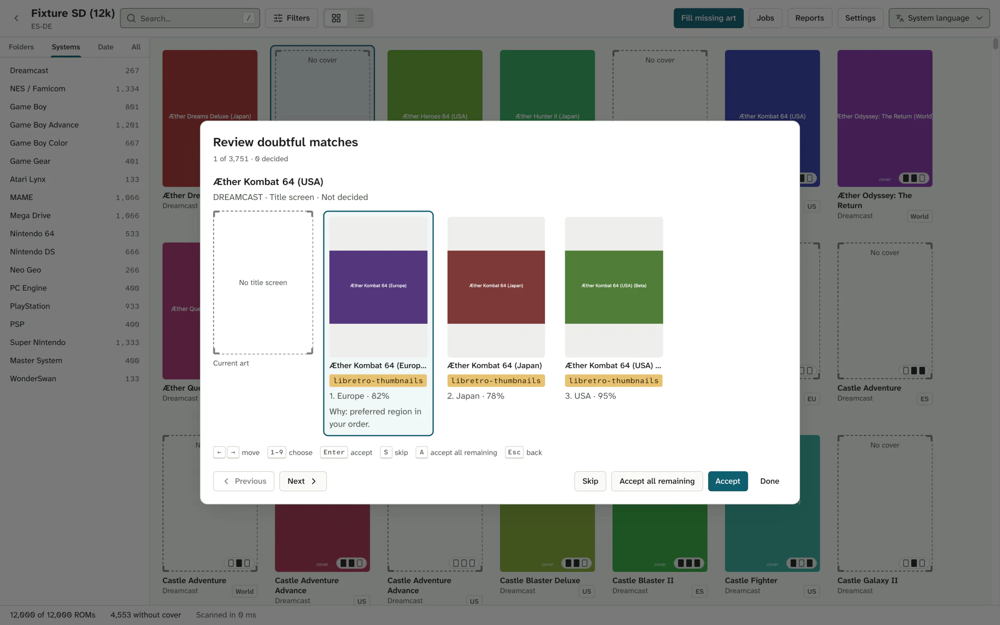

<p align="center">
  <a href="https://coverly-roms.maecly.com/en/"></a>
</p>

<h1 align="center">Every ROM gets its cover.</h1>

<p align="center">
  <b>Coverly ROMs</b> finds the ROMs on your handheld's SD card with no cover art and fills them in.<br>
  Dry run first, undo anytime. Windows, macOS and Linux.
</p>

<p align="center">
  <b>Free</b> · <b>No account</b> · <b>Open source</b>
</p>

<p align="center">
  <a href="https://coverly-roms.maecly.com/en/#download"></a>
</p>

<p align="center">
  <a href="https://github.com/MAECLY/coverly-roms/releases/latest"></a>
  <a href="https://github.com/MAECLY/coverly-roms/releases"></a>
  <a href="https://github.com/MAECLY/coverly-roms/stargazers"></a>
  <a href="https://hits.sh/github.com/MAECLY/coverly-roms/"></a>
  <a href="https://github.com/MAECLY/coverly-roms/commits/main"></a>
  <a href="https://github.com/MAECLY/coverly-roms/actions/workflows/ci.yml"></a>
  <a href="LICENSE"></a>
  <a href="#supported-systems"></a>
  <a href="#install"></a>
  <a href="README.es.md"></a>
  <a href="#privacy-and-safety"></a>
</p>

<p align="center">
  <a href="https://coverly-roms.maecly.com/en/"><b>Website</b></a> ·
  <a href="#install">Download</a> ·
  <a href="#how-it-works">How it works</a> ·
  <a href="#questions">FAQ</a> ·
  <a href="https://coverly-roms.maecly.com/features/">Features</a> ·
  <a href="https://coverly-roms.maecly.com/roadmap/">Roadmap</a> ·
  <a href="CONTRIBUTING.md">Contributing</a> ·
  <b>English</b> · <a href="README.es.md">Español</a>
</p>

<p align="center">
  <a href="https://coverly-roms.maecly.com/en/">
    <picture>
      <source media="(prefers-color-scheme: dark)" srcset="docs/assets/shots/en/library-dark.webp">
      
    </picture>
  </a>
</p>

> [!NOTE]
> **Early days, said plainly.** v0.3.0 is the current release. Coverly ROMs has
> not been tested on real handhelds yet. The builds are not signed with an
> Apple or Microsoft certificate yet, so the first launch shows a warning (see
> [Install](#install)). If you try it on a handheld, an
> [issue](https://github.com/MAECLY/coverly-roms/issues) saying how it went
> helps a lot.

---

## The problem

Stock firmware on many handhelds shows a blank tile when a game has no cover.
On a card with a few thousand ROMs, that is a lot of blank tiles. The tools
that fix it either run on Windows only, take some assembly, or work best with a
ScreenScraper account. Coverly ROMs is the safe option on all three desktop
systems: no account, a dry run before anything is written, and undo after.

Coverly ROMs does not include ROMs, BIOS files or game art.

## What it does

**Audit, read-only.** Open a folder or an SD card and Coverly lists every
system, every ROM (multi-file games such as `.cue`/`.bin`, `.m3u` and `.gdi`
count once) and which art each one has: cover, screenshot, title screen. Export
the report as CSV or JSON.

**Fill the gaps in bulk.** Each ROM is identified by its fingerprint (CRC32,
MD5 and SHA1 against libretro-database), or failing that by its name, with
arcade short names translated. When several images match, a strategy picks
one: **ROM region** (the default, region order `rom,world,usa,europe,japan`),
**Source priority** (your source order) or **Popularity** (SteamGridDB votes).
Confident matches go through on their own; doubtful ones wait in a review
queue. On Batocera and Knulli it also merges `gamelist.xml`, with a backup, and
undo restores it byte for byte.

**Never overwrites unless you ask.** By default only missing art is written.
If you choose to replace art (`--overwrite backup`), a copy is kept first in the
app's data folder, not on the card. Nothing is written outside the folder you
opened.

**Organise loose ROMs.** Pick a downloads folder full of zips and Coverly
proposes one folder per system, in the layout you choose (Anbernic stock by
default: `ROMS/GBA/`, `ROMS/GB/`, `ROMS/SFC/`…). Each file is identified by
catalogue CRC (zip entries included), then header magic, extension and name,
plus ScreenScraper by CRC when configured, and shows a confidence and a reason.
Archives are recognised by their contents, not their name, so a 7z saved as
`.zip` opens as a 7z: zip, 7z, RAR, tar, gzip, bzip2, xz, zstd, lz4 and single
compressed ROMs such as `game.gba.gz`. Disc games inside an archive (PlayStation,
Saturn, Dreamcast, Sega CD, PC Engine CD, Neo Geo CD) are identified from the
disc itself, serial included, and on apply their `.cue`/`.gdi` and tracks are
extracted into the system folder, each track checked against the archive.
A game you already have in the library, under any name or container, is set
aside instead of being copied in twice. Unfinished downloads, BIOS files, web
pages saved as `.zip` and damaged or multi-game archives stay where they are.
Nothing is clobbered, copies across drives are verified, and an interrupted job
can be resumed or undone.

**131 systems, from cartridges to current consoles.** From the Atari 2600 to
the PlayStation 5, each under the folder names the layouts use. Disc images and
archives are identified from what is inside them. GameCube, Wii, Wii U, 3DS,
Switch, PS Vita, PS3, PS4, PS5, Xbox, Xbox 360 and Xbox One games are recognised
from the plain header of their own format, reading a few kilobytes; nothing
encrypted is read, and Coverly never reads, asks for, downloads or ships
console keys. Switch names come from the title ID, without keys, through an
optional catalogue (blawar/titledb, MIT) that stays off until you turn it on in
Settings → Sources; with no network the file name is used, and a game whose
name cannot be read without keys is labelled "Encrypted" instead of guessed.
A game that is a folder (PS3, PS Vita, Wii U, PS4, Xbox…) moves as one item and
is never split, also from inside a zip or 7z, where it is recognised from the
listing without extracting. Loose multi-disc games are grouped into one set
with an `.m3u`, with a note when a disc is missing. Each item that writes 10 GB
or more asks first ("Yes / Yes to all / No"), with its size and the free space
left on the target.

**Find duplicates.** Coverly finds the same game stored more than once in a
system by its content, never by its name: the exact same data whatever the
name, container, copier header or compression (`Tetris.gb` and
`Tetris (1).zip`), and the same disc in another format by its serial
(`Crash Bash.bin` and `Crash Bash.PBP`). Other versions of a game (revisions,
regions, betas) are listed, and set aside only with "One ROM per game". For
each game it picks the copy that stays, with a reason ("Stays: it has your
save"), and you can pick another. The other copies are set aside in
`_Duplicados/` inside the library, keeping their folders, together with their
saves and art; or they go to the Trash if you prefer. Copies with different
saves are never touched. Updates and DLC are listed under their game, and the
same game stored twice under one title ID is found too, with the newer version
kept. Every job can be undone, and nothing is deleted.

**Browse the library.** Folder, system, date and flat views; filters for
missing art, system, extension and region; search; and a detail panel where you
can swap any slot's art by hand or search by title. Six ways to look at it, all
fast past 10,000 games: **Covers** (five sizes), **Details** (pick and resize
columns, thumbnails, compact rows), **Columns** (system → folder → game →
preview), **Gallery** (one game's art large, with a filmstrip), **Art slots**
(cover, title and screenshot side by side, so the gaps show) and **Shelves**
(one row per system). Switch with ⌘/Ctrl+1–6, resize covers with ⌘/Ctrl +/−,
group by system, folder, region, art status or first letter, type a name to
jump to it and press Space for a Quick look. Each library remembers its view.

**System icons.** Every system name in the app has its icon beside it: a plain
silhouette of the hardware (from RetroArch's Monochrome theme, CC BY 4.0), or
a short label where no neutral drawing exists.

**Jobs you control.** The fill wizard shows the whole plan before it runs.
Jobs can be paused, resumed, cancelled and undone.

**Settings.** General, Library, Organise, Duplicates, Profiles, Art, Matching,
Sources, Network, Safety, Advanced, Credits and About, in three groups. Common
options come first and the rest wait under _Advanced options_. Search with ⌘F
(Ctrl+F on Windows and Linux) and land on the setting. The Duplicates and
Organise screens open their own tab and come back with your choices kept.
Custom layout profiles have a live path preview. API keys are kept in the OS
keychain.

**Credits.** Settings → Credits lists every cover and metadata source,
database, technical reference, library and font Coverly uses, with its licence,
link and the credit it asks for, and shows the full third-party licence texts.
The same list is in [Acknowledgements](#acknowledgements) and
[THIRD-PARTY-NOTICES.md](THIRD-PARTY-NOTICES.md).

**Also:** a command-line tool, `coverly`; English and Spanish interface; light
and dark themes; in-app updates.

Every feature, one by one, is on the [features
page](https://coverly-roms.maecly.com/features/), and what comes next is on the
[roadmap](https://coverly-roms.maecly.com/roadmap/). Both pages go live with
the next update of the website.

## How it works

Four steps. The first two write nothing.

1. **Open the folder or SD card.** Coverly recognises your firmware's or
   frontend's layout and shows every system with what it lacks.
2. **Rehearse the job first.** The dry run identifies each ROM, picks the
   image and shows the whole plan. Nothing is written until you press **Run**
   (or pass `--apply`).
3. **Decide only the doubtful ones.** They wait in a queue you can clear from
   the keyboard, and each pick says why it was picked.
4. **Apply it, and undo it if you change your mind.** Images are written one at
   a time, never left half-written. Undo puts the card back the way it was.

<table>
  <tr>
    <td width="50%">
      <picture>
        <source media="(prefers-color-scheme: dark)" srcset="docs/assets/shots/en/fill-dark.webp">
        
      </picture>
    </td>
    <td width="50%">
      <picture>
        <source media="(prefers-color-scheme: dark)" srcset="docs/assets/shots/en/review-dark.webp">
        
      </picture>
    </td>
  </tr>
</table>

More detail: [fill pipeline](docs/04-architecture/fill-pipeline.md),
[identification](docs/04-architecture/identification.md),
[organise](docs/04-architecture/organize.md).

## Supported layouts

Eight firmware and frontend layouts, detected when you open the folder. You can
override the detection, and build a custom profile for any other firmware.

| ID               | Name                                 | ROMs folder | Art it writes                                                                                                 |
| ---------------- | ------------------------------------ | ----------- | ------------------------------------------------------------------------------------------------------------- |
| `anbernic-stock` | Anbernic stock                       | `ROMS`      | cover in `<SYS>/Imgs/<stem>.png`                                                                              |
| `garlicos`       | GarlicOS                             | `Roms`      | cover in `Imgs/`                                                                                              |
| `onion`          | Onion OS                             | `Roms`      | cover in `Imgs/`                                                                                              |
| `muos`           | muOS                                 | `ROMS`      | cover and screenshot in `MUOS/info/catalogue/<sys>/box` and `preview`                                         |
| `minui`          | MinUI / NextUI                       | `Roms`      | cover in `.media/`                                                                                            |
| `esde`           | ES-DE                                | `ROMs`      | cover, screenshot and title in `downloaded_media/<sys>/covers`, `screenshots` and `titlescreens`              |
| `batocera`       | Batocera / Knulli / EmulationStation | `roms`      | cover, screenshot and title as `images/<stem>-image`, `-screenshot` and `-titleshot.png`, plus `gamelist.xml` |
| `retroarch`      | RetroArch                            | `.`         | cover, screenshot and title in `thumbnails/<db>/Named_Boxarts`, `Named_Snaps` and `Named_Titles`              |

`coverly profiles` lists them, with your custom profiles.

## Supported systems

131 systems, each under the folder names the layouts use (`GBA`, `gba` and
`gameboyadvance` are the same system). Among them: Game Boy, Game Boy Color,
Game Boy Advance, NES/Famicom, Super Nintendo, Mega Drive, Master System, Game
Gear, PlayStation 1 to 5, PSP, PS Vita, Nintendo 64, GameCube, Wii, Wii U,
Nintendo DS, 3DS, Switch, Dreamcast, Saturn, Xbox, Xbox 360, Xbox One, Neo Geo,
CPS1–3, MAME, FinalBurn Neo, ZX Spectrum, Amstrad CPC, PICO-8, ScummVM and DOS.

<details>
<summary>All 131 systems and their folder aliases (<code>coverly systems</code>)</summary>

| ID                | Name                          | Folder aliases                                           |
| ----------------- | ----------------------------- | -------------------------------------------------------- |
| `a2600`           | Atari 2600                    | `A2600`, `atari2600`, `2600`                             |
| `a5200`           | Atari 5200                    | `A5200`, `atari5200`, `5200`                             |
| `a7800`           | Atari 7800                    | `A7800`, `atari7800`, `7800`                             |
| `a800`            | Atari 8-bit                   | `A800`, `atari800`, `atari8bit`                          |
| `amiga`           | Commodore Amiga               | `AMIGA`                                                  |
| `atarist`         | Atari ST                      | `ATARIST`, `atari st`                                    |
| `atomiswave`      | Atomiswave                    | `ATOMISWAVE`, `awave`                                    |
| `c64`             | Commodore 64                  | `C64`, `commodore64`                                     |
| `cps1`            | Capcom Play System            | `CPS1`                                                   |
| `cps2`            | Capcom Play System II         | `CPS2`                                                   |
| `cps3`            | Capcom Play System III        | `CPS3`                                                   |
| `dos`             | DOS                           | `DOS`, `msdos`                                           |
| `dreamcast`       | Sega Dreamcast                | `DREAMCAST`, `dc`                                        |
| `easyrpg`         | EasyRPG                       | `EASYRPG`, `rpgmaker`                                    |
| `fbneo`           | FinalBurn Neo                 | `FBNEO`, `fba`, `fbalpha`, `finalburn`                   |
| `nes`             | Nintendo Entertainment System | `FC`, `NES`, `famicom`                                   |
| `fds`             | Famicom Disk System           | `FDS`, `famicomdisk`                                     |
| `gb`              | Game Boy                      | `GB`, `gameboy`                                          |
| `gba`             | Game Boy Advance              | `GBA`, `gameboyadvance`                                  |
| `gbc`             | Game Boy Color                | `GBC`, `gameboycolor`                                    |
| `gamegear`        | Sega Game Gear                | `GG`, `gamegear`                                         |
| `gw`              | Game & Watch                  | `GW`, `gameandwatch`                                     |
| `hbmame`          | HBMAME                        | `HBMAME`                                                 |
| `lynx`            | Atari Lynx                    | `LYNX`, `atarilynx`                                      |
| `mame`            | MAME                          | `MAME`, `arcade`, `mame2003`, `mame2003plus`, `mame2010` |
| `megadrive`       | Sega Mega Drive / Genesis     | `MD`, `megadrive`, `genesis`, `Mega Drive`               |
| `segacd`          | Sega CD / Mega-CD             | `MDCD`, `segacd`, `megacd`, `Mega CD`                    |
| `msx`             | MSX                           | `MSX`, `msx1`                                            |
| `n64`             | Nintendo 64                   | `N64`, `nintendo64`                                      |
| `naomi`           | Sega NAOMI                    | `NAOMI`                                                  |
| `nds`             | Nintendo DS                   | `NDS`, `nintendods`, `dsi`, `nintendodsi`                |
| `neocd`           | Neo Geo CD                    | `NEOCD`, `neogeocd`                                      |
| `neogeo`          | Neo Geo                       | `NEOGEO`, `Neo Geo`                                      |
| `ngp`             | Neo Geo Pocket                | `NGP`, `neogeopocket`                                    |
| `ngpc`            | Neo Geo Pocket Color          | `NGPC`, `neogeopocketcolor`                              |
| `ons`             | ONScripter                    | `ONS`, `onscripter`                                      |
| `openbor`         | OpenBOR                       | `OPENBOR`                                                |
| `pcengine`        | PC Engine / TurboGrafx-16     | `PCE`, `pcengine`, `tg16`, `turbografx16`, `PC Engine`   |
| `pcenginecd`      | PC Engine CD / TurboGrafx-CD  | `PCECD`, `pcenginecd`, `tgcd`, `turbografxcd`            |
| `pgm2`            | IGS PGM2                      | `PGM2`                                                   |
| `pico8`           | PICO-8                        | `PICO`, `pico8`, `pico-8`                                |
| `pokemini`        | Pokemon Mini                  | `POKE`, `pokemini`                                       |
| `psx`             | Sony PlayStation              | `PS`, `psx`, `ps1`, `playstation`                        |
| `psp`             | Sony PSP                      | `PSP`                                                    |
| `saturn`          | Sega Saturn                   | `SATURN`, `segasaturn`                                   |
| `scummvm`         | ScummVM                       | `SCUMMVM`, `scumm`                                       |
| `sega32x`         | Sega 32X                      | `SEGA32X`, `32x`, `sega32`                               |
| `snes`            | Super Nintendo                | `SFC`, `snes`, `Super Nintendo`, `supernintendo`         |
| `mastersystem`    | Sega Master System            | `SMS`, `mastersystem`, `Master System`                   |
| `varcade`         | Arcade (various)              | `VARCADE`                                                |
| `virtualboy`      | Virtual Boy                   | `VB`, `virtualboy`                                       |
| `vic20`           | Commodore VIC-20              | `VIC20`, `vic-20`                                        |
| `wonderswan`      | WonderSwan                    | `WS`, `wonderswan`                                       |
| `wonderswancolor` | WonderSwan Color              | `WSC`, `wonderswancolor`                                 |
| `ps2`             | Sony PlayStation 2            | `PS2`, `playstation2`                                    |
| `3do`             | 3DO Interactive Multiplayer   | `3DO`, `3d0`                                             |
| `pcfx`            | NEC PC-FX                     | `PCFX`, `pc-fx`                                          |
| `cdi`             | Philips CD-i                  | `CDI`, `cdimono1`, `cd-i`                                |
| `amigacd32`       | Commodore Amiga CD32          | `CD32`, `amigacd32`                                      |
| `cdtv`            | Commodore CDTV                | `CDTV`, `amigacdtv`                                      |
| `jaguarcd`        | Atari Jaguar CD               | `JAGUARCD`, `atarijaguarcd`                              |
| `fmtowns`         | Fujitsu FM Towns              | `FMTOWNS`, `fm-towns`                                    |
| `colecovision`    | ColecoVision                  | `COLECO`, `colecovision`                                 |
| `intellivision`   | Mattel Intellivision          | `INTELLIVISION`, `intv`                                  |
| `vectrex`         | GCE Vectrex                   | `VECTREX`, `gcevectrex`                                  |
| `odyssey2`        | Magnavox Odyssey² / Videopac  | `ODYSSEY`, `odyssey2`, `videopac`, `o2em`                |
| `channelf`        | Fairchild Channel F           | `FAIRCHILD`, `channelf`                                  |
| `arcadia`         | Emerson Arcadia 2001          | `ARCADIA`, `arcadia2001`                                 |
| `scv`             | Epoch Super Cassette Vision   | `SCV`, `supercassettevision`                             |
| `jaguar`          | Atari Jaguar                  | `JAGUAR`, `atarijaguar`                                  |
| `sg1000`          | Sega SG-1000 / SC-3000        | `SEGASGONE`, `sg1000`, `sg-1000`, `sc3000`               |
| `pico`            | Sega Pico                     | `SEGAPICO`                                               |
| `supergrafx`      | PC Engine SuperGrafx          | `SGFX`, `supergrafx`                                     |
| `n64dd`           | Nintendo 64DD                 | `N64DD`, `64dd`                                          |
| `satellaview`     | Nintendo Satellaview          | `SATELLAVIEW`, `bsx`, `bs-x`                             |
| `sufami`          | Bandai Sufami Turbo           | `SUFAMI`, `sufamiturbo`                                  |
| `supervision`     | Watara Supervision            | `SUPERVISION`                                            |
| `gamecom`         | Tiger Game.com                | `GAMECOM`                                                |
| `megaduck`        | Mega Duck / Cougar Boy        | `MEGADUCK`, `cougarboy`                                  |
| `zxspectrum`      | Sinclair ZX Spectrum          | `ZXS`, `zxspectrum`, `spectrum`                          |
| `zx81`            | Sinclair ZX81                 | `ZX81`                                                   |
| `amstradcpc`      | Amstrad CPC                   | `CPC`, `amstradcpc`                                      |
| `bbcmicro`        | Acorn BBC Micro               | `BBCMICRO`, `bbc`                                        |
| `thomson`         | Thomson MO/TO                 | `THOMSON`, `moto`, `to8`, `thomsonmoto`, `theodore`      |
| `dragon`          | Dragon 32/64                  | `DRAGON`, `dragon32`, `dragon64`                         |
| `coco`            | Tandy TRS-80 Color Computer   | `COCO`, `trs80coco`                                      |
| `ti99`            | Texas Instruments TI-99/4A    | `TI99`, `ti994a`                                         |
| `x68000`          | Sharp X68000                  | `X68000`, `x68k`                                         |
| `x1`              | Sharp X1                      | `X1`                                                     |
| `pc98`            | NEC PC-98                     | `PC98`, `pc9800`                                         |
| `pc88`            | NEC PC-88                     | `PC88`, `pc8800`, `pc8000`                               |
| `plus4`           | Commodore Plus/4              | `PLUS4`, `cplus4`, `commodoreplus4`                      |
| `pet`             | Commodore PET                 | `PET`, `commodorepet`                                    |
| `c128`            | Commodore 128                 | `C128`, `commodore128`                                   |
| `atarixe`         | Atari XE / XEGS               | `ATARIXE`, `xegs`                                        |
| `msx2`            | MSX2                          | `MSX2`                                                   |
| `msxturbor`       | MSX turbo R                   | `MSXTURBOR`, `turbor`                                    |
| `apple2`          | Apple II                      | `APPLE2`, `appleii`                                      |
| `tic80`           | TIC-80                        | `TIC`, `tic80`                                           |
| `wasm4`           | WASM-4                        | `WASM4`                                                  |
| `arduboy`         | Arduboy                       | `ARDUBOY`                                                |
| `uzebox`          | Uzebox                        | `UZEBOX`                                                 |
| `lowresnx`        | LowRes NX                     | `LOWRESNX`                                               |
| `vircon32`        | Vircon32                      | `VIRCON32`                                               |
| `doom`            | Doom (PrBoom)                 | `PRBOOM`, `doom`                                         |
| `quake`           | Quake                         | `QUAKE`, `tyrquake`                                      |
| `cavestory`       | Cave Story (NXEngine)         | `CAVESTORY`, `nxengine`                                  |
| `wolf3d`          | Wolfenstein 3D (ECWolf)       | `ECWOLF`, `wolf3d`, `wolfenstein3d`                      |
| `mrboom`          | Mr. Boom                      | `MRBOOM`                                                 |
| `dinothawr`       | Dinothawr                     | `DINOTHAWR`                                              |
| `lutro`           | Lutro                         | `LUTRO`                                                  |
| `solarus`         | Solarus                       | `SOLARUS`                                                |
| `flashback`       | Flashback (REminiscence)      | `REMINISCENCE`, `flashback`                              |
| `xrick`           | Rick Dangerous (XRick)        | `XRICK`, `rickdangerous`                                 |
| `model2`          | Sega Model 2                  | `MODEL2`                                                 |
| `model3`          | Sega Model 3                  | `MODEL3`                                                 |
| `naomi2`          | Sega NAOMI 2                  | `NAOMI2`                                                 |
| `triforce`        | Namco Sega Nintendo Triforce  | `TRIFORCE`                                               |
| `gamecube`        | Nintendo GameCube             | `GAMECUBE`, `gc`, `ngc`, `gcn`                           |
| `wii`             | Nintendo Wii                  | `WII`                                                    |
| `3ds`             | Nintendo 3DS                  | `3DS`, `n3ds`, `nintendo3ds`                             |
| `wiiu`            | Nintendo Wii U                | `WIIU`                                                   |
| `switch`          | Nintendo Switch               | `SWITCH`, `nintendoswitch`, `nsw`                        |
| `psvita`          | Sony PlayStation Vita         | `PSVITA`, `vita`                                         |
| `ps3`             | Sony PlayStation 3            | `PS3`, `playstation3`                                    |
| `xbox`            | Microsoft Xbox                | `XBOX`                                                   |
| `xbox360`         | Microsoft Xbox 360            | `XBOX360`, `x360`                                        |
| `ps4`             | Sony PlayStation 4            | `PS4`, `playstation4`                                    |
| `ps5`             | Sony PlayStation 5            | `PS5`, `playstation5`                                    |
| `xboxone`         | Microsoft Xbox One            | `XBOXONE`, `xb1`                                         |
| `xboxseries`      | Microsoft Xbox Series X\|S    | `XBOXSERIES`, `xsx`, `xboxseriesx`                       |

</details>

## Art sources

- **[libretro-thumbnails](https://github.com/libretro-thumbnails/libretro-thumbnails)**
  (`thumbnails.libretro.com`): the default. No account.
- **[SteamGridDB](https://www.steamgriddb.com/)**: optional, with your own API
  key. Its community votes feed the Popularity strategy. In the app the key is
  kept in the OS keychain; the CLI reads it from `COVERLY_SGDB_KEY`.
- **ScreenScraper**: planned for a later version, not available as an art
  source yet. Today it is only used to identify files when organising, when it
  is configured.
- **Identification data** comes from
  [libretro-database](https://github.com/libretro/libretro-database),
  downloaded at runtime, not bundled.

More detail: [docs/04-architecture/art-sources.md](docs/04-architecture/art-sources.md).

## Install

Download the file for your computer from the
[latest release](https://github.com/MAECLY/coverly-roms/releases/latest):

| System                                         | File                                                                                                                                                                             |
| ---------------------------------------------- | -------------------------------------------------------------------------------------------------------------------------------------------------------------------------------- |
| macOS 11 or later, Apple silicon (M1 or newer) | `Coverly-ROMs_<version>_mac_arm.dmg`                                                                                                                                             |
| macOS 11 or later, Intel                       | `Coverly-ROMs_<version>_mac_intel.dmg`                                                                                                                                           |
| Windows 10/11 (x64)                            | `Coverly-ROMs_<version>_windows_x64-setup.exe` (recommended); stable releases also `Coverly-ROMs_<version>_windows_x64.msi`                                                      |
| Windows 11 (ARM64)                             | `Coverly-ROMs_<version>_windows_arm-setup.exe` (recommended); stable releases may also have `Coverly-ROMs_<version>_windows_arm.msi`                                             |
| Linux x64                                      | `Coverly-ROMs_<version>_linux_x64.AppImage` or `Coverly-ROMs_<version>_linux_x64.deb`                                                                                            |
| Linux ARM64                                    | `Coverly-ROMs_<version>_linux_arm.AppImage` or `Coverly-ROMs_<version>_linux_arm.deb`                                                                                            |
| Command line                                   | `coverly_<version>_<system>` (`mac_arm`, `mac_intel`, `windows_x64.exe`, `windows_arm.exe`, `linux_x64`, `linux_arm`); once installed, `coverly update install` keeps it current |

Not sure which Mac you have? Apple menu → About This Mac:
"Chip" means Apple silicon, "Processor" means Intel. On a Windows ARM64 PC,
install the ARM64 build; a copy of the x64 build installed earlier keeps
working and updating as x64.

Check the file against `SHA256SUMS` from the same release, for example
`shasum -a 256 -c SHA256SUMS --ignore-missing` (macOS),
`sha256sum -c SHA256SUMS --ignore-missing` (Linux) or
`Get-FileHash <file>` (Windows PowerShell).

> [!WARNING]
> The builds are not signed with an Apple or Microsoft certificate yet, so macOS
> and Windows warn you the first time. Only follow these steps for a file you
> took from this repository's releases and checked against `SHA256SUMS`.
>
> <details>
> <summary><b>macOS says the app is damaged, or that Apple could not verify it.</b> It isn't.</summary>
>
> macOS quarantines apps without an Apple Developer ID. Move Coverly ROMs to
> Applications, then clear the flag once in Terminal (the quotes matter: the
> name has a space):
>
> ```bash
> xattr -rd com.apple.quarantine "/Applications/Coverly ROMs.app"
> ```
>
> That flag is the check that protects you from a tampered download. Instead of
> Terminal you can also try to open it once, then go to **System Settings →
> Privacy & Security**, scroll down and click **Open Anyway**. The `coverly`
> binary for macOS is quarantined the same way when a browser downloads it:
> `xattr -d com.apple.quarantine coverly_<version>_mac_arm` (or `_mac_intel`).
>
> </details>
>
> <details>
> <summary><b>Windows shows "Windows protected your PC".</b></summary>
>
> Choose **More info**, then **Run anyway**. If you see a **Security Warning**
> with **Publisher: Unknown Publisher** instead, choose **Run**. With Smart App
> Control turned on there is no **Run anyway**: it blocks unsigned apps, and
> turning it off may not be reversible without reinstalling Windows.
> Coverly ROMs needs Windows 10/11 (x64) or Windows 11 (ARM64). The
> `-setup.exe` installs for your user without administrator rights; the `.msi`
> installs for every user. Both use Microsoft Edge WebView2: Windows 11 has it,
> and on Windows 10 the installer downloads it if it is missing (that needs
> internet).
>
> </details>
>
> <details>
> <summary><b>Linux</b></summary>
>
> Mark the AppImage executable (`chmod +x`) if your file manager has not. The
> `.deb` depends on `libwebkit2gtk-4.1-0` and `libgtk-3-0`;
> `sudo apt install ./Coverly-ROMs_<version>_linux_x64.deb` (or
> `_linux_arm.deb`) pulls them in. Both are built on Ubuntu 22.04 for x64 and
> ARM64, so they need glibc 2.35 or newer (Ubuntu 22.04, Debian 12 or later).
>
> </details>

**Command line.** Rename the binary to `coverly` (`coverly.exe` on Windows),
make it executable (`chmod +x`) and put it on your `PATH`.

**Watch for releases.** On GitHub, **Watch → Custom → Releases**, or follow the
[releases feed](https://github.com/MAECLY/coverly-roms/releases.atom).

## Updates

The app checks for updates on start (Settings → General; turn it
off and it requests nothing) and from Settings → About, and never restarts
while a fill job is running. The CLI: `coverly update check` and
`coverly update install`. Every update is verified with the project's minisign
key before it is installed; a download that fails the check is not installed.
There are stable and beta channels.

## Command line

`coverly` is the same engine as the app, for the terminal. Like the app, it
writes nothing unless you pass `--apply`.

| Command    | What it does                                                                    |
| ---------- | ------------------------------------------------------------------------------- |
| `audit`    | Report which ROMs of a library lack cover, screenshot or title art (read-only)  |
| `catalog`  | Manage the optional Switch name catalogue (`switch status`, `update`, `remove`) |
| `fill`     | Fill missing art from the enabled sources (dry run unless --apply)              |
| `organize` | Sort a pile of loose ROMs into one folder per system (dry run unless --apply)   |
| `dedupe`   | Find the same game stored twice in a system and set the copies aside (dry run)  |
| `profiles` | List the built-in and custom layout profiles                                    |
| `systems`  | List the known systems and their folder aliases                                 |
| `undo`     | Undo the last job (fill, organise or duplicates), or the one given with --job   |
| `update`   | Check for a newer coverly, or install it (verified with minisign)               |

```bash
coverly audit /Volumes/SD --missing-only --format csv --output report.csv
coverly fill /Volumes/SD                      # dry run: the plan, nothing written
coverly fill /Volumes/SD --apply --auto-only --system gba,snes --media cover
coverly fill /Volumes/SD --sources libretro,steamgriddb --strategy popularity
coverly organize ~/Downloads/roms             # dry run: a proposal by system
coverly organize ~/Downloads/roms --target /Volumes/SD --copy --apply
coverly dedupe /Volumes/SD                    # dry run: which copy stays, where the rest go
coverly dedupe /Volumes/SD --apply            # set them aside in /Volumes/SD/_Duplicados
coverly dedupe /Volumes/SD --apply --trash    # or send them to the Trash
coverly catalog switch update                 # download the optional Switch name catalogue
coverly undo --list
coverly undo                                  # undo the last job
```

<details>
<summary>Useful flags</summary>

**`fill`:** `--profile ID|auto`, `--regions rom,world,usa,europe,japan`,
`--match hash-then-name|hash-only|name-only`, `--scope missing|all` (`all`
needs `--overwrite backup`), `--concurrency 1-6`, `--refresh` (ignore cached
candidates and indexes), `--report table|json`, `--output FILE`.

**`organize`:** `--layout PROFILE_ID`, `--target DIR`, `--flat`,
`--copy`/`--move`, `--names keep|catalogue`, `--assign FILE=SYSTEM_ID`
(repeatable), `--resume JOB_ID`, `--include-review`, `--offline`,
`--no-external-tools` (do not use unrar, 7-Zip or bsdtar),
`--duplicates set-aside|report|off` (copies already in the library),
`--yes-large` (confirm an apply that writes 10 GB or more), `--skip-large`
(leave those items where they are).

**`catalog switch`:** `status`, `update`, `remove`, `--data-dir DIR`.

**`dedupe`:** `--system gb,psx`, `--level exact,format,version`,
`--one-game-one-rom`, `--keep PATH` (this copy stays; repeatable),
`--keep-rules has_save,verified,…`, `--reset-choices`, `--quarantine DIR`,
`--trash`, `--resume JOB_ID`, `--offline`, `--no-external-tools`,
`--report table|json`, `--output FILE`.

**`undo`:** `--list`, `--job ID`, `--include-later` (with `--job`: also undo
the newer jobs that touched the same folder, newest first).

**Environment:** `COVERLY_SGDB_KEY` (SteamGridDB key; the CLI has no keychain),
`COVERLY_SS_USER` and `COVERLY_SS_PASSWORD` (ScreenScraper account, used by
`organize`).

`coverly <command> --help` lists every option.

</details>

## Privacy and safety

- **No telemetry, no account.** The app only talks to the art sources you
  enable, to the Switch name catalogue if you turn it on and, unless you turn
  it off, to the update check.
- **No console keys.** Coverly never reads, asks for, downloads or ships
  them; key and licence files on the card are left untouched.
- **Images are re-encoded** before they are written, so they carry no metadata.
- **Your SteamGridDB key stays in the OS keychain** and is sent only to
  SteamGridDB, as an `Authorization: Bearer` header.
- **The audit only reads.** Fill, organise and duplicates write nothing until
  you apply, never outside the library root, and every job can be undone.
  Duplicates are moved aside or to the Trash, never deleted.
- **Backups and job logs** go to the app's data folder, not to the SD card.
- **No ROMs, BIOS files or game art** ship with Coverly ROMs.

## What it doesn't do yet

- ScreenScraper as an art source: planned, not available yet.
- Videos, mixed images, marquees or wheels.
- Editing metadata, renaming or verifying ROMs.
- Running on the handheld itself.
- It has not been tested on real handhelds yet.
- The builds are not signed with an Apple or Microsoft certificate yet.

## Compared with other tools

Skraper, Skyscraper and ARRM use ScreenScraper and bring videos, mixed images
and metadata; Coverly ROMs only fills images. Mini Scraper also works without
an account and already has releases out. Where Coverly ROMs differs: a native
build for macOS (Apple silicon and Intel), Windows and Linux (x64 and ARM64),
the Anbernic `Imgs/` layout built in, no account, and a dry run and undo for
every job. The [comparison on the website](https://coverly-roms.maecly.com/en/#compare)
lists each tool's sources.

## Questions

<details>
<summary><b>Is it free?</b></summary>

Yes. It costs nothing, needs no account and has no paid tier. The code is
AGPL-3.0.

</details>

<details>
<summary><b>Does it come with ROMs or cover art?</b></summary>

No. Coverly ROMs bundles no ROMs, BIOS files or game art. Images are downloaded
from libretro-thumbnails and, if you add your own key, SteamGridDB. Every image
belongs to its owners.

</details>

<details>
<summary><b>Does it need console keys?</b></summary>

No. Every system is identified from what is readable without keys: plain
headers, file tables, the title ID and the file name. A Switch or 3DS game
whose name cannot be read that way is labelled "Encrypted". Files such as
`prod.keys` or `title.keys` are never opened or moved.

</details>

<details>
<summary><b>Will it overwrite my covers?</b></summary>

Not unless you ask it to. By default it only fills what is missing. If you
choose to replace art, it first keeps a copy in the app's data folder, not on
the card, and Undo puts it back.

</details>

<details>
<summary><b>Do I need an account?</b></summary>

No. libretro-thumbnails works without one. SteamGridDB is optional and uses
your own key, kept in your system keychain.

</details>

<details>
<summary><b>Can it open 7z and RAR archives?</b></summary>

Yes. Zip, 7z, tar, gzip, bzip2, xz, zstd and lz4 open with nothing else
installed. RAR needs a program that is already on many computers, because the
official RAR code cannot ship in a free program: `unrar`, 7-Zip (`7zz` or `7z`)
or `bsdtar`, which macOS already includes (`/usr/bin/bsdtar`). On Windows,
7-Zip or WinRAR in their usual folders are found; on Linux, install `unrar`,
`7zip` or `libarchive-tools`. Without one, a RAR stays where it is with the note
"To open RAR archives, install unrar" and the rest is organised. Settings →
Organise → _Advanced options_ → _External programs for RAR_ shows what was
found and can turn them off.

Disc games are extracted, because handhelds load `.cue`/`.gdi` and tracks, not
archives. Cartridge ROMs in a zip or 7z are moved as they are when the layout
loads them; other containers are extracted. In move mode the archive goes to
the Trash only after every file has been verified, and only when nothing else
is left in it (a save file inside keeps the archive). Undo removes what was
extracted and brings the archive back from the Trash.

</details>

<details>
<summary><b>Which handhelds does it work with?</b></summary>

Any that uses the Anbernic stock, GarlicOS, Onion OS, MinUI and NextUI, muOS,
ES-DE, Batocera, Knulli and EmulationStation, or RetroArch layout. For other
firmware you can build your own layout with a live preview. It has not been
tested on real handhelds yet.

</details>

<details>
<summary><b>Why do Gatekeeper and SmartScreen warn me?</b></summary>

Because the downloads carry no Apple or Microsoft certificate yet. The first
time, on macOS clear the quarantine flag or click **Open Anyway**; on Windows,
choose **More info**, then **Run anyway**. Only do it for files from this
project's releases. The steps are under [Install](#install).

</details>

<details>
<summary><b>Does it send data anywhere?</b></summary>

There is no telemetry. The app only talks to the art sources and, unless you
turn it off, to the update check at startup. Images are re-encoded, so they
carry no metadata.

</details>

<details>
<summary><b>How does it update?</b></summary>

From inside the app, with GitHub Releases builds verified with minisign before
they install. There are stable and beta channels, and it never restarts in the
middle of a job. The command line uses `coverly update`.

</details>

## Help make it better

- **Try it on a real handheld** and [open an issue](https://github.com/MAECLY/coverly-roms/issues)
  saying which firmware, which layout was detected and how the fill went.
- **Add a layout profile or a folder alias** your firmware uses.
- **Improve a translation** in [`locales/en/ui.json`](locales/en/ui.json) or
  [`locales/es/ui.json`](locales/es/ui.json).

Read [CONTRIBUTING.md](CONTRIBUTING.md) first. In short: contributions are made
under the [Contributor License Agreement](CLA.md); `make check` runs everything
CI runs; commits follow [Conventional Commits](https://www.conventionalcommits.org/),
checked by commitlint; new behaviour in `coverly-core` comes with its test
first; and the repository never takes ROMs or game art. Security reports go
through [SECURITY.md](SECURITY.md) (a private GitHub advisory, or
`security@maecly.com`).

## For developers

<details>
<summary>Stack, layout and building from source</summary>

**Stack.** Tauri 2 · Rust · React + TypeScript + Vite + Tailwind.

| Path                  | What it holds                                                      |
| --------------------- | ------------------------------------------------------------------ |
| `crates/coverly-core` | Scanning, identification, sources, fill, organise, undo (no Tauri) |
| `crates/coverly-cli`  | The `coverly` command-line tool                                    |
| `src-tauri`           | The desktop shell and its commands                                 |
| `src`                 | The React interface                                                |

**Prerequisites:** [Rust](https://rustup.rs/) 1.93 or newer,
[Node.js](https://nodejs.org/) 22.22.2 or newer with [pnpm](https://pnpm.io/), and
the [Tauri 2 system dependencies](https://v2.tauri.app/start/prerequisites/)
for your OS. `make doctor` shows which ones are installed.

```sh
make install                                   # install JS and Rust dependencies
make dev                                       # run the desktop app in development
make web                                       # only the UI, in a browser, with a mock backend
make example                                   # build a small example library and audit it
make example-fill                              # plan filling its covers (dry run)
make audit ROOT=<path>                         # audit a library from the terminal
make check                                     # lint, format check and all tests
```

Also: `make build` (an unsigned release bundle), `make cli ARGS="systems"`
(run the CLI), `make fill ROOT=<path>` (plan a fill, dry run).

`make help` lists every target. The example library lives in `target/example`
(`make example-apply`, `make example-undo`, `make example-clean`).

The landing page at [coverly-roms.maecly.com](https://coverly-roms.maecly.com)
lives in its own repository, [MAECLY/coverly-roms-landing](https://github.com/MAECLY/coverly-roms-landing),
which explains how to preview, check and publish it.

**Docs.** [docs/README.md](docs/README.md) is the index. Architecture in
[docs/04-architecture/](docs/04-architecture/system-architecture.md), decisions
in [docs/adr/](docs/adr/README.md), the release process in
[RELEASING.md](RELEASING.md) and the history in [CHANGELOG.md](CHANGELOG.md).

</details>

## Acknowledgements

<!-- credits:start -->
<!-- Generated from credits/credits.json by `pnpm credits:readme`; do not edit by hand. -->

Coverly builds on the work of these projects. Here is what it uses from each, its licence and the credit it asks for.

### Cover and metadata sources

- [libretro-thumbnails](https://github.com/libretro-thumbnails/libretro-thumbnails). Covers, screenshots, title screens and logos, looked up by name. Licence: No licence declared; the art belongs to its owners.

  > Covers and screenshots: libretro-thumbnails. Screenshots via MobyGames, Fandom and volunteer contributions. The art belongs to each game's developers and publishers.

- [SteamGridDB](https://www.steamgriddb.com/). Courtesy credit. Community-made vertical covers, with your own API key. Licence: SteamGridDB terms (not verified).
- [ScreenScraper](https://www.screenscraper.fr/). Media and hash identification in Organise, with your account. Licence: [CC BY-NC-SA 4.0](https://creativecommons.org/licenses/by-nc-sa/4.0/).

  > Data and media from ScreenScraper (screenscraper.fr), CC BY-NC-SA 4.0.

- Art inside the games. Icons and art inside the game files themselves (SMDH, NACP, ICON0…), read locally. Licence: © each game's owners.
- Nintendo eShop icons. Switch game icons, only if you turn them on; kept in your local cache and never redistributed. Licence: © Nintendo.

  > Switch game icons © Nintendo, downloaded only if you turn them on and kept only on your computer.

### Databases and DATs

- [titledb](https://github.com/blawar/titledb). Switch game names, publisher and release date by title ID; an optional on-demand download. Licence: [MIT](https://github.com/blawar/titledb/blob/master/LICENSE).

  > Switch title names: blawar/titledb (MIT, © 2019 Blake Warner); game names and artwork © their respective owners.

- [nlib (api.nlib.cc)](https://github.com/ghost-land/nlib-api). Optional fallback for Switch names, only if you turn it on; Coverly ships none of its code. Licence: GPL-3.0.
- [libretro-database](https://github.com/libretro/libretro-database). Identifies ROMs by hash, serial or arcade short name, and gives the catalogue name; downloaded to your cache. Licence: [CC BY-SA 4.0](https://creativecommons.org/licenses/by-sa/4.0/).

  > Identification data: libretro-database, © libretro contributors, CC BY-SA 4.0.

- [GameTDB](https://www.gametdb.com/). The GameCube, Wii, Wii U and PS3 IDs that libretro-database carries. Licence: Permission in its FAQ.

  > Game data from GameTDB (https://www.gametdb.com/), where you can add new game entries and artwork.

- [No-Intro](https://no-intro.org/). Courtesy credit. Cartridge DATs and the file-name conventions, through libretro-database. Licence: DAT-o-MATIC terms (not verified).
- [Redump](https://redump.org/). Courtesy credit. Disc DATs and the track and CUE sheet conventions, through libretro-database. Licence: Redump terms (not verified).
- [TOSEC](https://www.tosecdev.org/). Courtesy credit. Classic computer DATs and their naming conventions, through libretro-database. Licence: TOSEC terms (not verified).
- MAME. Courtesy credit. Arcade short names and DATs from the MAME emulator, through libretro-database. Licence: DAT licence not verified.
- FinalBurn Neo. Courtesy credit. Arcade DATs from the FinalBurn Neo emulator, through libretro-database. Licence: Own licence (not verified).

### Technical docs and wikis

- [Switchbrew](https://switchbrew.org/). Courtesy credit. Documentation of Switch formats (NCA, NRO, CNMT, XCI, tickets). Licence: Wiki content (licence not verified).
- [WiiBrew](https://wiibrew.org/). Courtesy credit. Documentation of Wii formats (discs, DOL, WAD, TMD). Licence: Wiki content (licence not verified).
- [WiiUBrew](https://wiiubrew.org/). Courtesy credit. Documentation of Wii U formats (TMD, RPX/RPL, meta.xml) and its title database. Licence: Wiki content (licence not verified).
- [3dbrew](https://www.3dbrew.org/). Courtesy credit. Documentation of 3DS formats (NCCH, CIA, SMDH, TMD) and its title list. Licence: Wiki content (licence not verified).
- [DSiBrew](https://dsibrew.org/). Courtesy credit. Documentation of the DSi title list. Licence: Wiki content (licence not verified).
- [XboxDevWiki](https://xboxdevwiki.net/). Courtesy credit. Documentation of the original Xbox XBE format. Licence: Wiki content (licence not verified).
- [PSDevWiki](https://www.psdevwiki.com/). Courtesy credit. Documentation of PlayStation formats (SFO, PKG, SELF, PBP, SYSTEM.CNF). Licence: Wiki content (licence not verified).
- Dolphin. Courtesy credit. Source code of the emulator, read to understand the Wii and GameCube formats. Licence: Licence not verified.
- PPSSPP. Courtesy credit. Source code of the emulator, read to understand the PSP formats. Licence: Licence not verified.
- RPCS3. Courtesy credit. Source code of the emulator, read to understand the PS3 formats. Licence: [GPL-2.0](https://spdx.org/licenses/GPL-2.0-only.html).
- Vita3K. Courtesy credit. Source code of the emulator, read to understand the PS Vita formats. Licence: [MIT](https://spdx.org/licenses/MIT.html).
- Cemu. Courtesy credit. Source code of the emulator, read to understand the Wii U formats. Licence: [MPL-2.0](https://spdx.org/licenses/MPL-2.0.html).
- Xenia. Courtesy credit. Source code of the emulator, read to understand the Xbox 360 formats. Licence: Licence not verified.
- xemu. Courtesy credit. Source code of the emulator, read to understand the Xbox formats. Licence: Licence not verified.
- Azahar. Courtesy credit. Source code of the emulator, read to understand the 3DS formats. Licence: GPL-3.0.
- DuckStation. Courtesy credit. Source code of the emulator, read to understand the PlayStation formats. Licence: Licence not verified.
- shadPS4. Courtesy credit. Source code of the emulator, read to understand the PS4 formats. Licence: Licence not verified.
- Cxbx-Reloaded. Courtesy credit. Source code of the emulator, read to understand the Xbox formats. Licence: Licence not verified.
- decaf-emu. Courtesy credit. Source code of the emulator, read to understand the Wii U formats. Licence: Licence not verified.

### Frontend and firmware conventions

- [ES-DE](https://es-de.org/). Courtesy credit. System and media folder names Coverly follows when it organizes. Licence: Licence not verified.
- [Batocera](https://batocera.org/). Courtesy credit. System and media folder names Coverly follows when it organizes. Licence: Licence not verified.
- [muOS](https://muos.dev/). Courtesy credit. System and media folder names Coverly follows when it organizes. Licence: Licence not verified.
- [Knulli](https://knulli.org/). Courtesy credit. System and media folder names Coverly follows when it organizes. Licence: Licence not verified.
- RetroBat. Courtesy credit. System and media folder names Coverly follows when it organizes. Licence: Licence not verified.
- [Onion](https://onionui.github.io/). Courtesy credit. System and media folder names Coverly follows when it organizes. Licence: Licence not verified.
- [ROCKNIX](https://rocknix.org/). Courtesy credit. System and media folder names Coverly follows when it organizes. Licence: Licence not verified.

### Libraries

- [Tauri](https://tauri.app/). The desktop app's base: window, dialogs, links and updates. Licence: Apache-2.0 OR MIT.
- [React](https://react.dev/). The interface engine. Licence: [MIT](https://spdx.org/licenses/MIT.html).
- [zustand](https://github.com/pmndrs/zustand). The interface state. Licence: [MIT](https://spdx.org/licenses/MIT.html).
- [Radix UI](https://www.radix-ui.com/primitives). Accessible components: dialogs, menus, tabs. Licence: [MIT](https://spdx.org/licenses/MIT.html).
- [shadcn/ui](https://ui.shadcn.com/). The base of the interface components. Licence: [MIT](https://spdx.org/licenses/MIT.html).
- [Tailwind CSS](https://tailwindcss.com/). Generates the interface styles. Licence: [MIT](https://spdx.org/licenses/MIT.html).
- [TanStack Virtual](https://tanstack.com/virtual). Long lists that stay smooth. Licence: [MIT](https://spdx.org/licenses/MIT.html).
- [sonner](https://sonner.emilkowal.ski/). The toast notifications. Licence: [MIT](https://spdx.org/licenses/MIT.html).
- [class-variance-authority](https://github.com/joe-bell/cva). The components' style variants. Licence: [Apache-2.0](https://spdx.org/licenses/Apache-2.0.html).
- [SQLite](https://sqlite.org/). The cache and the local database. Licence: Public domain.
- [rusqlite](https://github.com/rusqlite/rusqlite). SQLite access from Rust. Licence: [MIT](https://spdx.org/licenses/MIT.html).
- [ureq](https://github.com/algesten/ureq). The network requests. Licence: MIT OR Apache-2.0.
- [rustls](https://github.com/rustls/rustls). The HTTPS connections. Licence: Apache-2.0 OR ISC OR MIT.
- [serde](https://serde.rs/). Reads and writes settings and data. Licence: MIT OR Apache-2.0.
- [zip](https://github.com/zip-rs/zip2). Reads and extracts zip archives. Licence: [MIT](https://spdx.org/licenses/MIT.html).
- [sevenz-rust2](https://github.com/hasenbanck/sevenz-rust2). Reads and extracts 7z archives. Licence: [Apache-2.0](https://spdx.org/licenses/Apache-2.0.html).
- [image](https://github.com/image-rs/image). Decodes and resizes images. Licence: MIT OR Apache-2.0.

### Fonts and icons

- [RetroArch Assets](https://github.com/libretro/retroarch-assets). System silhouettes (XMB Monochrome theme), adapted. Licence: [CC BY 4.0](https://creativecommons.org/licenses/by/4.0/).

  > System icons adapted from RetroArch Assets (XMB Monochrome theme), © libretro contributors. CC BY 4.0 (https://creativecommons.org/licenses/by/4.0/), without warranties. Original: https://github.com/libretro/retroarch-assets. Changes: recoloured, optimised with SVGO and cropped.

- [Lucide](https://lucide.dev/). The interface icons. Licence: [ISC](https://spdx.org/licenses/ISC.html).

  > Copyright (c) 2026 Lucide Icons and Contributors. Copyright (c) 2013-present Cole Bemis.

- [Archivo](https://github.com/Omnibus-Type/Archivo). The heading typeface. Licence: [SIL OFL 1.1](https://openfontlicense.org/).

  > Copyright 2020 The Archivo Project Authors. SIL Open Font License 1.1.

- [Atkinson Hyperlegible Next](https://github.com/googlefonts/atkinson-hyperlegible-next). The body typeface. Licence: [SIL OFL 1.1](https://openfontlicense.org/).

  > Copyright 2020-2024 The Atkinson Hyperlegible Next Project Authors. SIL Open Font License 1.1.

- [Atkinson Hyperlegible Mono](https://github.com/googlefonts/atkinson-hyperlegible-next-mono). The monospaced typeface for numbers and paths. Licence: [SIL OFL 1.1](https://openfontlicense.org/).

  > Copyright 2020-2024 The Atkinson Hyperlegible Mono Project Authors. SIL Open Font License 1.1.

Coverly ships no ROMs, BIOS files, keys or game art.
The licences of every Rust crate and npm package in the build are in `LICENSES/generated/`, and the app shows them in Settings → Credits.
<!-- credits:end -->

Game art belongs to its owners. Full list:
[THIRD-PARTY-NOTICES.md](THIRD-PARTY-NOTICES.md).

## Licence and trademarks

Coverly ROMs is free software, licensed under the
[GNU Affero General Public License v3.0 only](LICENSE) (`AGPL-3.0-only`).
Copyright © 2026 Miguel Angel Esparza Calero (MAECLY).

The name **Coverly ROMs**, its wordmark and its mark are trademarks of MAECLY
and are not licensed under the AGPL (section 7(e)); forks must use their own
name. See [TRADEMARKS.md](TRADEMARKS.md) and
[docs/09-legal/](docs/09-legal/license.md).

Game art is fetched from third-party sources at your request and belongs to
its owners; see [THIRD-PARTY-NOTICES.md](THIRD-PARTY-NOTICES.md). All other
product names mentioned are trademarks of their respective owners.

---

<p align="center">
  <sub>Made by Miguel Angel Esparza Calero · <a href="https://coverly-roms.maecly.com/en/">coverly-roms.maecly.com</a></sub>
</p>
