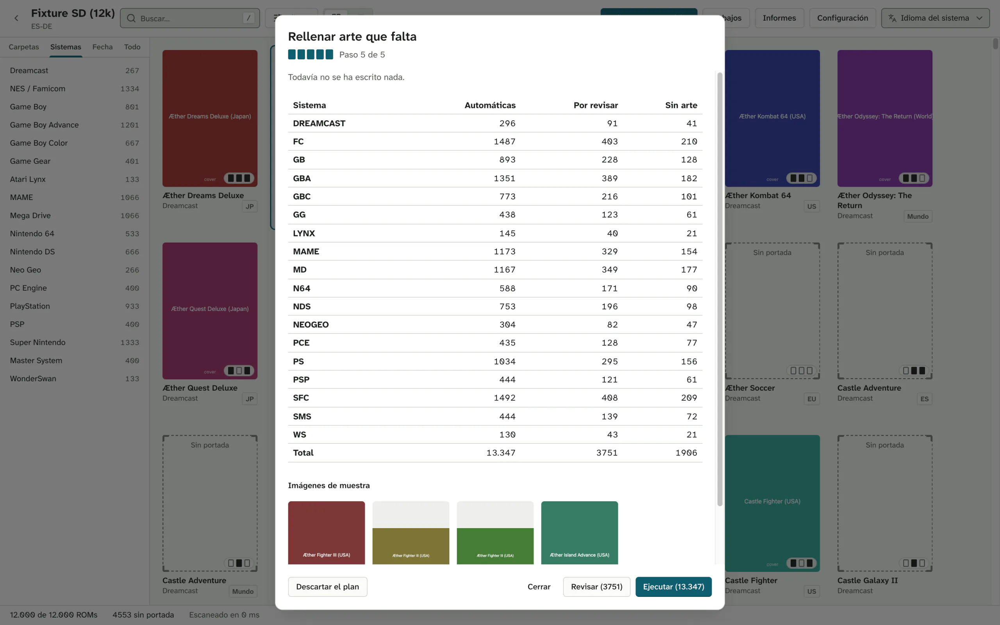
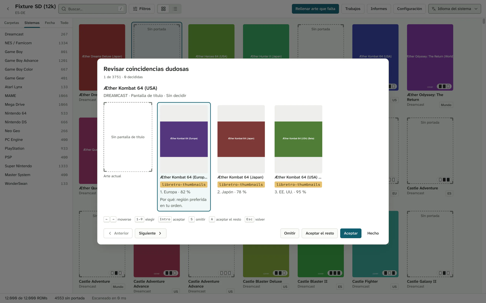

# Funciones

[Coverly ROMs](../../README.es.md) › Funciones · **Español** · [English](features.md)

## El problema

El firmware de fábrica de muchas consolas portátiles enseña una ficha vacía
cuando un juego no tiene portada. En una tarjeta con unos miles de ROMs, son
muchas fichas vacías. Las herramientas que lo arreglan funcionan solo en
Windows, piden montarlas a mano o van mejor con una cuenta de ScreenScraper.
Coverly ROMs es la opción segura en los tres sistemas de escritorio: sin
cuenta, con una simulación antes de escribir nada y con deshacer después.

Coverly ROMs no incluye ROMs, BIOS ni imágenes de juegos.

## Qué hace

**Auditar, solo lectura.** Abre una carpeta o una tarjeta SD y Coverly lista
cada sistema, cada ROM (los juegos de varios archivos, como `.cue`/`.bin`,
`.m3u` y `.gdi`, cuentan una vez) y qué imágenes tiene cada uno: portada,
captura, pantalla de título. Exporta el informe a CSV o JSON.

**Rellenar los huecos de una vez.** Cada ROM se identifica por su huella (CRC32,
MD5 y SHA1 contra libretro-database) y, si no, por su nombre, traduciendo los
nombres cortos de arcade. Cuando encajan varias imágenes, una estrategia elige
una: **Región de la ROM** (la de serie, con el orden de regiones
`rom,world,usa,europe,japan`), **Prioridad de fuentes** (el orden que les das) o
**Popularidad** (los votos de SteamGridDB). Las coincidencias seguras van solas;
las dudosas esperan en una cola de revisión. En Batocera y Knulli también
fusiona `gamelist.xml`, con copia de seguridad, y deshacer lo deja byte a byte
como estaba.

**No sobrescribe salvo que lo pidas.** Por defecto solo escribe lo que falta.
Si eliges sustituir imágenes (`--overwrite backup`), antes guarda una copia en
la carpeta de datos de la app, no en la tarjeta. No escribe nada fuera de la
carpeta que abriste.

**Organizar ROMs sueltas.** Elige una carpeta de descargas llena de zips y
Coverly propone una carpeta por sistema, con el formato que elijas (de serie,
Anbernic de fábrica: `ROMS/GBA/`, `ROMS/GB/`, `ROMS/SFC/`…). Cada archivo se
identifica por el CRC del catálogo (también dentro de los zip), luego por la
cabecera, la extensión y el nombre, y por ScreenScraper con el CRC si lo tienes
configurado, y muestra una confianza y un motivo. Los comprimidos se reconocen
por su contenido, no por su nombre, así que un 7z guardado como `.zip` se abre
como 7z: zip, 7z, RAR, tar, gzip, bzip2, xz, zstd, lz4 y ROMs sueltas
comprimidas como `juego.gba.gz`. Los juegos de disco dentro de un comprimido
(PlayStation, Saturn, Dreamcast, Sega CD, PC Engine CD, Neo Geo CD) se
identifican por el propio disco, con su número de serie, y al aplicar se
extraen su `.cue`/`.gdi` y sus pistas a la carpeta del sistema, cada pista
comprobada contra el comprimido. Las descargas sin terminar, las BIOS, las
páginas web guardadas como `.zip` y los archivos dañados o con varios juegos se
quedan donde están. Un juego que ya tienes en la biblioteca, con cualquier
nombre o formato, se aparta en vez de copiarse otra vez. No pisa ningún
archivo, las copias entre discos se verifican y un trabajo interrumpido se
puede reanudar o deshacer.

**133 sistemas, de los cartuchos a las consolas actuales.** De la Atari 2600 a
la PlayStation 5, cada uno con los nombres de carpeta que usan los formatos.
Las imágenes de disco y los comprimidos se identifican por lo que llevan
dentro. Los juegos de GameCube, Wii, Wii U, 3DS, Switch, PS Vita, PS3, PS4,
PS5, Xbox, Xbox 360 y Xbox One se reconocen por la cabecera en claro de su
propio formato, leyendo unos pocos kilobytes; no se lee nada cifrado, y Coverly
nunca lee, pide, descarga ni incluye claves de consola. Los nombres de Switch
salen del title ID, sin claves, con un catálogo opcional (blawar/titledb, MIT)
que está apagado hasta que lo activas en Configuración → Integraciones; sin red se
usa el nombre del archivo, y un juego cuyo nombre no se puede leer sin claves
aparece como «Cifrado» en vez de adivinarse. Un juego que es una carpeta (PS3,
PS Vita, Wii U, PS4, Xbox…) se mueve como un solo elemento y nunca se parte,
también desde dentro de un zip o un 7z, donde se reconoce por el listado sin
extraer. Los juegos de varios discos sueltos se agrupan en un solo conjunto con
un `.m3u`, con un aviso si falta un disco. Cada elemento que escribe 10 GB o
más pregunta antes («Sí / Sí a todo / No»), con su tamaño y el espacio libre
que queda en el destino. En arcade están Cave CV1000 y Taito Type X, donde cada
carpeta es un juego; Coverly nunca abre nada dentro de un juego de Type X.

**Una carpeta por juego, con sus actualizaciones y DLC.** En 3DS, Switch, Wii U,
Wii, PS3, PS4, PS5, Vita, PSP, Xbox 360, Xbox One y Series se reconocen las
actualizaciones, los DLC, las demos y los títulos de sistema, y Organizar puede
mover un juego junto con ellos a `<Sistema>/<Juego>/`, las actualizaciones en
`Updates/` y los DLC en `DLC/` (activado con el formato «Coverly»; los demás
formatos tienen un interruptor en Configuración → Biblioteca). Las
actualizaciones se nombran con la versión leída del archivo, y la región leída
del título o del código de producto se añade al nombre del juego. Las
revisiones retro como `(Rev 1)` se agrupan como versiones de un mismo juego. Lo
que no está claro se queda donde está, y el trabajo entero se puede deshacer.

**Mods, parches de traducción y trucos.** Los parches (`.ips`, `.bps`, `.ups`,
`.xdelta`, `.ppf`) se enlazan con su juego por el CRC32 de la ROM para la que
se hicieron, por su nombre o por su léeme; los trucos, por el nombre, el número
de serie o el title ID del juego; los packs de texturas y otras carpetas de
mods, por su carpeta. Con el formato «Coverly» van a la carpeta `Mods/` o
`Cheats/` del juego. Organizar también puede ordenar un sistema como lo espera
su emulador (shadPS4, RPCS3, Azahar, Cemu, Vita3K, Ryujinx y yuzu, RetroArch,
DuckStation, PCSX2, Dolphin, PPSSPP, Xenia, Flycast, Mesen) o para frontends
como ES-DE. Nunca se extrae, descifra ni instala nada, y nada se borra.

**Extras.** La carpeta `Extras/` de un juego guarda su banda sonora, manuales,
arte, vídeos, temas y guías, en categorías a las que puedes añadir archivos,
cambiar de nombre y poner etiquetas. Los archivos se copian con comprobación, y
cada cambio se puede deshacer. Los extras oficiales (temas de PS3, Vita y PSP,
temas e imágenes de jugador de Xbox 360, bandas sonoras de 3DS) se reconocen y,
con el formato «Coverly», Organizar los coloca. El audio suena en un minirreproductor que sigue mientras
navegas; los vídeos, las imágenes, los manuales en PDF y los archivos de texto
se abren en un visor dentro de la app.

**Encontrar duplicados.** Coverly encuentra el mismo juego guardado más de una
vez en un sistema por su contenido, nunca por su nombre: los mismos datos
exactos, sea cual sea el nombre, el contenedor, la cabecera de copiadora o la
compresión (`Tetris.gb` y `Tetris (1).zip`), y el mismo disco en otro formato
por su número de serie (`Crash Bash.bin` y `Crash Bash.PBP`). Las otras
versiones de un juego (revisiones, regiones, betas) se enumeran, y solo se
apartan con «Una ROM por juego». Para cada juego elige la copia que se queda,
con su motivo («Se queda: tiene tu partida»), y puedes elegir otra. Las demás
copias se apartan en `_Duplicados/` dentro de la biblioteca, con sus carpetas,
sus partidas y sus imágenes; o van a la Papelera si lo prefieres. Las copias
con partidas distintas no se tocan. Las actualizaciones y los DLC se listan
debajo de su juego, y también se encuentra el mismo juego guardado dos veces
con un mismo title ID, quedándose la versión más nueva. Cada trabajo se puede
deshacer y nada se borra.

**Explorar la biblioteca.** Vistas por carpeta, sistema, fecha y lista plana;
filtros por imágenes que faltan, sistema, extensión y región; búsqueda; y una
ficha de detalle donde cambias a mano la imagen de cada hueco o buscas por
título. Seis formas de verla, todas fluidas con más de 10.000 juegos:
**Portadas** (cinco tamaños), **Detalles** (columnas a elegir y de ancho
ajustable, miniaturas, filas compactas), **Columnas** (sistema → carpeta →
juego → vista previa), **Galería** (la imagen de un juego en grande, con tira
de miniaturas), **Huecos de arte** (portada, título y captura lado a lado, para
ver lo que falta) y **Estantes** (una fila por sistema). Cambia con
⌘/Ctrl+1–6, ajusta el tamaño de las portadas con ⌘/Ctrl +/−, agrupa por
sistema, carpeta, región, estado del arte o inicial, escribe un nombre para
saltar a él y pulsa Espacio para una Vista rápida. Cada biblioteca recuerda su
vista.
Las actualizaciones, los DLC, las demos y las revisiones se ven dentro de su
juego en todas las vistas, y la ficha del juego los lista con la versión
instalada, el arte de los DLC y cuántos mods, trucos, extras y partidas guardan
las carpetas del juego.

**Iconos de sistema.** Cada nombre de sistema en la app lleva su icono al lado:
una silueta sencilla del hardware (del tema Monochrome de RetroArch,
CC BY 4.0) o una etiqueta corta cuando no hay un dibujo neutro.

**Trabajos bajo control.** El asistente de relleno te enseña el plan entero
antes de ejecutarlo. Los trabajos se pueden pausar, reanudar, cancelar y
deshacer.

**Configuración.** General, Biblioteca, Organizar, Duplicados, Perfiles, Arte,
Coincidencias, Fuentes, Integraciones, Red, Seguridad, Avanzado,
Agradecimientos y Acerca de, en tres grupos. Las opciones comunes van primero y
el resto espera en _Opciones avanzadas_. Busca con ⌘F (Ctrl+F en Windows y
Linux) y llega al ajuste. Las pantallas de Duplicados y Organizar abren su
pestaña y vuelven con lo que habías elegido. Los perfiles de formato propios
tienen vista previa de las rutas.

**Integraciones.** Configuración → Integraciones tiene una tarjeta por cada
servicio con el que Coverly habla en tu nombre: SteamGridDB (clave de API),
ScreenScraper (cuenta), el catálogo de nombres de Switch y un enlace a
Actualizaciones. Cada tarjeta dice para qué sirve el servicio, muestra su
estado (sin configurar, guardada, conectado, error con qué hacer, cuota
agotada, desactivado) y tiene «Probar conexión», «Cómo conseguir la clave» (la
página de cuenta del propio servicio), desactivar sin borrar y «Olvidar
credenciales». Las claves se guardan en el llavero del sistema y nunca se
vuelven a mostrar; si el llavero está bloqueado o niega el acceso, el aviso
dice qué hacer en tu sistema. La cuota diaria de ScreenScraper se muestra
cuando el servicio la informa. Rellenar, Organizar y la línea de comandos
llevan a la tarjeta cuando falta una cuenta o se agota una cuota. Las claves
que ya habías guardado siguen funcionando. Cómo configurar cada una está en
[Integraciones](integrations.es.md).

**Agradecimientos.** Configuración → Agradecimientos lista cada fuente de
portadas y metadatos, base de datos, referencia técnica, biblioteca y
tipografía que usa Coverly, con su licencia, su enlace y el crédito que pide, y
enseña los textos completos de las licencias de terceros. La misma lista está
en [Agradecimientos](credits.es.md) y en
[THIRD-PARTY-NOTICES.md](../../THIRD-PARTY-NOTICES.md).

**Además:** una herramienta de línea de comandos, `coverly`; interfaz en
inglés y español; temas claro y oscuro; actualizaciones desde la app.

Todas las funciones, una a una, están en la [página de
funciones](https://coverly-roms.maecly.com/features/), y lo que viene después,
en la [hoja de ruta](https://coverly-roms.maecly.com/roadmap/).

## Cómo funciona

Cuatro pasos. Los dos primeros no escriben nada.

1. **Abre la carpeta o la tarjeta SD.** Coverly reconoce el formato de tu
   firmware o frontend y te enseña cada sistema con lo que le falta.
2. **Prueba el trabajo antes de hacerlo.** La simulación identifica cada ROM,
   elige la imagen y te enseña el plan entero. Hasta que pulsas **Ejecutar**
   (o pasas `--apply`), no se escribe nada.
3. **Decide solo las dudosas.** Esperan en una cola que recorres con el
   teclado, y la elegida dice por qué.
4. **Aplica, y deshaz si no te convence.** Las imágenes se escriben de una en
   una, sin dejar archivos a medias. Deshacer devuelve la tarjeta a como
   estaba.

<table>
  <tr>
    <td width="50%">
      <picture>
        <source media="(prefers-color-scheme: dark)" srcset="../assets/shots/es/fill-dark.webp">
        
      </picture>
    </td>
    <td width="50%">
      <picture>
        <source media="(prefers-color-scheme: dark)" srcset="../assets/shots/es/review-dark.webp">
        
      </picture>
    </td>
  </tr>
</table>

Más detalle (en inglés): [proceso de relleno](../04-architecture/fill-pipeline.md),
[identificación](../04-architecture/identification.md),
[organizar](../04-architecture/organize.md).
