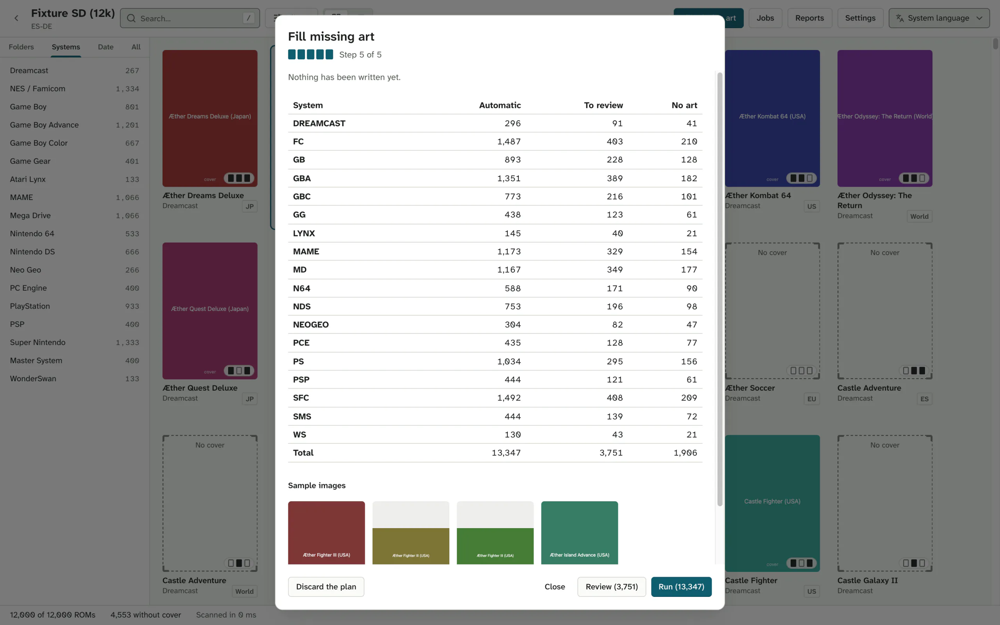
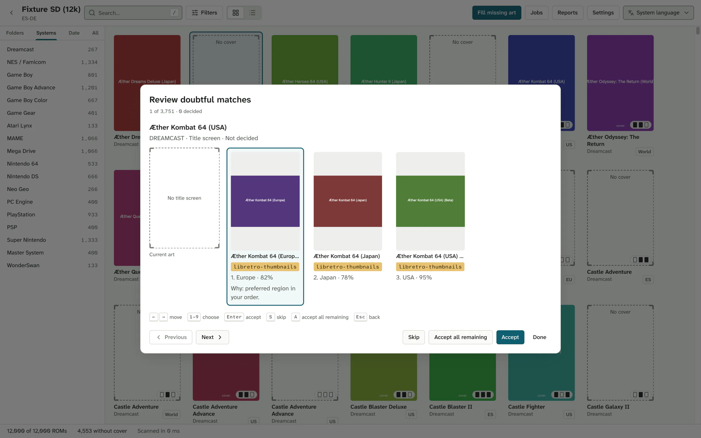

# Features

[Coverly ROMs](../../README.md) › Features · **English** · [Español](features.es.md)

## The problem

Stock firmware on many handhelds shows a blank tile when a game has no cover.
On a card with a few thousand ROMs, that is a lot of blank tiles. The tools
that fix it either run on Windows only, take some assembly, or work best with a
ScreenScraper account. Coverly ROMs is the safe option on all three desktop
systems: no account, a dry run before anything is written, and undo after.

Coverly ROMs does not include ROMs, BIOS files or game art.

## What it does

**Audit, read-only.** Open a folder or an SD card and Coverly lists every
system, every ROM (multi-file games such as `.cue`/`.bin`, `.m3u` and `.gdi`
count once) and which art each one has: cover, screenshot, title screen. Export
the report as CSV or JSON.

**Fill the gaps in bulk.** Each ROM is identified by its fingerprint (CRC32,
MD5 and SHA1 against libretro-database), or failing that by its name, with
arcade short names translated. When several images match, a strategy picks
one: **ROM region** (the default, region order `rom,world,usa,europe,japan`),
**Source priority** (your source order) or **Popularity** (SteamGridDB votes).
Confident matches go through on their own; doubtful ones wait in a review
queue. On Batocera and Knulli it also merges `gamelist.xml`, with a backup, and
undo restores it byte for byte.

**Never overwrites unless you ask.** By default only missing art is written.
If you choose to replace art (`--overwrite backup`), a copy is kept first in the
app's data folder, not on the card. Nothing is written outside the folder you
opened.

**Organise loose ROMs.** Pick a downloads folder full of zips and Coverly
proposes one folder per system, in the layout you choose (Anbernic stock by
default: `ROMS/GBA/`, `ROMS/GB/`, `ROMS/SFC/`…). Each file is identified by
catalogue CRC (zip entries included), then header magic, extension and name,
plus ScreenScraper by CRC when configured, and shows a confidence and a reason.
Archives are recognised by their contents, not their name, so a 7z saved as
`.zip` opens as a 7z: zip, 7z, RAR, tar, gzip, bzip2, xz, zstd, lz4 and single
compressed ROMs such as `game.gba.gz`. Disc games inside an archive (PlayStation,
Saturn, Dreamcast, Sega CD, PC Engine CD, Neo Geo CD) are identified from the
disc itself, serial included, and on apply their `.cue`/`.gdi` and tracks are
extracted into the system folder, each track checked against the archive.
A game you already have in the library, under any name or container, is set
aside instead of being copied in twice. Unfinished downloads, BIOS files, web
pages saved as `.zip` and damaged or multi-game archives stay where they are.
Nothing is clobbered, copies across drives are verified, and an interrupted job
can be resumed or undone.

**133 systems, from cartridges to current consoles.** From the Atari 2600 to
the PlayStation 5, each under the folder names the layouts use. Disc images and
archives are identified from what is inside them. GameCube, Wii, Wii U, 3DS,
Switch, PS Vita, PS3, PS4, PS5, Xbox, Xbox 360 and Xbox One games are recognised
from the plain header of their own format, reading a few kilobytes; nothing
encrypted is read, and Coverly never reads, asks for, downloads or ships
console keys. Switch names come from the title ID, without keys, through an
optional catalogue (blawar/titledb, MIT) that stays off until you turn it on in
Settings → Integrations; with no network the file name is used, and a game whose
name cannot be read without keys is labelled "Encrypted" instead of guessed.
A game that is a folder (PS3, PS Vita, Wii U, PS4, Xbox…) moves as one item and
is never split, also from inside a zip or 7z, where it is recognised from the
listing without extracting. Loose multi-disc games are grouped into one set
with an `.m3u`, with a note when a disc is missing. Each item that writes 10 GB
or more asks first ("Yes / Yes to all / No"), with its size and the free space
left on the target. Arcade includes Cave CV1000 and Taito Type X, where each
folder is one game; Coverly never opens anything inside a Type X game.

**One folder per game, with its updates and DLC.** On 3DS, Switch, Wii U, Wii,
PS3, PS4, PS5, Vita, PSP, Xbox 360, Xbox One and Series, updates, DLC, demos
and system titles are recognised, and Organise can move a game together with
them into `<System>/<Game>/`, updates in `Updates/` and DLC in `DLC/` (on with
the "Coverly" layout, a switch in Settings → Library for the others). Updates
are named with the version read from the file, and the region read from the
title or product code is added to the game's name. Retro revisions such as
`(Rev 1)` are grouped as versions of one game. Anything unclear stays where it
is, and the whole run can be undone.

**Mods, translation patches and cheats.** Patches (`.ips`, `.bps`, `.ups`,
`.xdelta`, `.ppf`) are linked to their game by the CRC32 of the ROM they were
made for, their name or their readme; cheats by the game's name, serial or
title ID; texture packs and other mod folders by their folder. With the
"Coverly" layout they go into the game's `Mods/` or `Cheats/` folder. Organise
can also lay a system out the way its emulator expects it (shadPS4, RPCS3,
Azahar, Cemu, Vita3K, Ryujinx and yuzu, RetroArch, DuckStation, PCSX2,
Dolphin, PPSSPP, Xenia, Flycast, Mesen) or for frontends such as ES-DE.
Nothing is ever extracted, decrypted or installed, and nothing is deleted.

**Extras.** A game's `Extras/` folder holds its soundtrack, manuals, artwork,
videos, themes and guides, in categories you can add to, rename and tag. Files
are copied in with a check, and every change can be undone. Official extras
(PS3, Vita and PSP themes, Xbox 360 themes and gamer pictures, 3DS soundtracks)
are recognised and, with the "Coverly" layout, placed by
Organise. Audio plays in a mini player that keeps
going while you browse; video, images, PDF manuals and text files open in a
viewer inside the app.

**Find duplicates.** Coverly finds the same game stored more than once in a
system by its content, never by its name: the exact same data whatever the
name, container, copier header or compression (`Tetris.gb` and
`Tetris (1).zip`), and the same disc in another format by its serial
(`Crash Bash.bin` and `Crash Bash.PBP`). Other versions of a game (revisions,
regions, betas) are listed, and set aside only with "One ROM per game". For
each game it picks the copy that stays, with a reason ("Stays: it has your
save"), and you can pick another. The other copies are set aside in
`_Duplicados/` inside the library, keeping their folders, together with their
saves and art; or they go to the Trash if you prefer. Copies with different
saves are never touched. Updates and DLC are listed under their game, and the
same game stored twice under one title ID is found too, with the newer version
kept. Every job can be undone, and nothing is deleted.

**Browse the library.** Folder, system, date and flat views; filters for
missing art, system, extension and region; search; and a detail panel where you
can swap any slot's art by hand or search by title. Six ways to look at it, all
fast past 10,000 games: **Covers** (five sizes), **Details** (pick and resize
columns, thumbnails, compact rows), **Columns** (system → folder → game →
preview), **Gallery** (one game's art large, with a filmstrip), **Art slots**
(cover, title and screenshot side by side, so the gaps show) and **Shelves**
(one row per system). Switch with ⌘/Ctrl+1–6, resize covers with ⌘/Ctrl +/−,
group by system, folder, region, art status or first letter, type a name to
jump to it and press Space for a Quick look. Each library remembers its view.
Updates, DLC, demos and revisions show inside their game in every view, and
the game panel lists them with the version installed, the DLC art, and how
many mods, cheats, extras and saves the game's folders hold.

**System icons.** Every system name in the app has its icon beside it: a plain
silhouette of the hardware (from RetroArch's Monochrome theme, CC BY 4.0), or
a short label where no neutral drawing exists.

**Jobs you control.** The fill wizard shows the whole plan before it runs.
Jobs can be paused, resumed, cancelled and undone.

**Settings.** General, Library, Organise, Duplicates, Profiles, Art, Matching,
Sources, Integrations, Network, Safety, Advanced, Credits and About, in three
groups. Common options come first and the rest wait under _Advanced options_.
Search with ⌘F (Ctrl+F on Windows and Linux) and land on the setting. The
Duplicates and Organise screens open their own tab and come back with your
choices kept. Custom layout profiles have a live path preview.

**Integrations.** Settings → Integrations has one card per service Coverly
talks to on your behalf: SteamGridDB (API key), ScreenScraper (account), the
Switch name catalogue and a link to Updates. Each card says what the service
is for, shows its status (not set up, saved, connected, error with what to do,
daily quota used up, off), and has "Test connection", "How to get the key"
(the service's own account page), turn off without deleting, and "Forget
credentials". Keys are kept in the OS keychain and never shown again; a
keychain that is locked or refuses access says what to do on your system.
ScreenScraper's daily quota is shown when the service reports it. Fill,
Organise and the command line point to the card when an account is missing
or a quota is used up. Keys you saved before keep working. How to set each
one up is under [Integrations](integrations.md).

**Credits.** Settings → Credits lists every cover and metadata source,
database, technical reference, library and font Coverly uses, with its licence,
link and the credit it asks for, and shows the full third-party licence texts.
The same list is in [Acknowledgements](credits.md) and
[THIRD-PARTY-NOTICES.md](../../THIRD-PARTY-NOTICES.md).

**Also:** a command-line tool, `coverly`; English and Spanish interface; light
and dark themes; in-app updates.

Every feature, one by one, is on the [features
page](https://coverly-roms.maecly.com/en/features/), and what comes next is on the
[roadmap](https://coverly-roms.maecly.com/en/roadmap/).

## How it works

Four steps. The first two write nothing.

1. **Open the folder or SD card.** Coverly recognises your firmware's or
   frontend's layout and shows every system with what it lacks.
2. **Rehearse the job first.** The dry run identifies each ROM, picks the
   image and shows the whole plan. Nothing is written until you press **Run**
   (or pass `--apply`).
3. **Decide only the doubtful ones.** They wait in a queue you can clear from
   the keyboard, and each pick says why it was picked.
4. **Apply it, and undo it if you change your mind.** Images are written one at
   a time, never left half-written. Undo puts the card back the way it was.

<table>
  <tr>
    <td width="50%">
      <picture>
        <source media="(prefers-color-scheme: dark)" srcset="../assets/shots/en/fill-dark.webp">
        
      </picture>
    </td>
    <td width="50%">
      <picture>
        <source media="(prefers-color-scheme: dark)" srcset="../assets/shots/en/review-dark.webp">
        
      </picture>
    </td>
  </tr>
</table>

More detail: [fill pipeline](../04-architecture/fill-pipeline.md),
[identification](../04-architecture/identification.md),
[organise](../04-architecture/organize.md).
